# 14장 현업 전문가: 인터뷰 워크숍

## 14.1 인터뷰 워크숍이란

챗봇이 회사 데이터에 답하려면 데이터 설계도(온톨로지)가 있어야 합니다. 설계도를 만들려면 "어떤 대상을 다루고,
무엇을 보고 판단하며, 어떤 질문을 자주 하는지"를 업무를 가장 잘 아는 사람에게 들어야 합니다.

**인터뷰 워크숍** 은 이 과정을 돕습니다. AI 면담자가 정해진 순서로 질문하고, 현업 전문가가 평소 말하듯
답하면, 답에서 설계도의 **후보**(객체 타입·속성·관계·조치·자주 묻는 질문)를 뽑습니다. 후보는 사람이 하나하나
확정·수정·거절해야 쓰입니다. 뽑힌 후보마다 그것이 나온 **내 발언**이 근거로 붙습니다.

| 누가 | 하는 일 | 장 |
| --- | --- | --- |
| 현업 전문가(`domain_expert`) | 인터뷰를 만들고 질문에 답함, 후보 검토, 제출 | 14~15장 |
| 모델러(`modeler`) | 제출된 인터뷰의 후보로 설계도 초안을 만듦 | 15장 |

이 장은 현업 전문가 최현업(`choi.expert`)이 "변전소 안전 점검 업무"를 설명하는 실제 인터뷰를 따라갑니다.

## 14.2 인터뷰 만들기

1. 맨 위 **인터뷰** 메뉴를 누릅니다. 처음에는 "아직 인터뷰가 없습니다."가 보입니다.

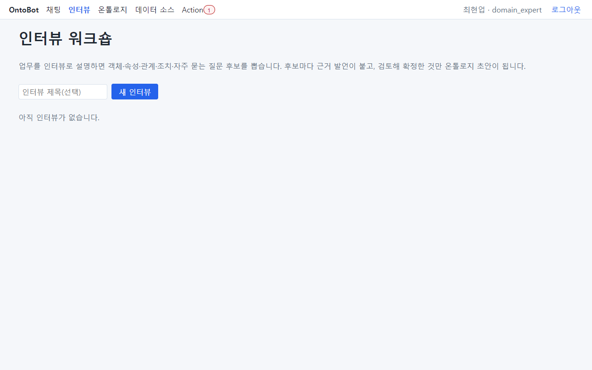

2. **인터뷰 제목(선택)** 칸(①)에 제목을 씁니다. 예: `변전소 안전 점검 업무`. 비워도 되지만, 나중에 찾기 쉽게
   업무 이름을 쓰세요.
3. **새 인터뷰**(②)를 누릅니다.

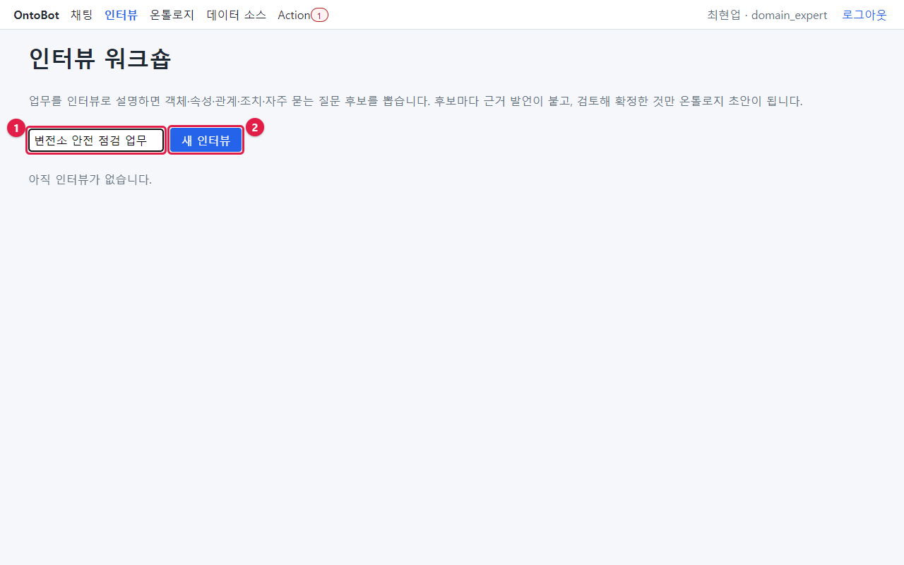

4. 바로 인터뷰 화면이 열리고, 면담자의 첫 질문이 보입니다.

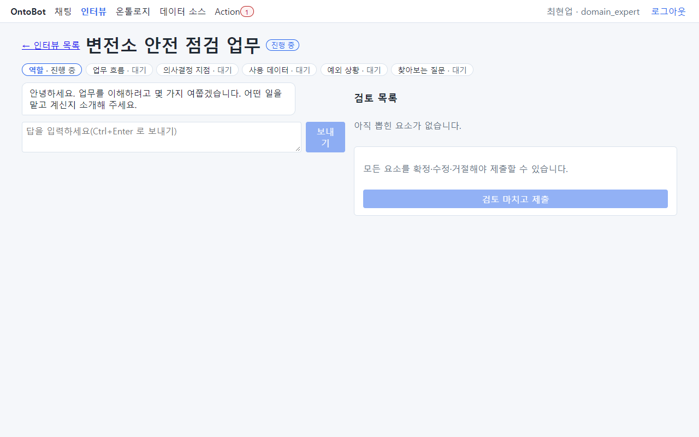

목록으로 돌아가면(**← 인터뷰 목록**) 방금 만든 인터뷰가 id · 제목 · 상태(진행 중) · 시작 시각과 함께 보입니다.
**열기**(①)로 다시 들어갈 수 있습니다. 인터뷰는 한 번에 끝내지 않아도 됩니다. 나중에 열어 이어서 답하세요.

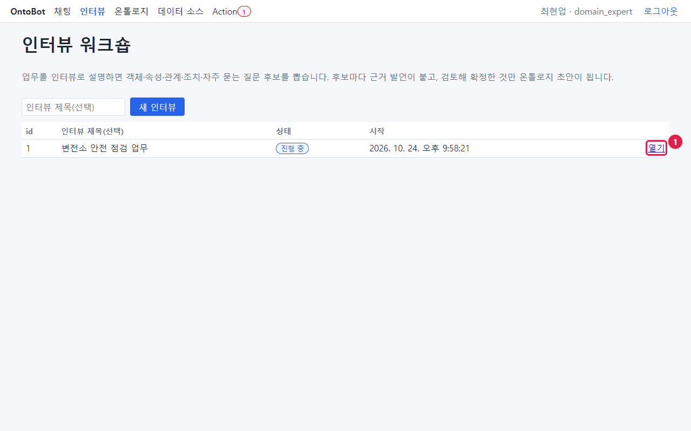

> **알아 두기** 인터뷰를 만든 사람이 **인터뷰 대상자**입니다. 다른 사람이 열면 "인터뷰 대상자만 답할 수
> 있습니다."가 보이고 답할 수 없습니다(검토 목록은 볼 수 있습니다).

## 14.3 인터뷰 화면의 네 부분

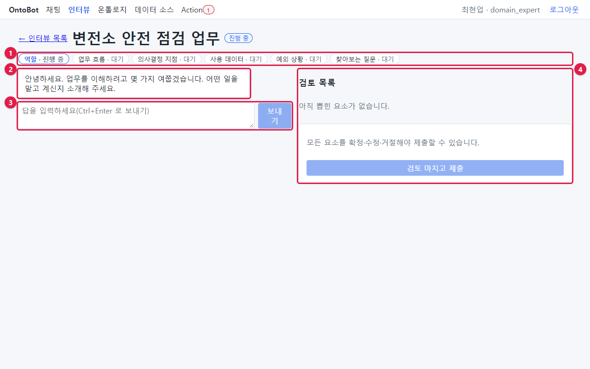

| 번호 | 부분 | 하는 일 |
| --- | --- | --- |
| ① | 주제 진행 표시 | 여섯 주제와 각각의 상태(대기·진행 중·완료·정보 부족) |
| ② | 대화 | 면담자의 질문(흰 말풍선)과 내 답(파란 말풍선) |
| ③ | 답 입력 칸 · **보내기** | 답을 씁니다. **Ctrl + Enter** 로도 보냅니다 |
| ④ | 검토 목록 | 내 답에서 뽑힌 후보. 처음에는 "아직 뽑힌 요소가 없습니다." |

### 실시간 미리보기(v1)

오른쪽 ④ 자리는 **실시간 미리보기** 입니다. 답을 보낼 때마다 다시 그려지고, 대화 아래에 "미리보기 갱신 3.5초"처럼 걸린
시간이 나옵니다. 탭이 셋입니다.

- **검토** — 위의 검토 목록(후보 확정·수정·거절).
- **요소 그래프** — 거절하지 않은 후보로 그린 "이대로 게시하면 생길 모양"입니다. 상자는 객체(안에 속성), 화살표는 관계.
  아직 검토 전인 후보는 점선·흐리게, 후보는 없는데 속성이나 관계가 가리키는 이름은 점선 상자로 보입니다 — 그 객체를
  설명하는 답이 더 필요하다는 뜻입니다.
- **Action 정의서** — 조치 후보마다 하는 일·근거 발언과, 게시 뒤 Action 정의 화면에서 정할 것(대상·파라미터·승인 등).

휴대폰처럼 좁은 화면에서는 한 번에 하나만 보입니다. 위의 **대화 / 미리보기** 탭으로 바꿉니다.

음성 입력(🎤 말하기)은 폐쇄망 설치에서는 보이지 않습니다. 인터넷에 연결된 설치에서 운영자가 켠 경우에만 나오고, 음성이
브라우저의 음성 인식 서버로 간다는 안내가 함께 붙습니다. 인식된 글은 입력 칸에 들어가며 보내기 전에 고칠 수 있습니다.

### 여섯 주제

면담자는 다음 순서로 묻습니다. 다음에 무엇을 물을지는 AI 가 아니라 정해진 순서표가 고릅니다. AI 는 내 답이
충분한지 평가하고, 부족하면 되묻는 문장을 쓰고, 후보를 뽑는 일만 합니다.

| 순서 | 주제 | 면담자가 알고 싶은 것 | 좋은 답의 예 |
| --- | --- | --- | --- |
| 1 | 역할 | 어떤 일을 맡고 있는지 | "지역본부에서 변전소와 전주 같은 전력 시설의 안전 관리를 맡고 있습니다." |
| 2 | 업무 흐름 | 일의 순서, 다루는 대상 | "매주 시설 목록을 보고 위험등급이 높은 시설부터 점검 일정을 잡습니다. 시설은 운영 조직이 소유하고, 시설마다 지역이 있어요." |
| 3 | 의사결정 지점 | 무엇을 보고 판단하는지, 판단 뒤의 조치 | "위험등급이 4 이상이면 현장 점검을 요청하고, 결과가 나쁘면 사용 중지를 결정합니다." |
| 4 | 사용 데이터 | 대상마다 확인하는 항목 | "시설마다 시설 코드, 이름, 유형, 위험등급, 설비 용량, 마지막 점검일을 봅니다." |
| 5 | 예외 상황 | 평소와 다르게 처리하는 경우 | "태풍 경보가 뜨면 그 지역 시설을 전부 긴급 점검합니다." |
| 6 | 찾아보는 질문 | 평소 자주 찾는 질문과 기대하는 답 | "위험등급이 3 이상인 시설은 몇 개야? 보통 18개 정도 나와요." |

## 14.4 질문에 답하기 — 실제 진행

### 1번째 답: 모호한 답을 하면 되묻는다

면담자: "안녕하세요. 업무를 이해하려고 몇 가지 여쭙겠습니다. 어떤 일을 맡고 계신지 소개해 주세요."

일부러 모호하게 답해 봅니다: `그냥 이것저것 해요.`

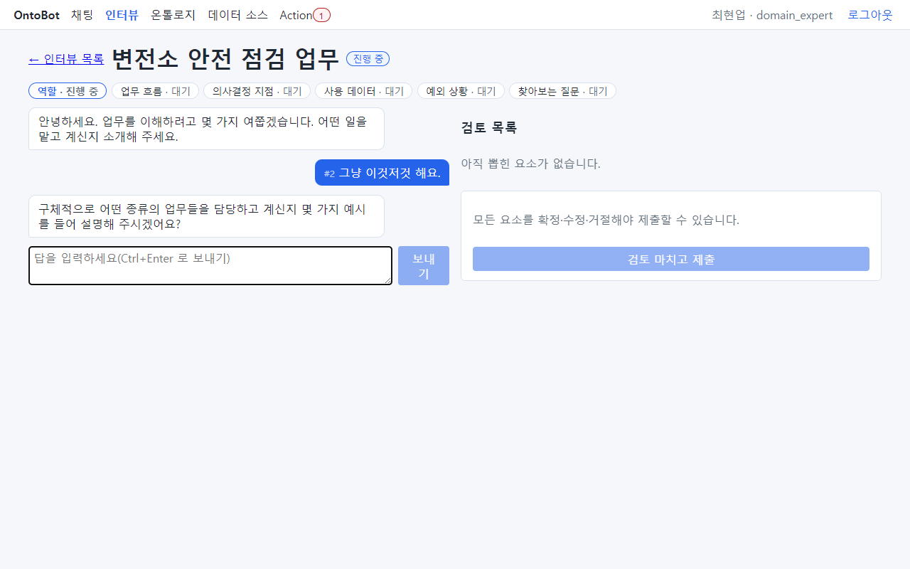

면담자는 다음 주제로 넘어가지 않고 "구체적으로 어떤 종류의 업무들을 담당하고 계신지 몇 가지 예시를 들어
설명해 주시겠어요?"라고 되묻습니다. 주제 표시의 **역할** 은 여전히 "진행 중"입니다. 내 답 앞의 **#2** 는 발언
번호입니다(면담자의 말까지 포함해 매긴 번호). 나중에 후보의 근거가 "근거 발언 #4"처럼 이 번호로 표시됩니다.

### 2번째 답: 구체적으로

`저는 지역본부에서 변전소와 전주 같은 전력 시설의 안전 관리를 맡고 있습니다.`

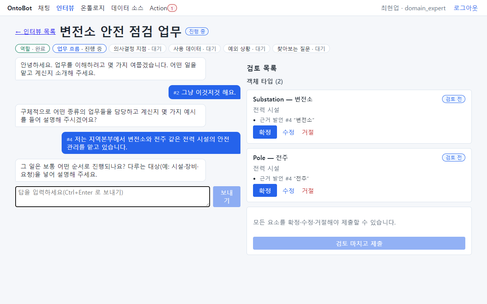

**역할** 이 "완료"가 되고 **업무 흐름** 으로 넘어갑니다. 오른쪽 검토 목록에 첫 후보들이 나타나기 시작합니다.

### 3~6번째 답

같은 방법으로 업무 흐름, 의사결정 지점, 사용 데이터, 예외 상황에 차례로 답합니다. 답할 때마다 주제가 완료되고
검토 목록에 후보가 늘어납니다.

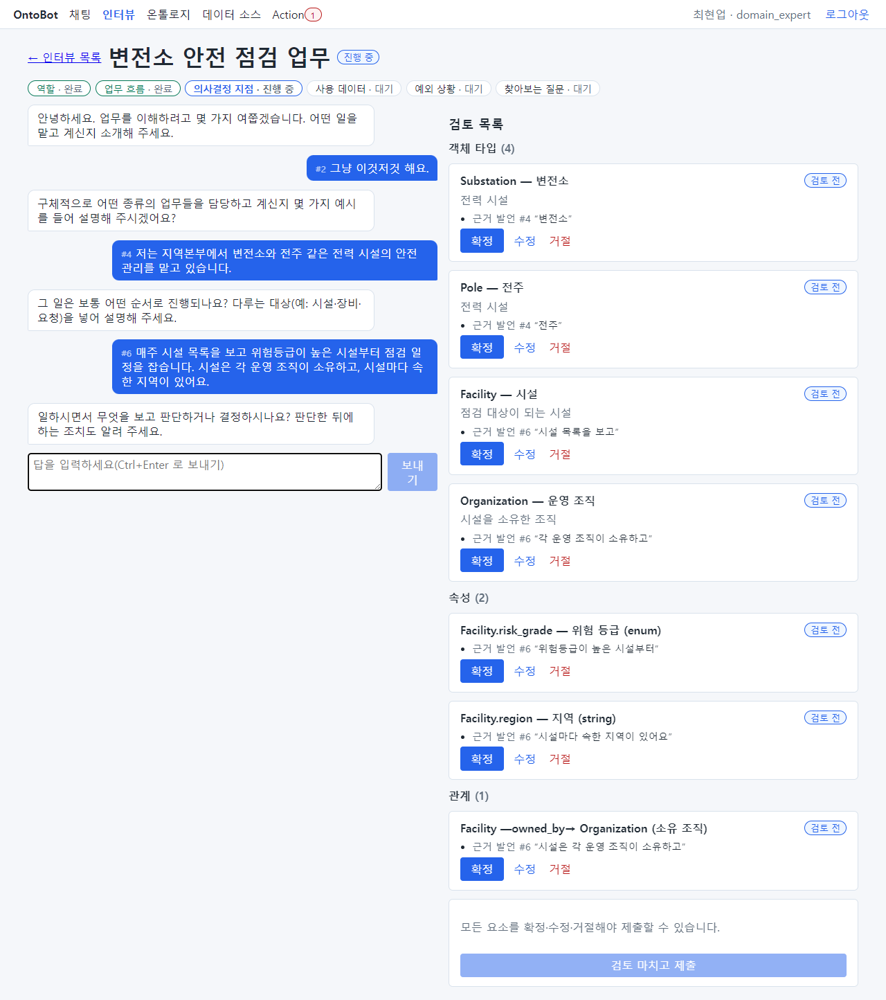

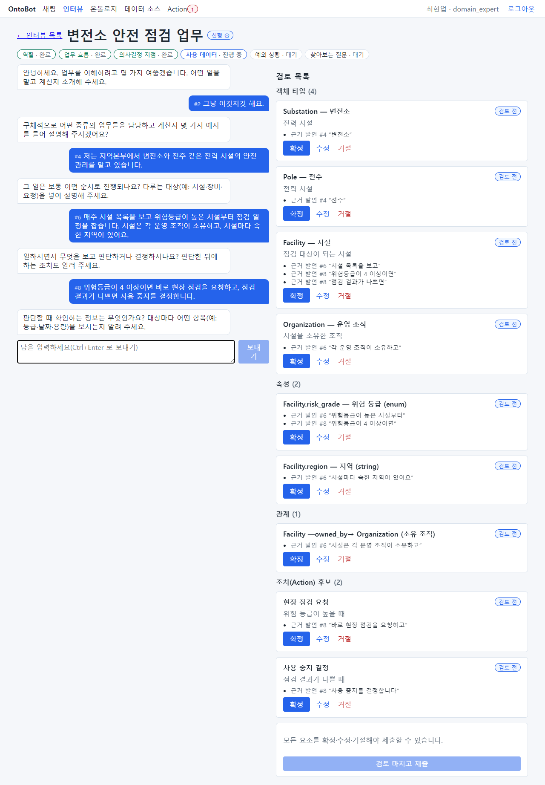

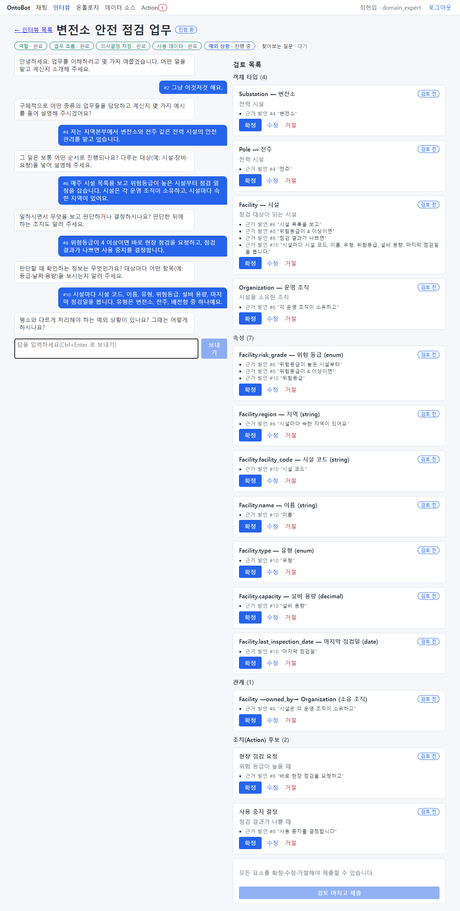

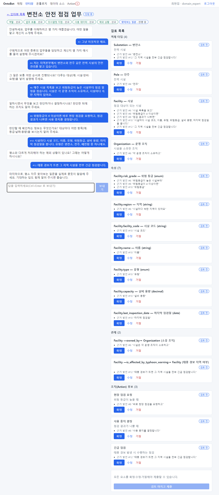

### 7번째 답: 찾아보는 질문

마지막 주제에서 면담자는 "평소 자주 찾아보는 질문을 실제로 묻듯이 말씀해 주세요. 기대하는 답도 함께 알려
주시면 좋습니다."라고 묻습니다.

`위험등급이 3 이상인 시설은 몇 개야? 이건 보통 18개 정도 나와요. 그리고 변전소 목록도 자주 봐요.`

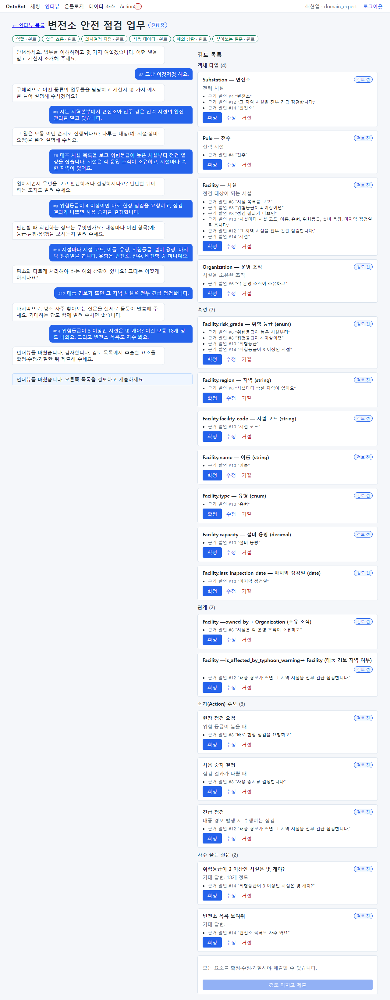

여섯 주제가 모두 **완료** 가 되고, 면담자가 "인터뷰를 마쳤습니다. 감사합니다. 검토 목록에서 추출한 요소를
확정·수정·거절한 뒤 제출해 주세요."라고 말합니다. 아래에 "인터뷰를 마쳤습니다. 오른쪽 목록을 검토하고
제출하세요."(①)가 보이고, 주제 표시(②)는 모두 완료입니다.

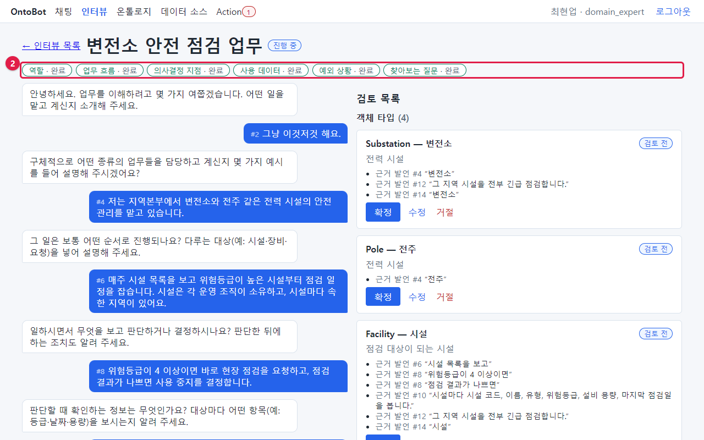

이 답에서 뽑힌 "자주 묻는 질문" 후보는 나중에 챗봇 시험 문항(골든셋)의 초안이 됩니다(「20장」). 그래서 실제로
묻듯이, 기대하는 답과 함께 말하는 것이 중요합니다.

## 14.5 답하는 요령

| 요령 | 좋은 예 | 피할 예 |
| --- | --- | --- |
| 구체적인 이름을 쓴다 | "변전소와 전주" | "설비" |
| 대상마다 보는 항목을 나열한다 | "위험등급, 설비 용량, 마지막 점검일" | "여러 가지 봐요" |
| 판단 기준을 숫자로 | "위험등급이 4 이상이면" | "위험하면" |
| 판단 뒤의 행동을 말한다 | "현장 점검을 요청하고" | (말하지 않음) |
| 관계를 말한다 | "시설은 운영 조직이 소유하고" | |
| 질문은 실제 말투로, 기대 답과 함께 | "…몇 개야? 보통 18개" | "개수 같은 거" |
| 모르는 것은 모른다고 | "그 부분은 잘 모르겠습니다" | 지어서 답함 |

> **주의** 개인 전화번호·주민번호 같은 개인정보는 말하지 마세요. 자동으로 가려서 저장하지만, 처음부터 말하지
> 않는 것이 가장 안전합니다. 저장된 발언은 가려진 형태로 남고, 후보의 근거도 가려진 발언으로 확인합니다.

> **알아 두기** 답을 보낸 뒤 "답을 정리하는 중…"이 보이는 동안(보통 수십 초) 면담자가 답을 평가하고 후보를
> 뽑습니다. 가끔 "이번 답에서 요소를 뽑지 못했습니다(모델 출력 오류)…"가 보일 수 있습니다. 인터뷰는 계속
> 진행되니 걱정하지 마세요. 필요한 후보는 검토 단계에서 확인합니다.

## 14.6 이 장의 핵심

> **요령**
>
> - **인터뷰** → 제목 → **새 인터뷰**. 만든 사람이 인터뷰 대상자입니다.
> - 여섯 주제를 차례로 답합니다. 모호하면 면담자가 되묻습니다.
> - 구체적인 이름·숫자·관계·행동을 말하고, 찾아보는 질문은 실제 말투와 기대 답으로 말합니다.
> - 답할수록 오른쪽 검토 목록에 후보가 쌓입니다. 검토는 다음 장에서.
