# 15장 후보 검토와 제출, 초안 만들기

인터뷰를 마치면 오른쪽 **검토 목록** 에 후보가 쌓여 있습니다. 이 장에서는 후보를 하나씩 확정·수정·거절하고,
제출한 뒤, 모델러가 설계도 초안으로 만드는 과정까지 따라갑니다.

## 15.1 검토 목록 읽기

14장의 인터뷰에서 뽑힌 후보는 18개였습니다.

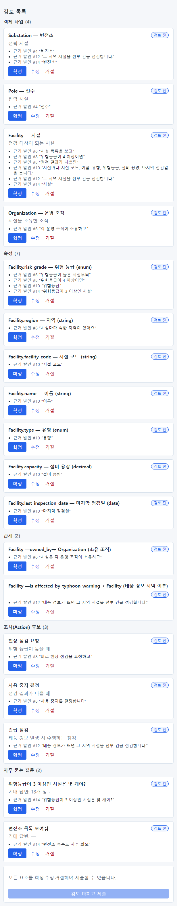

후보는 종류별로 묶여 있습니다. 괄호 안은 개수입니다.

| 종류 | 이 인터뷰에서 | 뜻 |
| --- | --- | --- |
| 객체 타입(4) | Substation — 변전소, Pole — 전주, Facility — 시설, Organization — 운영 조직 | 다루는 대상의 종류 |
| 속성(7) | Facility.risk_grade — 위험 등급, … last_inspection_date — 마지막 점검일 | 대상마다 보는 항목 |
| 관계(2) | Facility —owned_by→ Organization (소유 조직), Facility —is_affected_by_typhoon_warning→ Facility | 대상 사이의 연결 |
| 조치(Action) 후보(3) | 현장 점검 요청, 사용 중지 결정, 긴급 점검 | 판단 뒤 하는 일. 나중에 Action 이 될 수 있음 |
| 자주 묻는 질문(2) | 위험등급이 3 이상인 시설은 몇 개야?, 변전소 목록 보여줘 | 챗봇 시험 문항의 초안 |

후보 하나는 이렇게 생겼습니다.

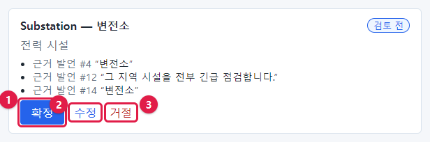

- 맨 위: 영문 이름(API 이름) — 표시 이름. 예: Substation — 변전소
- 그 아래: 설명. 예: 전력 시설
- **근거 발언 #N "…"**: 이 후보가 나온 내 발언과 그 안의 문장. 같은 후보가 여러 발언에서 나오면 여러 줄
- 오른쪽 위: 상태(검토 전 · 확정 · 수정 확정 · 거절)
- 단추 셋: **확정**(①), **수정**(②), **거절**(③)

## 15.2 세 가지 결정

| 단추 | 언제 | 결과 |
| --- | --- | --- |
| **확정** | 후보가 맞을 때 | 상태 "확정". 그대로 초안에 들어감 |
| **수정** → 고치고 **수정 확정** | 대체로 맞는데 이름·자료형 등을 고쳐야 할 때 | 상태 "수정 확정". 고친 내용으로 초안에 들어감 |
| **거절** | 틀렸거나 필요 없을 때 | 상태 "거절". 초안에 들어가지 않음. 카드가 흐려짐 |

> **요령** 판단 기준은 "이 후보가 **실제 데이터로 존재하거나 존재해야 하는가**"입니다. 업무 이야기에 나왔더라도
> 회사 데이터에 없는 개념(예: "태풍 경보 여부")은 거절하는 것이 좋습니다. 데이터에 없는 것을 설계도에 넣으면
> 챗봇이 답할 수 없는 질문만 늘어납니다.

## 15.3 수정하기

**Pole — 전주** 후보의 표시 이름을 "전주(배전용)"으로 고쳐 봅니다.

1. **수정** 을 누르면 카드가 입력 양식으로 바뀝니다.

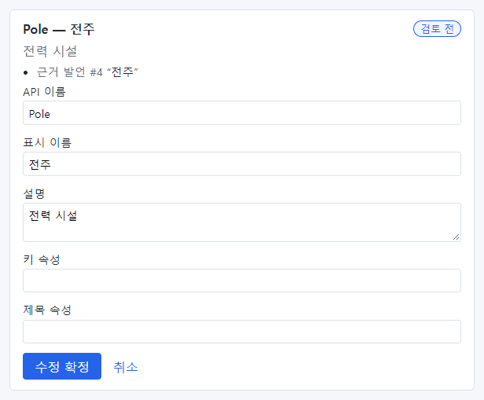

객체 타입 후보의 칸은 다음과 같습니다.

| 칸 | 뜻 |
| --- | --- |
| API 이름 | 설계도에서 쓰는 영문 이름. 영문 대문자로 시작(예: `Pole`) |
| 표시 이름 | 화면에 보이는 이름 |
| 설명 | 이 대상이 무엇인지 |
| 키 속성 | 식별자(pk)로 쓸 속성의 이름(모르면 비워 둠 — 모델러가 채움) |
| 제목 속성 | 이름으로 보일 속성(모르면 비워 둠) |

2. **표시 이름** 칸(①)을 고치고 **수정 확정**(②)을 누릅니다.

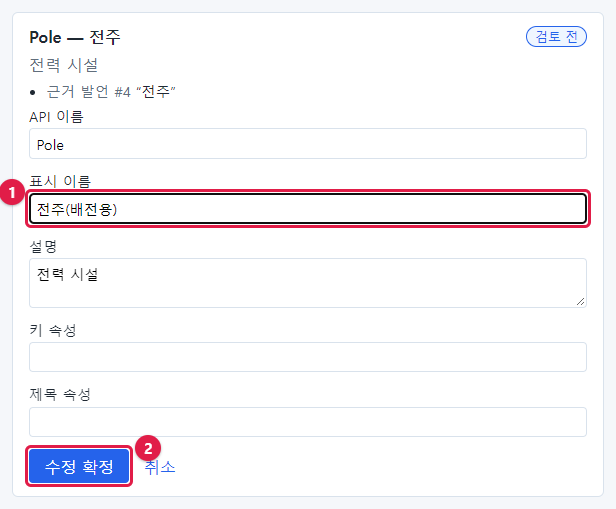

후보 종류에 따라 칸이 다릅니다.

| 종류 | 칸 |
| --- | --- |
| 속성 | 타입, API 이름, 표시 이름, 자료형, enum 값(쉼표로 구분), 설명 |
| 관계 | 출발 타입, 도착 타입, API 이름, 표시 이름, 다중도, FK 속성(선택) |
| 조치(Action) 후보 | 이름, 설명 |
| 자주 묻는 질문 | 질문, 기대 답변, 데이터로 답할 수 있는 질문(체크) |

## 15.4 자주 묻는 질문 후보

자주 묻는 질문 후보는 **기대 답변** 이 있어야 확정됩니다(데이터로 답할 수 있는 질문인 경우). "변전소 목록
보여줘" 후보는 기대 답변이 "—"(비어 있음)이었습니다. **수정** 을 눌러 기대 답변을 적습니다.

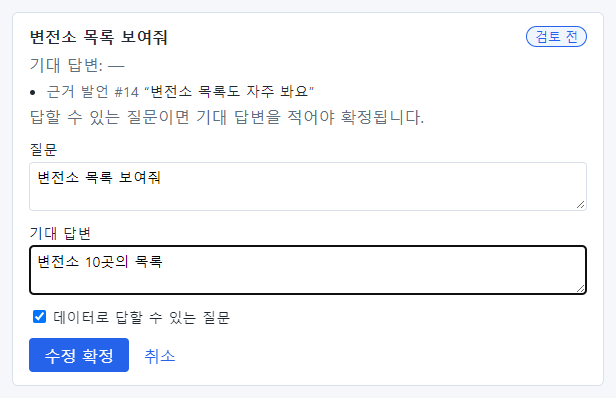

- **질문**: 실제로 물을 말 그대로
- **기대 답변**: 올바른 답. 예: "변전소 10곳의 목록"
- **데이터로 답할 수 있는 질문**: 데이터로 답할 수 있으면 체크. 데이터에 없는 정보를 묻는 질문이면 체크를
  끕니다(그러면 챗봇이 "답할 수 없다"고 해야 맞는 문항이 됩니다)

"위험등급이 3 이상인 시설은 몇 개야?" 후보는 인터뷰에서 "보통 18개 정도"라고 말해서 기대 답변 "18개 정도"가
이미 채워져 있었습니다. 내용을 확인하고 **수정 확정** 했습니다.

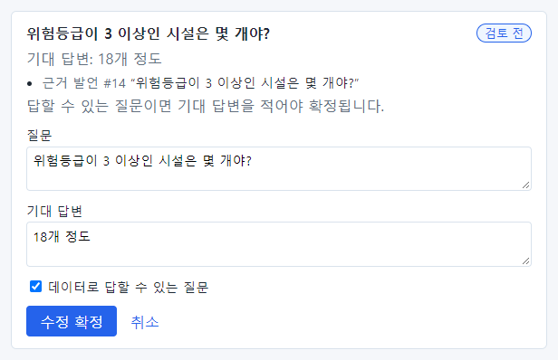

## 15.5 거절하기

"Facility —is_affected_by_typhoon_warning→ Facility (태풍 경보 지역 여부)" 관계 후보는 회사 데이터에 없는
개념이므로 **거절**(①)합니다.

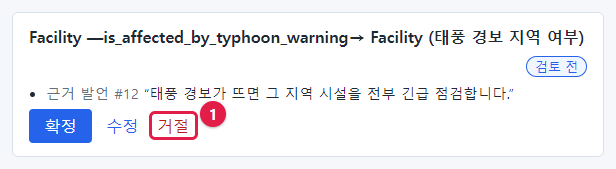

"사용 중지 결정" 조치 후보도 지금 데이터로는 할 수 없는 일이라 거절했습니다.

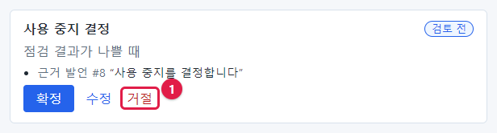

거절한 후보는 흐리게 보이고 상태가 "거절"이 됩니다. 거절했다가 마음이 바뀌면, 제출하기 전까지는 다시
**확정** 이나 **수정** 을 누를 수 있습니다.

## 15.6 확정이 거부될 때: "요소 내용이 올바르지 않습니다"

실제 인터뷰에서 이런 일이 있었습니다. **Facility.risk_grade — 위험 등급 (enum)** 후보를 **확정** 했더니 빨간
상자가 나타났습니다.

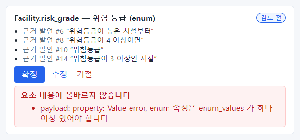

"요소 내용이 올바르지 않습니다 — payload: property: Value error, enum 속성은 enum_values 가 하나 이상 있어야
합니다". 풀어 쓰면 "자료형이 **enum**(정해진 값 중 하나)인데, 정해진 값 목록이 비어 있다"는 뜻입니다. AI 가
위험등급을 목록형으로 짐작했지만 값 목록은 뽑지 못한 것입니다. 위험등급은 1~5의 숫자이므로 자료형을
**int**(정수)로 고치는 것이 맞습니다.

1. **수정** 을 누릅니다.
2. **자료형**(①)을 `int` 로 바꿉니다.
3. **수정 확정**(②)을 누릅니다.

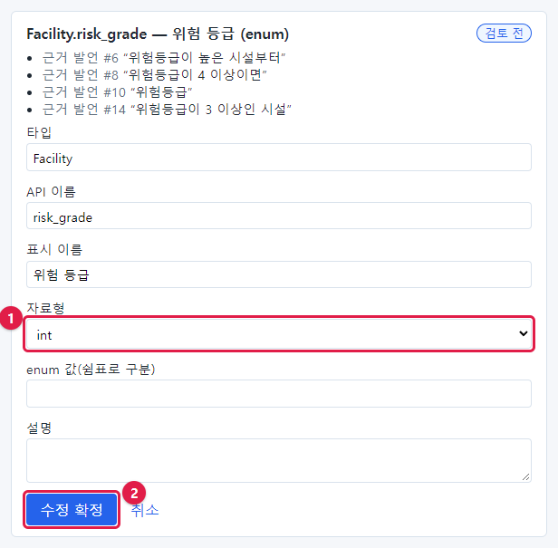

이제 상태가 "수정 확정"이 됩니다.

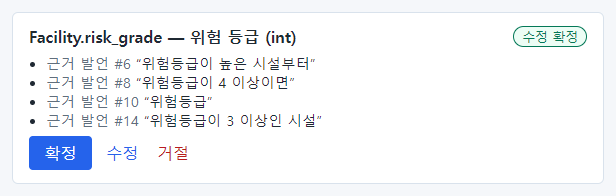

속성 후보의 자료형은 다음 중 하나입니다.

| 자료형 | 뜻 | 예 |
| --- | --- | --- |
| string | 글자 | 시설명, 시설 코드 |
| int | 정수 | 위험등급, 점검 주기(일) |
| decimal | 소수가 있는 숫자 | 설비 용량(kW) |
| bool | 예/아니오 | 사용 여부 |
| date | 날짜 | 설치일, 마지막 점검일 |
| datetime | 날짜와 시각 | 점검 시작 시각 |
| enum | 정해진 값 중 하나. **enum 값** 칸에 쉼표로 값을 적어야 함 | 시설 유형(변전소, 철탑, 전주) |

## 15.7 제출하기

모든 후보를 확정·수정·거절하면 **검토 마치고 제출** 단추가 눌립니다. 하나라도 "검토 전"이면 흐린 상태로
눌리지 않습니다("모든 요소를 확정·수정·거절해야 제출할 수 있습니다.").

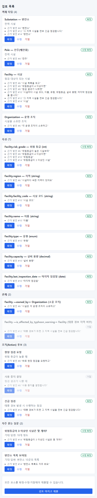

**검토 마치고 제출**(①)을 누릅니다.

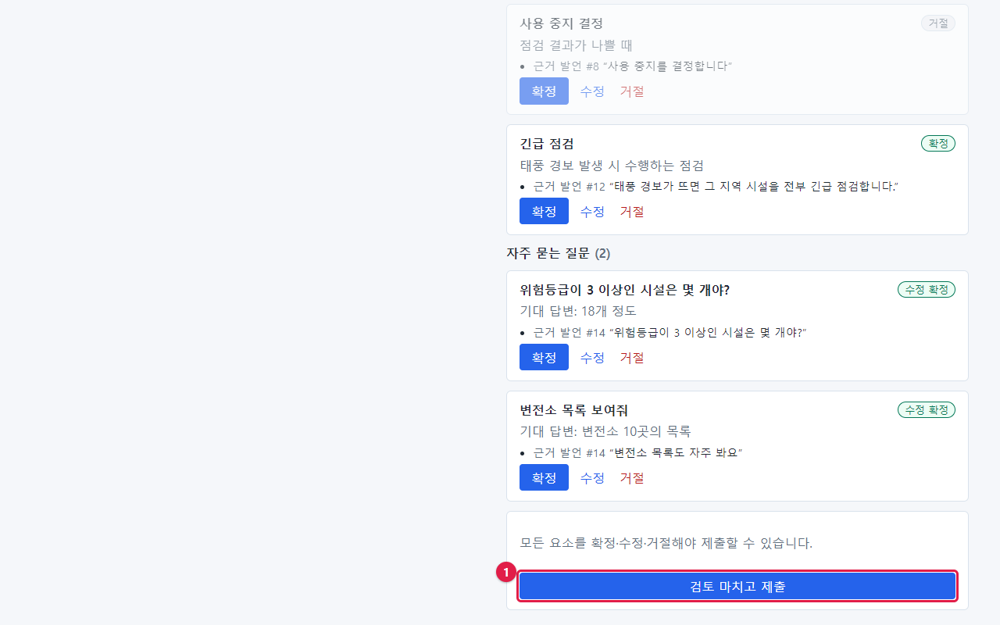

제출하면 인터뷰 상태가 **제출됨** 이 되고, 입력 칸 대신 "제출된 인터뷰입니다. 더 답할 수 없습니다."가 보입니다.
현업 전문가의 일은 여기까지입니다.

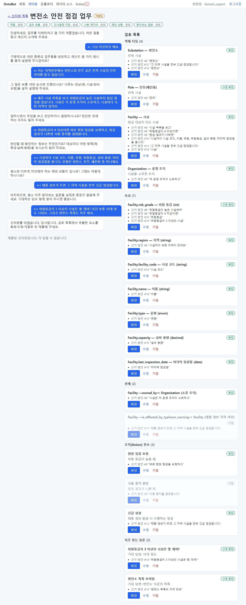

> **주의** 제출한 뒤에는 답을 더하거나 후보를 고칠 수 없습니다. 제출 전에 목록을 한 번 더 훑어보세요.

## 15.7b 모델러: 여러 인터뷰 병합하기(v1)

같은 업무를 여러 사람에게 인터뷰했다면 하나씩 게시하지 말고 병합해 draft 하나로 만듭니다.

1. 워크숍 목록에서 **제출됨** 인 인터뷰 왼쪽의 **병합** 칸을 둘 이상 고릅니다.
2. **병합 후보 보기** — 확정 후보를 이름이 **글자 그대로 같은** 것끼리 묶은 표가 나옵니다. 상태는 **일치**(합치면 하나),
   **충돌**(이름은 같은데 자료형이나 연결 타입이 다름 — 빨간 줄), **한 인터뷰에만** 입니다. "이름은 다르지만 표시 이름이 같은
   후보"는 같은 것을 다른 영문 이름으로 뽑았을 수 있다는 알림입니다 — 같은 것이면 한쪽 인터뷰 검토에서 이름을 맞추세요.
   비슷한 이름("시설"과 "설비")은 자동으로 묶지 않습니다.
3. 충돌이 있으면 **병합해 draft 만들기** 가 꺼집니다. 표의 #번호를 눌러 그 인터뷰 검토에서 고치거나 거절한 뒤 다시 봅니다.
4. **병합해 draft 만들기** → 확인. draft 버전 하나와 골든 질의 초안(같은 질문은 한 번만)이 생기고, 고른 인터뷰는 모두
   **게시됨** 이 됩니다. 이후는 「15.8」과 같습니다(draft 를 열어 게시 전 검사 → 게시).

## 15.8 모델러: 온톨로지 초안으로 게시

여기부터는 모델러 이모델(`lee.modeler`)의 일입니다.

1. **인터뷰** 메뉴를 누릅니다. 모델러는 모든 인터뷰를 볼 수 있습니다. 상태가 **제출됨** 인 인터뷰를 **열기**.

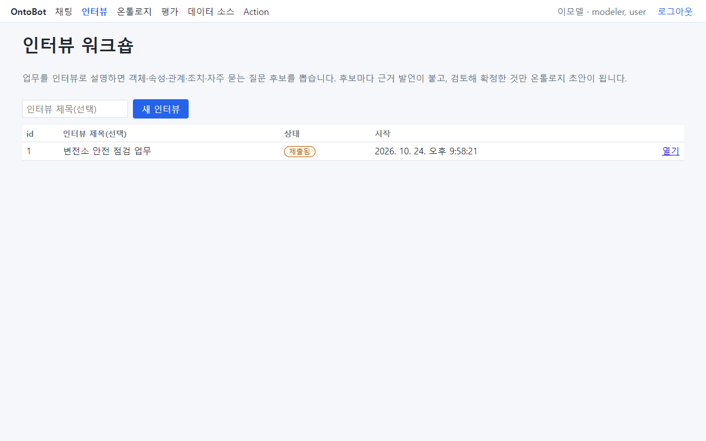

2. 검토 목록 아래 **온톨로지 초안으로 게시**(①)를 누릅니다. 설명: "확정 요소를 현재 게시 버전 위에 더한 새
   draft 를 만들고, 확정된 질문을 평가셋 초안에 넣습니다."

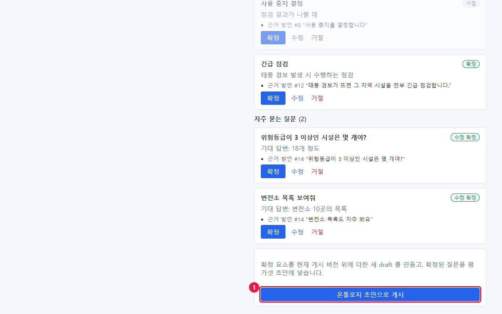

3. "draft 버전(id 2)을 만들었습니다. 평가셋 초안 질문 2개."가 나옵니다. **draft 열기**(①)를 누릅니다.

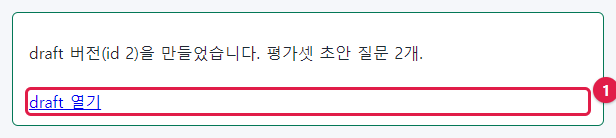

4. 새 draft(버전 2)가 열립니다. 현재 게시 버전(버전 1)에 확정한 후보가 더해져 있습니다.

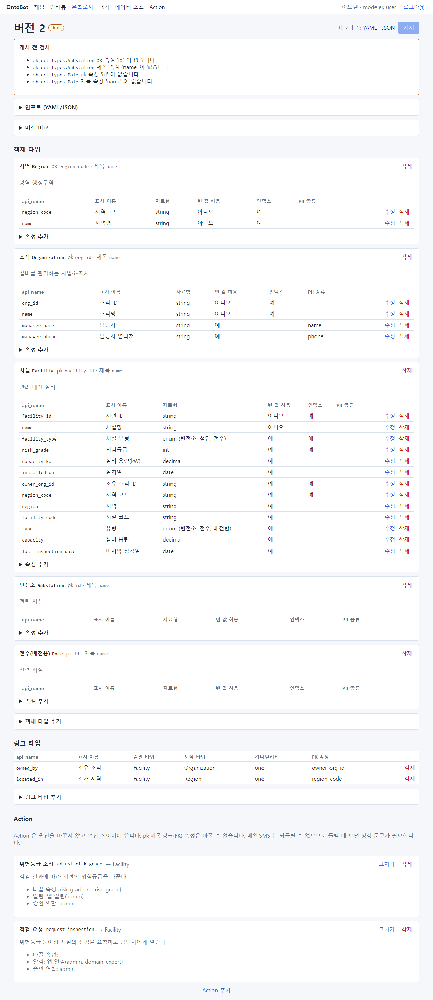

이 draft 를 보면 할 일이 보입니다.

- 맨 위 **게시 전 검사** 에 문제 넷: Substation·Pole 에 pk 속성 'id' 와 제목 속성 'name' 이 없습니다. 인터뷰에서
  변전소·전주를 별도 타입으로 뽑았지만 속성은 뽑지 않았기 때문입니다.
- 시설(Facility)에 기존 속성과 겹치는 속성(region·facility_code·type·capacity)이 새로 들어왔습니다. 이미
  region_code·facility_id·facility_type·capacity_kw 가 있으므로 정리해야 합니다.
- 위험등급(risk_grade)은 이름이 기존과 **정확히 같아서** 하나로 합쳐졌습니다(이름이 정확히 같을 때만
  합칩니다. 비슷한 이름은 합치지 않습니다).
- 마지막 점검일(last_inspection_date)은 새로 들어온 쓸모 있는 속성입니다.

> **알아 두기** 워크숍에서 만든 것은 **draft(초안)** 입니다. 챗봇은 아직 이 내용을 모릅니다. 모델러가 초안을
> 정리하고 **게시** 해야 반영됩니다. 다음 장에서 이 초안을 정리해 게시합니다. 확정된 질문 2개는 평가 화면의
> "workshop-session-2" 골든셋에 들어갔습니다(「20장」).

## 15.9 두 번째 인터뷰 — "잘 모르겠습니다"가 이어질 때

같은 현업 전문가(최현업)가 점검 업무로 두 번째 인터뷰를 했습니다. 일부러 몇 질문에 "잘 모르겠습니다"라고 답하자,
면담자는 그 주제를 **정보 부족** 으로 표시하고 다음 주제로 넘어갔습니다(찾아보는 질문 · 정보 부족).

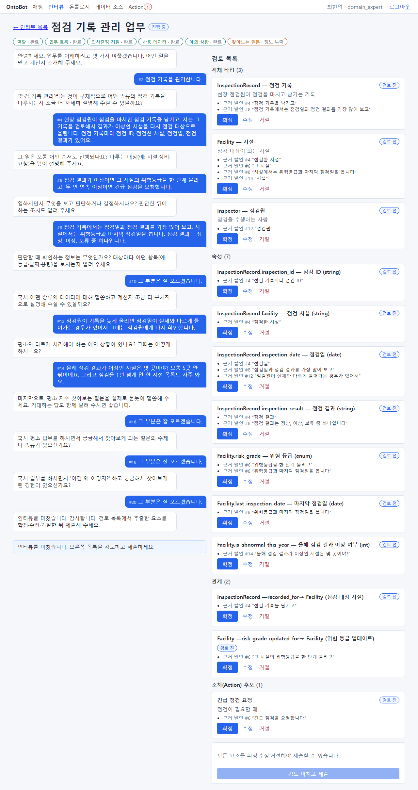

검토 목록에는 점검 기록(InspectionRecord)·점검원(Inspector) 타입, 위험등급(risk_grade) enum, 시설의
"올해 이상 여부"(is_abnormal_this_year) 같은 후보가 나왔습니다.

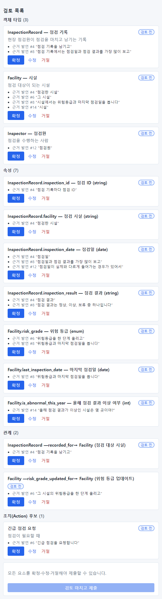

- 위험등급처럼 **이미 있는 이름** 이 다시 나오면, 게시할 때 이름이 정확히 같으므로 하나로 합쳐집니다.
- "올해 이상 여부"처럼 **조회로 계산할 수 있는 것** 은 속성으로 만들지 말고 거절합니다(점검 기록에서 셀 수 있습니다).
- 정보 부족으로 끝난 주제는 다음 인터뷰에서 그 업무를 잘 아는 사람에게 다시 묻습니다.

## 15.10 이 장의 핵심

> **요령**
>
> - 후보마다 근거 발언을 보고 **확정** · **수정** · **거절** 합니다. 데이터에 없는 개념은 거절합니다.
> - 질문 후보는 기대 답변이 있어야 확정됩니다.
> - "요소 내용이 올바르지 않습니다"가 나오면 **수정** 으로 자료형 등을 고칩니다.
> - 모두 처리해야 **검토 마치고 제출** 이 눌립니다. 제출 뒤에는 고칠 수 없습니다.
> - 모델러가 **온톨로지 초안으로 게시** 하면 draft 가 만들어지고, 정리 후 게시해야 챗봇에 반영됩니다.
