# 16장 모델러: 데이터 설계도(온톨로지) 관리

이 장부터 19장까지는 모델러(`modeler`)를 위한 장입니다. 모델러 이모델(`lee.modeler`)이 되어, 15장에서
워크숍으로 만든 초안을 정리해 게시하고, 새 객체 타입과 링크를 더해 봅니다.

## 16.1 설계도의 구성

설계도(온톨로지)는 세 부분과 Action 정의로 되어 있습니다.

| 부분 | 무엇 | 예제 |
| --- | --- | --- |
| 객체 타입 | 대상의 종류. 식별자(pk) 속성과 제목 속성이 있어야 함 | 지역(Region), 조직(Organization), 시설(Facility) |
| 속성 | 객체 타입마다 가진 정보 칸 | 시설의 위험등급(risk_grade, int) |
| 링크 타입 | 객체 타입 사이의 연결. FK 속성으로 만듦 | 시설 —소유 조직(owned_by)→ 조직 |
| Action | 데이터를 바꾸는 정해진 일 | 위험등급 조정, 점검 요청(「17장」) |

> **주의** 챗봇은 설계도에 적힌 것만 알고, 적힌 것만 묻고 답합니다. 이름(표시 이름)과 설명을 업무에서 쓰는 말로
> 지어 두어야 챗봇이 질문을 잘 알아듣습니다.

## 16.2 버전

설계도는 **버전** 으로 관리합니다.

| 상태 | 뜻 | 고칠 수 있나 |
| --- | --- | --- |
| draft | 작성 중 | 예 |
| 게시됨 | 지금 챗봇이 쓰는 것. 하나뿐 | 아니오 |
| 보관됨 | 예전에 게시했던 것 | 아니오 |

**온톨로지** 메뉴를 누르면 버전 목록이 나옵니다. 워크숍에서 만든 버전 2(draft)(①)와 지금 게시된 버전 1(②)이
보입니다.

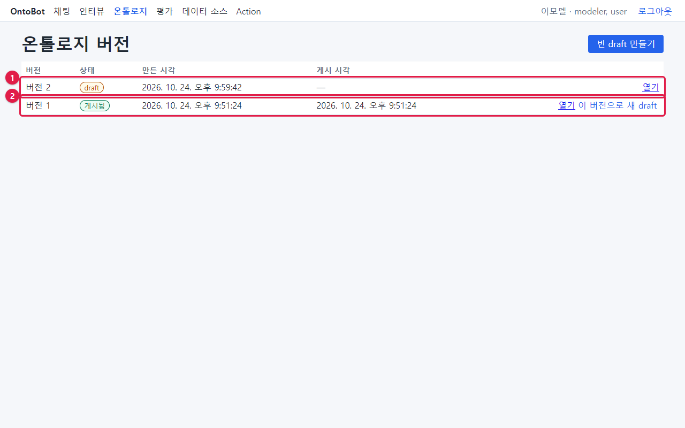

| 칸·단추 | 뜻 |
| --- | --- |
| 버전 · 상태 · 만든 시각 · 게시 시각 | 버전 번호와 상태 |
| **열기** | 그 버전을 엽니다 |
| **이 버전으로 새 draft** | 그 버전을 복사해 고칠 수 있는 새 draft 를 만듭니다(게시·보관된 버전에만 보임) |
| **빈 draft 만들기** | 빈 설계도에서 시작합니다(처음 설치 때나 완전히 새로 만들 때) |

게시된 버전 1을 열면 맨 위에 "게시·보관된 버전은 수정할 수 없습니다. 고치려면 이 버전으로 새 draft 를 만드세요."
(①)가 보이고, 수정·삭제 단추가 없습니다.

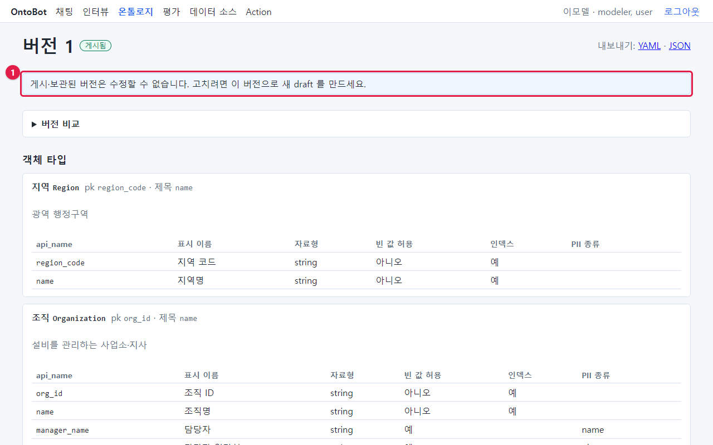

## 16.3 draft 화면과 게시 전 검사

버전 2(draft)를 엽니다. 맨 위 **게시 전 검사** 에 문제가 넷 있습니다.

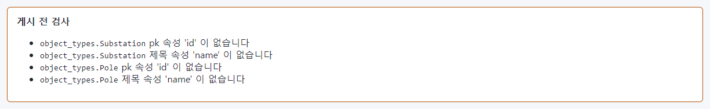

| 문제 | 뜻 |
| --- | --- |
| object_types.Substation pk 속성 'id' 이 없습니다 | Substation 타입의 식별자로 정한 속성 id 가 속성 목록에 없음 |
| object_types.Substation 제목 속성 'name' 이 없습니다 | 제목으로 정한 속성 name 이 없음 |
| (Pole 도 같은 문제 두 개) | |

게시 전 검사에 문제가 하나라도 있으면 **게시** 단추가 흐려져 누를 수 없습니다. 문제를 모두 고쳐야 합니다.

### 버전 비교로 무엇이 달라졌는지 보기

**버전 비교** 를 펼치고 **기준 버전** 에서 "버전 1 (게시됨)"을 고르면, 지금 게시된 것과 무엇이 다른지 보입니다.

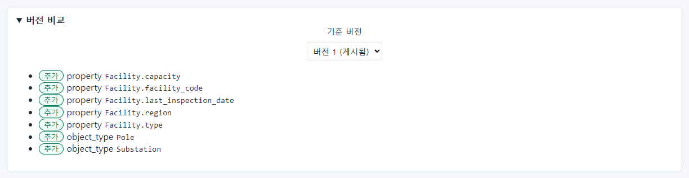

워크숍이 속성 다섯(capacity, facility_code, last_inspection_date, region, type)과 객체 타입 둘(Pole,
Substation)을 **추가** 했습니다. 이 중 무엇을 남길지 정리합니다.

| 추가된 것 | 판단 | 이유 |
| --- | --- | --- |
| Substation, Pole | 지움 | 변전소·전주는 이미 시설의 "시설 유형"으로 구분함. 데이터도 없음 |
| Facility.region, facility_code, type, capacity | 지움 | 이미 있는 region_code, facility_id, facility_type, capacity_kw 와 겹침 |
| Facility.last_inspection_date | 남김 | 새로 필요한 속성 |

## 16.4 객체 타입 지우기

Substation 타입 오른쪽 위 **삭제**(①)를 누르고, "삭제할까요?" 확인 창에서 **확인** 을 누릅니다. Pole 도 같은
방법으로 지웁니다.

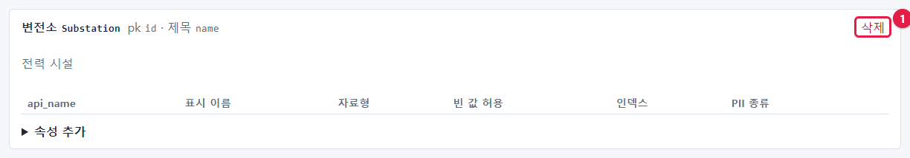

> **주의** 이미 게시된 적이 있는 타입을 지우면, 그 타입의 데이터를 챗봇이 더 이상 답하지 못합니다. draft 에서
> 새로 들어온 타입(이번처럼)이 아니면 신중하게 지우세요. 버전 비교의 "삭제"로 확인할 수 있습니다.

## 16.5 속성 지우기와 고치기

시설(Facility)의 속성 표에서 겹치는 속성 줄의 **삭제**(①)를 누릅니다. region, facility_code, type, capacity 를
차례로 지웠습니다.

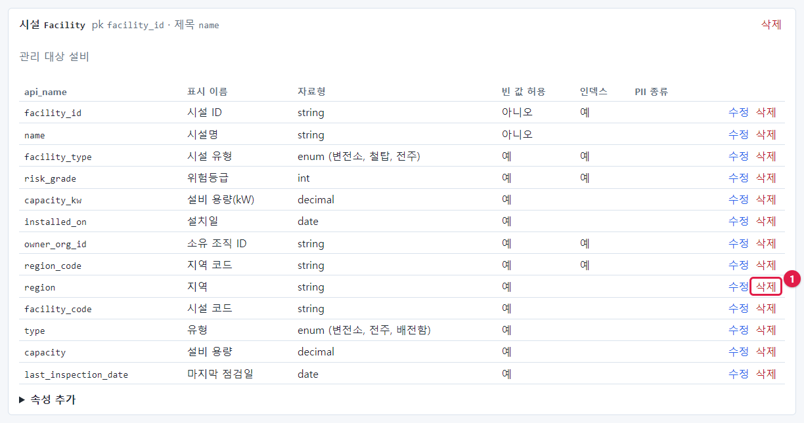

정리한 뒤의 시설 속성입니다.

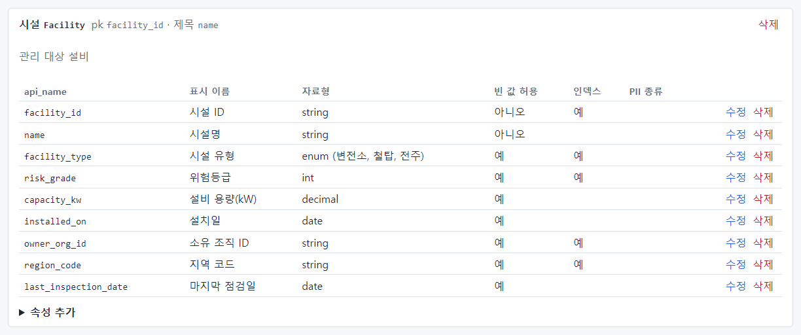

속성 표의 칸은 다음 뜻입니다.

| 칸 | 뜻 |
| --- | --- |
| api_name | 설계도에서 쓰는 영문 이름. 영문 소문자로 시작. **한 번 정하면 바꾸지 않음** |
| 표시 이름 | 화면과 챗봇이 쓰는 이름 |
| 자료형 | string · int · decimal · bool · date · datetime · enum(값 목록) |
| 빈 값 허용 | 값이 없어도 되는지. pk·제목 속성은 "아니오" |
| 인덱스 | 이 속성으로 자주 거르면 "예" — 조회가 빨라짐 |
| PII 종류 | 개인정보 종류(이름·전화·메일 등). 정하면 기록과 외부 AI 전송에서 가려짐 |

### 속성 고치기

마지막 점검일(last_inspection_date) 줄의 **수정** 을 누르면 그 줄이 양식으로 바뀝니다. api_name 은 바꿀 수 없어
흐리게 보입니다. 날짜로 자주 거를 것이므로 **인덱스** 를 체크하고 **저장** 합니다.

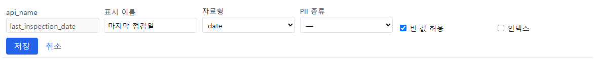

## 16.6 속성 추가

시설에 "점검 주기(일)"을 더합니다. 시설 타입 아래 **▶ 속성 추가** 를 펼칩니다.

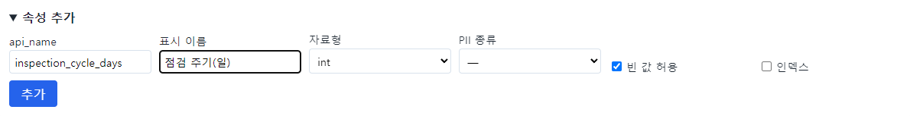

| 칸 | 입력 |
| --- | --- |
| api_name | `inspection_cycle_days` |
| 표시 이름 | `점검 주기(일)` |
| 자료형 | int |
| PII 종류 | — (개인정보 아님) |
| 빈 값 허용 | 체크(값이 없는 시설도 있음) |
| 인덱스 | 체크 안 함 |

**추가** 를 누르면 속성 표 맨 아래에 들어갑니다.

> **요령** 이름 규칙: 타입 api_name 은 영문 대문자로 시작(예: `Inspection`), 속성 api_name 은 영문 소문자로 시작하고
> 단어는 밑줄로 잇습니다(예: `inspection_cycle_days`). 표시 이름은 업무에서 부르는 말 그대로 지으세요. 챗봇이 질문의
> 낱말을 표시 이름과 맞춰 봅니다.

## 16.7 객체 타입 추가

점검 기록을 담을 새 타입 "점검 기록(Inspection)"을 만듭니다.

1. 객체 타입 목록 아래 **▶ 객체 타입 추가** 를 펼칩니다.
2. 칸을 채웁니다: api_name `Inspection`, 표시 이름 `점검 기록`, pk `inspection_id`, 제목 `inspection_id`.

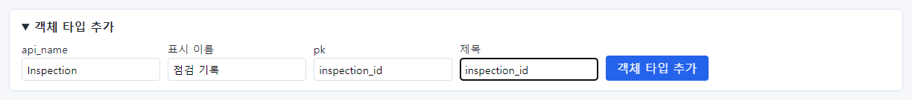

3. **객체 타입 추가** 를 누릅니다.

타입만 만들고 속성이 없으므로, 게시 전 검사가 곧바로 알려 줍니다: "pk 속성 'inspection_id' 이 없습니다",
"제목 속성 'inspection_id' 이 없습니다".

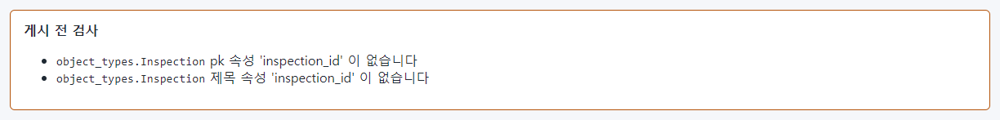

4. 새 타입의 **▶ 속성 추가** 로 속성 넷을 차례로 더합니다.

| api_name | 표시 이름 | 자료형 | 빈 값 허용 |
| --- | --- | --- | --- |
| inspection_id | 점검 ID | string | 아니오 |
| facility_id | 시설 ID | string | 아니오 |
| inspected_on | 점검일 | date | 예 |
| result | 점검 결과 | string | 예 |

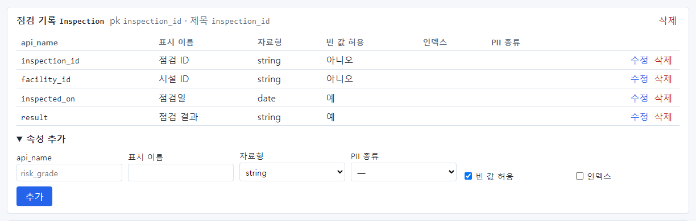

## 16.8 링크 타입 추가

점검 기록이 어느 시설의 것인지 잇습니다. **▶ 링크 타입 추가** 를 펼칩니다.

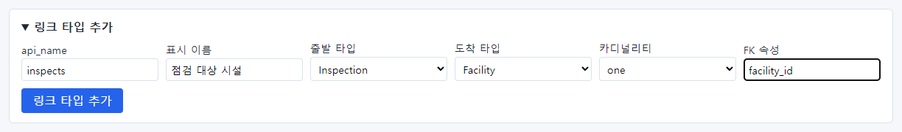

| 칸 | 입력 | 뜻 |
| --- | --- | --- |
| api_name | `inspects` | 링크의 영문 이름 |
| 표시 이름 | `점검 대상 시설` | 화면·챗봇이 쓰는 이름 |
| 출발 타입 | Inspection | 링크가 시작하는 타입 |
| 도착 타입 | Facility | 링크가 가리키는 타입 |
| 카디널리티 | one | 점검 기록 하나는 시설 하나를 가리킴(여럿이면 many) |
| FK 속성 | `facility_id` | 출발 타입(점검 기록)에서 도착 타입(시설)의 식별자를 담은 속성 |

**링크 타입 추가** 를 누르면 링크 타입 표에 들어갑니다.

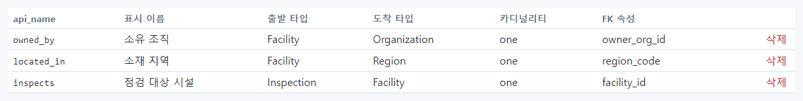

## 16.9 검사 통과와 버전 비교

문제를 모두 고치면 게시 전 검사가 초록 테두리로 "게시 전 검사를 모두 통과했습니다."가 됩니다.

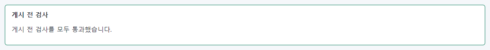

버전 비교를 다시 보면 최종 변경이 보입니다: 시설 속성 둘(inspection_cycle_days, last_inspection_date),
객체 타입 하나(Inspection), 링크 타입 하나(inspects) 추가.

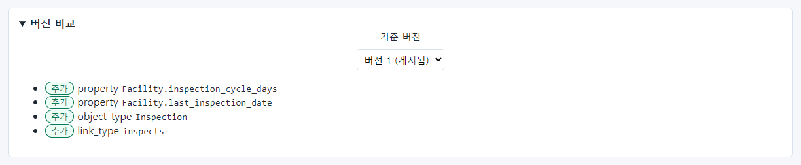

## 16.10 내보내기와 임포트

draft 화면 오른쪽 위에 **내보내기: YAML · JSON** 링크와 **게시** 단추가 있습니다(빨간 테두리).

- **내보내기**: 설계도를 파일로 받습니다. 백업하거나 다른 환경으로 옮길 때 씁니다.
- **임포트 (YAML/JSON)**: 펼치면 파일을 고르거나 내용을 붙여 넣는 칸이 나옵니다. **임포트** 를 누르면 draft 의
  정의를 그 내용으로 **통째로** 바꿉니다. 검사에 걸리면 아무것도 바뀌지 않습니다.

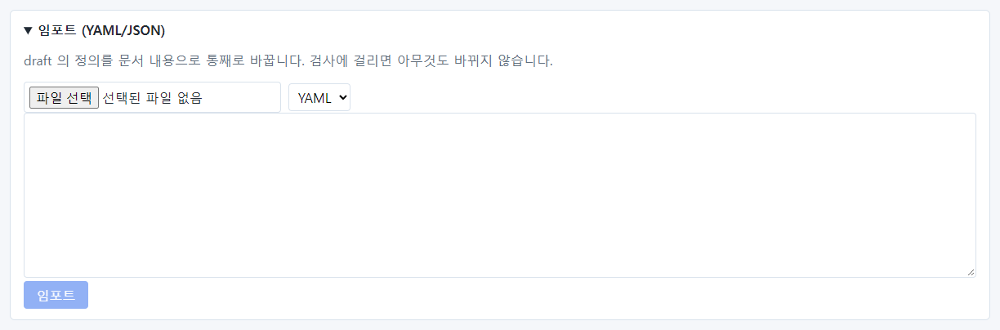

> **주의** 임포트는 draft 의 내용을 덮어씁니다. 화면에서 고친 내용이 사라질 수 있으니, 임포트하기 전에 내보내기로
> 받아 두세요.

정리한 draft 전체 화면입니다.

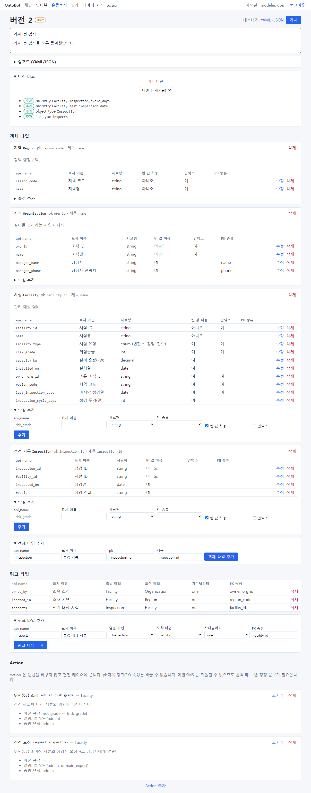

## 16.11 게시하기

1. 게시 전 검사 통과, 버전 비교 확인을 마쳤으면 **게시** 를 누릅니다.
2. 확인 창: "게시하면 현재 게시본은 보관되고 이 버전이 읽기 경로가 됩니다. 게시할까요?" — **확인**.
3. 버전 2가 **게시됨** 이 되고, 고칠 수 없는 상태가 됩니다. 버전 비교의 기준 버전 1은 **보관됨** 이 되었습니다.

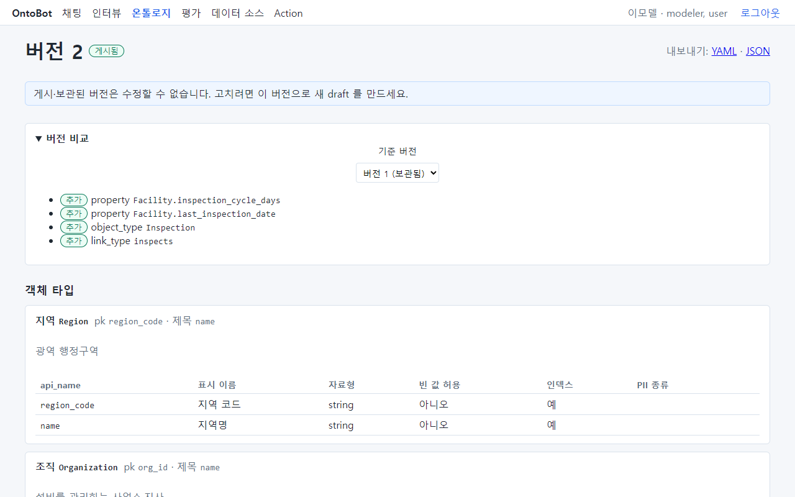

버전 목록에서도 버전 2 게시됨, 버전 1 보관됨으로 바뀌었습니다. 다음에 고칠 때는 버전 2의 **이 버전으로 새
draft**(①)로 시작합니다.

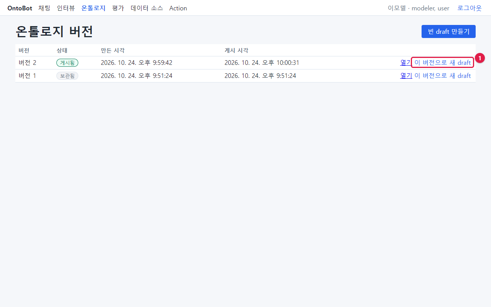

게시하면 챗봇은 **곧바로** 새 설계도로 답합니다.

> **요령** 게시한 뒤에 할 일
>
> 1. 채팅으로 대표 질문을 한두 개 물어 정상인지 확인합니다.
> 2. 새 객체 타입(이번의 점검 기록)은 **읽기 권한** 이 아무 역할에도 없습니다. 관리자에게 필요한 역할에 읽기 권한을
>    달라고 요청합니다(「21장」). 권한이 없으면 아무도 그 타입을 물을 수 없습니다.
> 3. 운영자에게 **워커 재시작** 을 요청합니다. 지금 판에서는 워커(동기화·평가를 돌리는 배경 프로그램)가 게시 전에 읽은
>    설계도를 계속 쓰기 때문입니다(「22장 22.9」).
> 4. 데이터가 들어오도록 데이터 소스와 매핑을 만듭니다(「18장」).
> 5. 평가를 돌려 품질이 떨어지지 않았는지 봅니다(「20장」).

## 16.12 이 장의 핵심

> **요령**
>
> - 게시된 버전은 고칠 수 없습니다. **이 버전으로 새 draft** 로 시작합니다.
> - **게시 전 검사** 를 모두 통과해야 게시할 수 있습니다. **버전 비교** 로 바뀐 것을 확인합니다.
> - api_name 은 한 번 정하면 바꾸지 않습니다. 표시 이름은 업무 말로 짓습니다.
> - 새 타입은 pk·제목 속성을 반드시 더합니다. 링크는 FK 속성으로 만듭니다.
> - 게시 뒤에는 읽기 권한 요청 · 데이터 연결 · 평가를 잊지 마세요.
