# 17장 모델러: Action 만들기

Action 은 설계도(온톨로지)의 일부입니다. draft 의 **Action** 칸에서 정의하고, 설계도와 함께 **게시** 해야 쓸 수
있습니다. 이 장에서는 "설비 용량 정정" Action 을 새로 만들어 게시하고, 채팅에서 실제로 요청해 봅니다.

## 17.1 새 draft 만들기

게시된 버전은 고칠 수 없으므로, 버전 목록에서 게시된 버전 2의 **이 버전으로 새 draft** 를 누릅니다. 버전 3(draft)이
생깁니다(①).

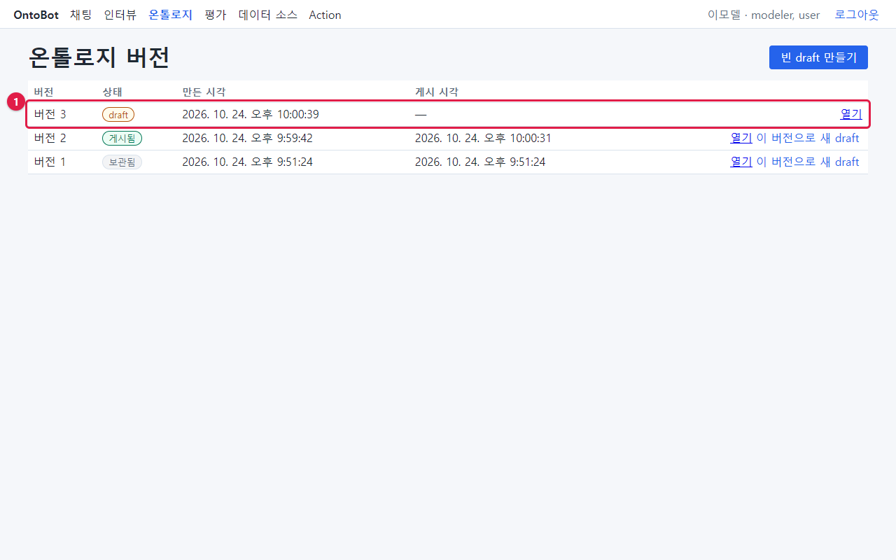

버전 3을 **열기** 하고 화면 맨 아래 **Action** 칸으로 내려갑니다.

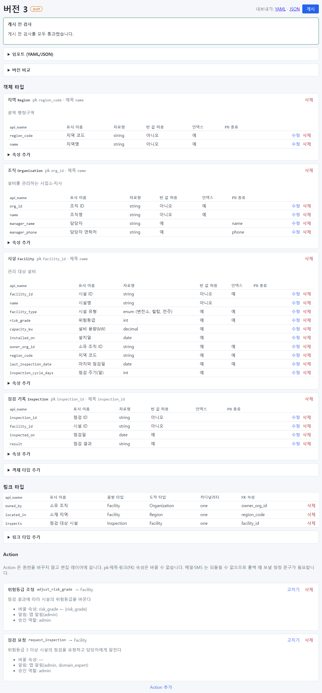

Action 칸 맨 위 안내: "Action 은 원천을 바꾸지 않고 편집 레이어에 씁니다. pk·제목·링크(FK) 속성은 바꿀 수
없습니다. 메일·SMS 는 되돌릴 수 없으므로 롤백 때 보낼 정정 문구가 필요합니다." 이미 있는 Action(위험등급 조정,
점검 요청)이 요약으로 보이고, 각각 **고치기** · **삭제** 가 있습니다. 맨 아래 **Action 추가** 를 누릅니다.

> **알아 두기** 인터뷰 워크숍에서 "조치(Action) 후보"를 확정해 두었다면, 양식 위의 **▶ 워크숍 Action 후보에서
> 시작** 을 펼쳐 후보 옆 **고르기** 를 누르면 이름과 설명이 채워진 채로 시작합니다(15장의 "현장 점검 요청"·"긴급
> 점검" 후보). 확정한 후보가 없으면 "확정한 Action 후보가 없습니다."가 보입니다.

## 17.2 양식 채우기

빈 양식입니다.

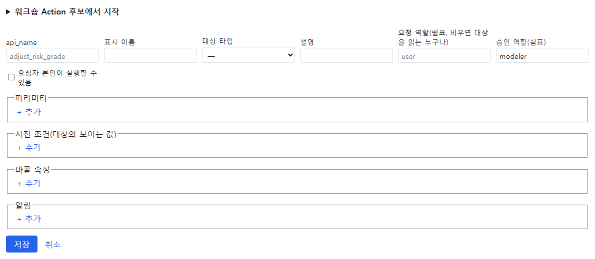

### 기본 정보

| 칸 | 입력 | 뜻 |
| --- | --- | --- |
| api_name | `correct_capacity` | 영문 이름. 영문 소문자로 시작 |
| 표시 이름 | `설비 용량 정정` | 화면과 챗봇이 쓰는 이름. 채팅에서 사람들이 쓸 말로 |
| 대상 타입 | 시설 (Facility) | 어떤 종류의 객체를 바꾸는지 |
| 설명 | `현장 확인 결과로 시설의 설비 용량(kW)을 바로잡는다` | 챗봇이 요청을 이해할 때 참고함 |
| 요청 역할(쉼표, 비우면 대상을 읽는 누구나) | (비움) | 누가 요청할 수 있는지. 비우면 시설을 읽을 수 있는 누구나 |
| 승인 역할(쉼표) | `admin` | 누가 승인할 수 있는지 |
| 요청자 본인이 실행할 수 있음 | 체크 안 함 | 체크하면 요청자가 승인 역할이기도 할 때 스스로 승인 가능 |

### 파라미터 — 요청할 때 받을 값

**파라미터** 칸의 **+ 추가** 를 눌러 줄을 더합니다. 줄마다 api_name · 표시 이름 · 자료형 · 필수 체크 · **빼기**.

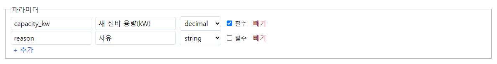

| api_name | 표시 이름 | 자료형 | 필수 |
| --- | --- | --- | --- |
| capacity_kw | 새 설비 용량(kW) | decimal | 예 |
| reason | 사유 | string | 아니오 |

자료형이 enum 이면 값 목록 칸이 나타납니다(예: 점검 요청의 긴급도 — 긴급, 일반).

> **요령** 파라미터의 표시 이름을 알기 쉽게 지으세요. 채팅으로 요청하면 챗봇이 질문에서 이 이름에 맞는 값을 찾아
> 채웁니다. "새 설비 용량(kW)"처럼 무엇을 넣는 칸인지 분명해야 합니다.

### 사전 조건 — 실행해도 되는 대상의 상태

**+ 추가** 로 줄을 더하고, 속성 · 조건 · 값을 고릅니다. 여기서는 "설비 용량(kW) 값 있음"으로 했습니다.

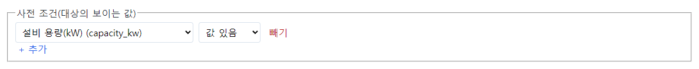

조건은 = · ≠ · > · ≥ · < · ≤ · 중 하나 · 비어 있음 · 값 있음 중에서 고릅니다. 사전 조건은 미리보기와 승인 순간에
모두 확인합니다.

### 바꿀 속성

어떤 속성을 무엇으로 바꿀지 정합니다. 속성 "설비 용량(kW)" ← "파라미터 capacity_kw".

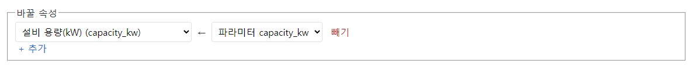

값 쪽 목록에서 **상수** 를 고르면 고정값을 적을 수 있습니다(예: 상태 ← "점검 중"). 바꾸는 값이 없는 Action
(점검 요청처럼 알림만 보내는 것)이면 비워 둡니다.

### 알림

채널 · 받는 역할(쉼표) · 문구를 정합니다. 채널 "앱 알림", 받는 역할 `admin`, 문구:

`'{target}'({target_pk}) 설비 용량을 {capacity_kw}kW로 정정합니다. 사유: {reason}`

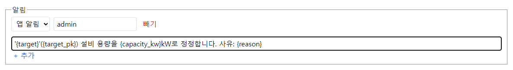

문구에는 다음 이름만 쓸 수 있습니다. 실행할 때 값으로 바뀝니다.

| 이름 | 바뀌는 값 | 예 |
| --- | --- | --- |
| `{target}` | 대상의 이름(제목) | 부산 변전소 10호 |
| `{target_pk}` | 대상의 식별자 | F-0010 |
| `{action}` | Action 의 표시 이름 | 설비 용량 정정 |
| `{파라미터 api_name}` | 요청 때 받은 값 | `{capacity_kw}` → 1,500 |

문구는 이 틀에 값만 끼워 넣습니다. AI 가 쓰지 않습니다.

### 메일·SMS 알림을 고르면

채널을 **메일** 로 바꾸면 **대상의 연락처 속성** 목록과, 양식 아래 **정정 문구(롤백 때 메일·SMS 수신자에게)** 칸이
나타납니다.

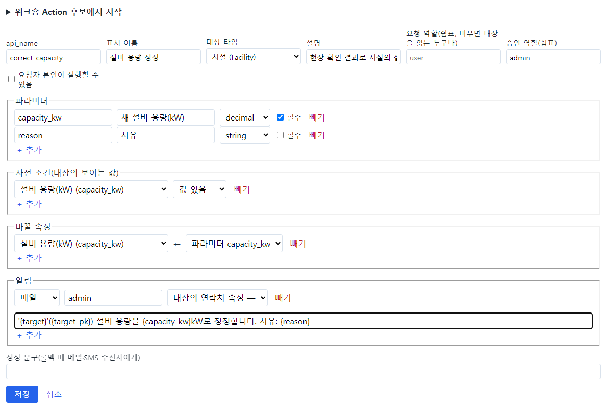

- **대상의 연락처 속성**: 받는 사람을 역할 대신 대상 객체의 연락처 속성(PII 종류가 메일·전화인 속성)으로 정할 수
  있습니다.
- **정정 문구**: 메일·SMS 는 되돌릴 수 없으므로, 롤백할 때 보낼 문구를 반드시 적어야 합니다.

> **주의** 메일·SMS 알림을 넣기 전에 운영자에게 발송 설정이 되어 있는지 확인하세요. 설정이 없으면 이 Action 의
> 요청은 모두 **막힘** 이 됩니다. 이 예제는 다시 **앱 알림** 으로 돌려 두었습니다.

### 완성한 양식

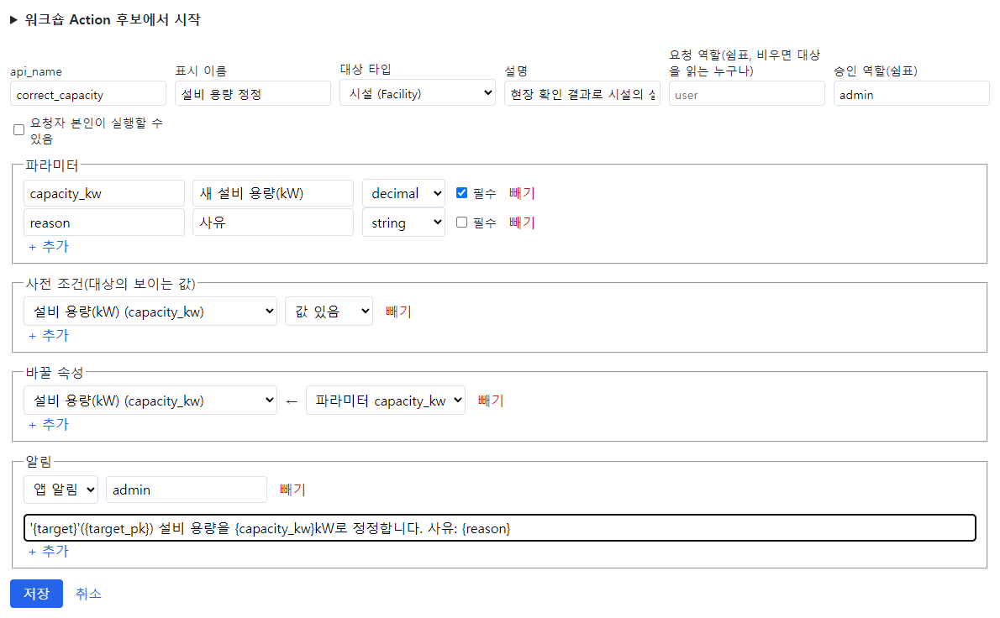

**저장** 을 누릅니다.

## 17.3 저장 뒤 확인

Action 목록에 "설비 용량 정정 correct_capacity → Facility"가 생깁니다. 요약에 바꿀 속성 · 알림 · 승인 역할이
보입니다. 게시 전 검사도 통과입니다.

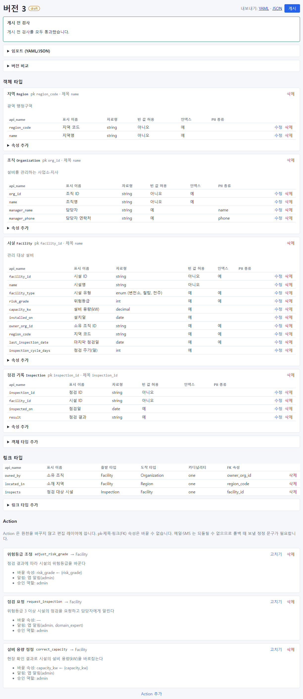

## 17.4 만들 수 없는 Action

Action 은 객체의 **식별자(pk) · 제목 · 링크(FK) 속성** 을 바꿀 수 없습니다. 바꾸면 기록과 연결이 끊기기 때문입니다.
시험 삼아 "시설 이름 바꾸기"(name ← 상수 "새 이름")를 만들어 저장해 보았습니다. 저장은 되지만 게시 전 검사가 막습니다:
"action_types.rename_facility.changes.name 제목 속성은 Action 으로 바꿀 수 없습니다".

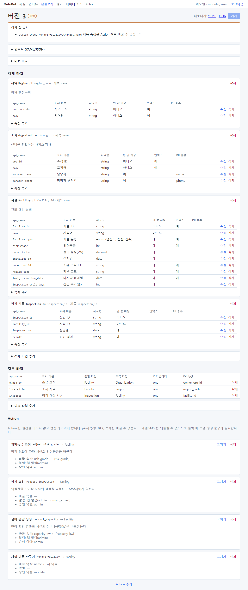

이 Action 을 **삭제** 하자 다시 검사를 통과했습니다.

이 밖에 게시 전 검사가 막는 경우:

| 경우 | 고치는 법 |
| --- | --- |
| 바꿀 속성이 대상 타입에 없음 | 속성 이름 확인 |
| 파라미터 자료형과 속성 자료형이 맞지 않음 | 같은 자료형으로 |
| 알림 문구에 없는 이름(`{없는것}`)을 씀 | 파라미터 api_name 확인 |
| 메일·SMS 알림인데 정정 문구가 없음 | 정정 문구 작성 |
| 승인 역할이 비어 있음 | 승인 역할 입력 |

## 17.5 게시하고 써 보기

**게시** 를 누르고 확인합니다(「16장 16.11」). 게시하자마자 새 Action 을 쓸 수 있습니다.

김사용으로 채팅에서 요청해 봅니다: `F-0010 시설 설비 용량을 1500으로 정정해줘. 사유는 현장 실측`

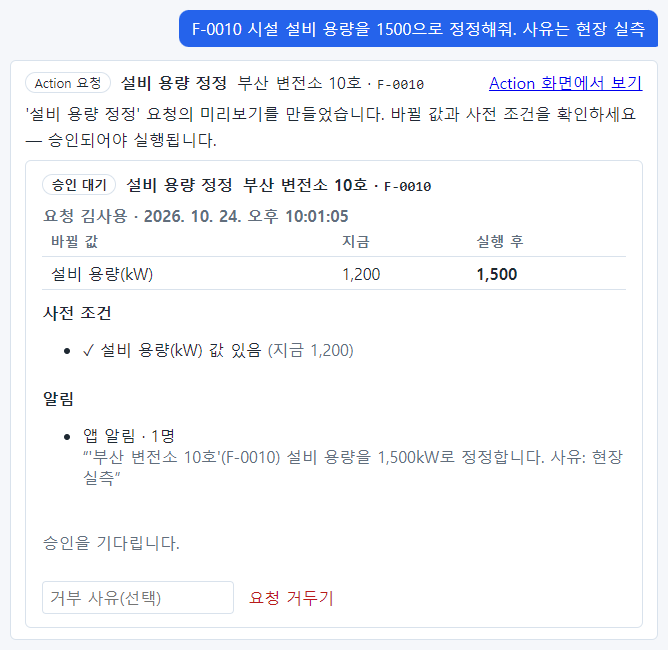

설비 용량(kW) 1,200 → **1,500**, 사전 조건 ✓ 설비 용량(kW) 값 있음(지금 1,200), 알림 문구에 사유 "현장 실측"까지
들어갔습니다.

Action 화면의 요청 칸에서도 고를 수 있습니다. 파라미터 칸(새 설비 용량(kW) *, 사유)이 정의대로 나타납니다.

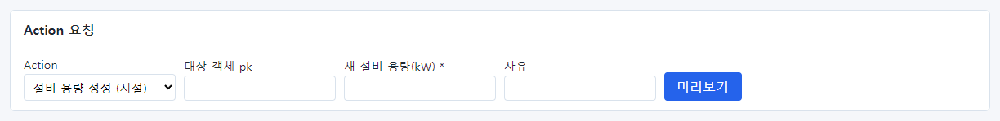

## 17.6 Action 을 고칠 때

- 이미 게시된 Action 을 고치려면 새 draft 에서 **고치기** → 저장 → 게시합니다.
- 고친 설계도를 게시하면, 그 전에 만들어진 **승인 대기** 요청은 승인하는 순간 재확인에서 **실패** 할 수 있습니다
  (설계도가 바뀌었으므로). 요청자가 새로 요청해야 합니다. 게시 시점을 승인자와 맞추세요.
- Action 의 api_name 은 바꾸지 않습니다. 기록이 이 이름으로 남습니다.

## 17.7 이 장의 핵심

> **요령**
>
> - Action 은 draft 의 **Action 추가** 로 만들고, 설계도와 함께 게시해야 쓸 수 있습니다.
> - 기본 정보 · 파라미터 · 사전 조건 · 바꿀 속성 · 알림 · 승인 역할을 채웁니다.
> - 알림 문구는 `{target}` · `{target_pk}` · `{action}` · `{파라미터}` 만 씁니다.
> - pk·제목·FK 속성은 바꿀 수 없습니다. 메일·SMS 는 정정 문구가 필요하고 발송 설정이 있어야 합니다.
