# 18장 모델러: 데이터 연결과 동기화

OntoBot 의 데이터는 회사의 원래 시스템(데이터베이스)에서 가져옵니다. 이 장에서는 "시설 원장 DB"를 연결하고,
표의 열을 설계도의 속성과 짝지은 뒤(매핑), 데이터를 가져오는(동기화) 과정을 따라 합니다. 일부러 동기화를
실패시켜 고치는 방법도 봅니다.

## 18.1 데이터 소스 화면

**데이터 소스** 메뉴를 누릅니다. 화면은 위에서부터 네 칸입니다.

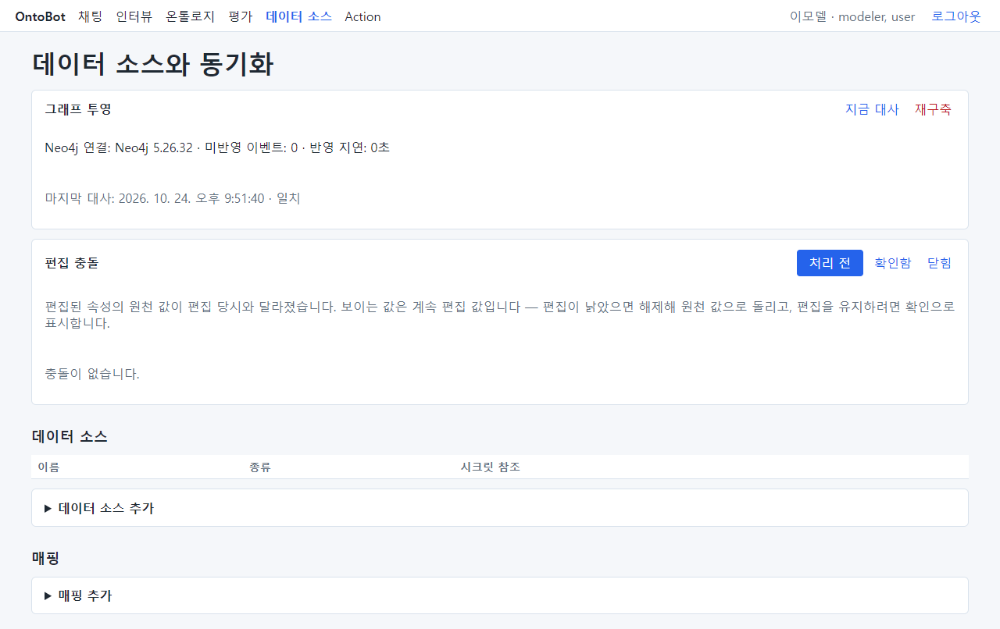

| 칸 | 하는 일 | 장 |
| --- | --- | --- |
| 그래프 투영 | 관계 정보 저장소의 상태 | 19장 |
| 편집 충돌 | Action 으로 바꾼 값과 원래 시스템 값이 엇갈린 목록 | 19장 |
| 데이터 소스 | 연결한 원래 시스템 목록과 **데이터 소스 추가** | 이 장 |
| 매핑 | 표 ↔ 객체 타입 짝과 동기화 기록, **매핑 추가** | 이 장 |

## 18.2 데이터 소스 추가

연결할 시스템의 접속 정보(주소·계정·비밀번호)는 화면에 넣지 않습니다. 운영자가 서버에 접속 정보를 넣어 두고
**이름(시크릿 참조)** 만 알려 줍니다. 여기서는 운영자에게 `env:ONTOBOT_SRC_FAC` 를 받았다고 합니다.

1. **▶ 데이터 소스 추가** 를 펼칩니다.
2. **종류**: postgres(지금은 PostgreSQL 만 지원), **이름**: `시설 원장 DB`, **시크릿 참조**: `env:ONTOBOT_SRC_FAC`

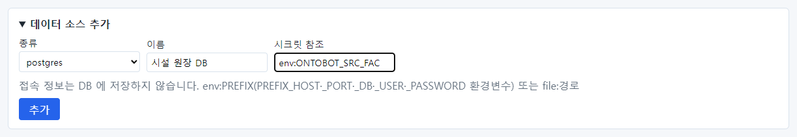

3. **추가** 를 누릅니다.

> **알아 두기** 시크릿 참조는 두 가지 꼴입니다. `env:PREFIX` 는 서버의 환경변수 PREFIX_HOST · PREFIX_PORT ·
> PREFIX_DB · PREFIX_USER · PREFIX_PASSWORD 를 읽고, `file:경로` 는 서버의 파일을 읽습니다. 비밀번호가 화면과
> 데이터베이스에 남지 않게 하려는 방식입니다.

## 18.3 접속 시험

데이터 소스 목록의 **접속 시험**(①)을 누르면, 서버가 실제로 연결해 봅니다. 성공하면 초록 글씨로 "접속 성공 ·
(데이터베이스 버전)"이 나옵니다.

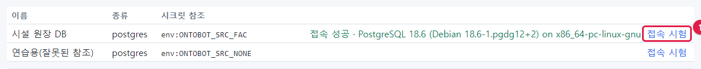

시크릿 참조가 틀렸거나 운영자가 아직 접속 정보를 넣지 않았으면 빨간 글씨로 무엇이 없는지 알려 줍니다. 아래는
일부러 없는 참조 `env:ONTOBOT_SRC_NONE` 으로 만든 "연습용" 데이터 소스입니다: "접속 정보가 없습니다:
ONTOBOT_SRC_NONE_HOST, …". 이때는 운영자에게 그 이름으로 접속 정보를 넣어 달라고 요청합니다.

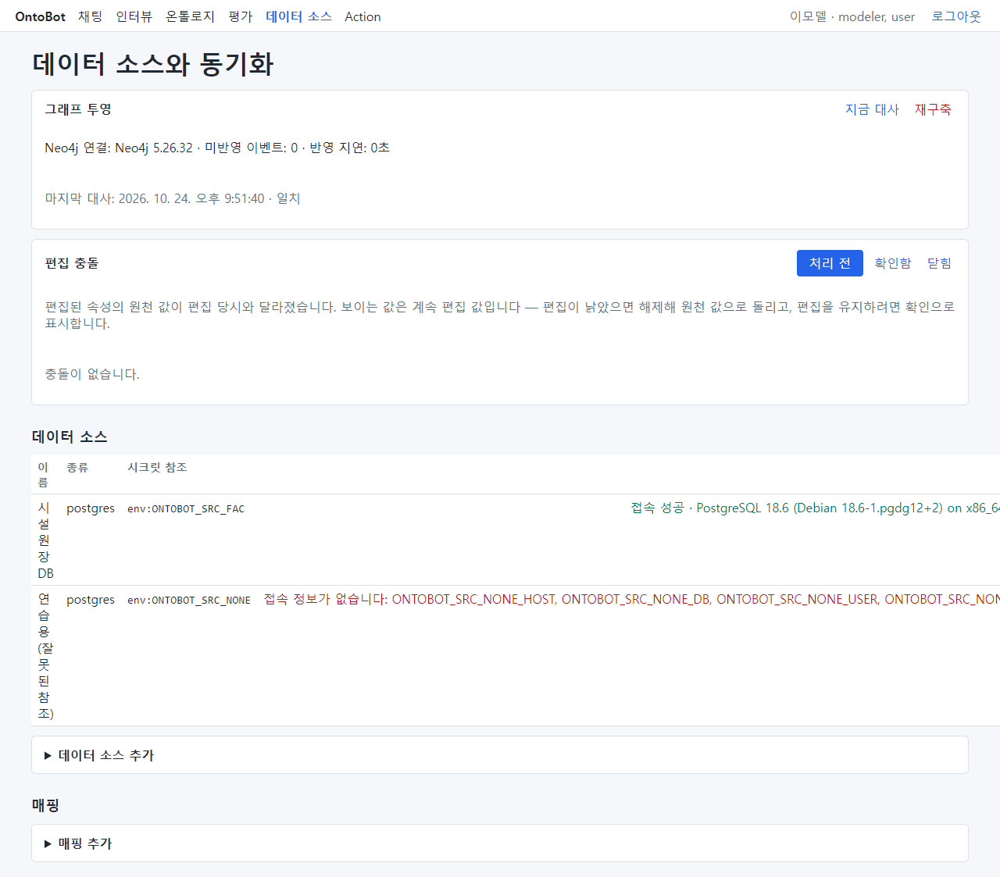

> **알아 두기** 오류 문구가 길면 표의 "이름" 칸이 좁아져 글자가 세로로 보일 수 있습니다(화면 결함). 창을 넓히면
> 나아집니다.

## 18.4 매핑 만들기

매핑은 "원래 시스템의 어느 표, 어느 열이 설계도의 어느 객체 타입, 어느 속성인가"를 짝지은 것입니다. 시설 원장
DB 의 `fac_master` 표를 시설(Facility)과 짝짓습니다. 표의 열 이름은 설계도의 속성 이름과 다릅니다.

| 원천 열(fac_master) | 속성(시설) |
| --- | --- |
| fac_id | 시설 ID facility_id (pk) |
| fac_name | 시설명 name |
| fac_type | 시설 유형 facility_type |
| risk | 위험등급 risk_grade |
| cap_kw | 설비 용량(kW) capacity_kw |
| inst_date | 설치일 installed_on |
| org_code | 소유 조직 ID owner_org_id |
| region | 지역 코드 region_code |
| updated_at | (짝 없음 — 증분 동기화의 워터마크로 쓸 수 있음) |

1. **▶ 매핑 추가** 를 펼치고 **데이터 소스**(시설 원장 DB), **객체 타입**(시설 (Facility)), **원천 표**
   (`public.fac_master` — 스키마.표 이름)를 넣습니다.

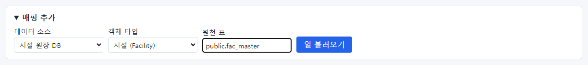

2. **열 불러오기** 를 누르면 객체 타입의 속성 목록과, 속성마다 **원천 열** 을 고르는 목록이 나타납니다. 이름이
   **정확히 같은** 열만 미리 골라 두므로, 이번에는 모두 "(매핑 안 함)"입니다(비슷한 이름을 짐작해 붙이지
   않습니다).

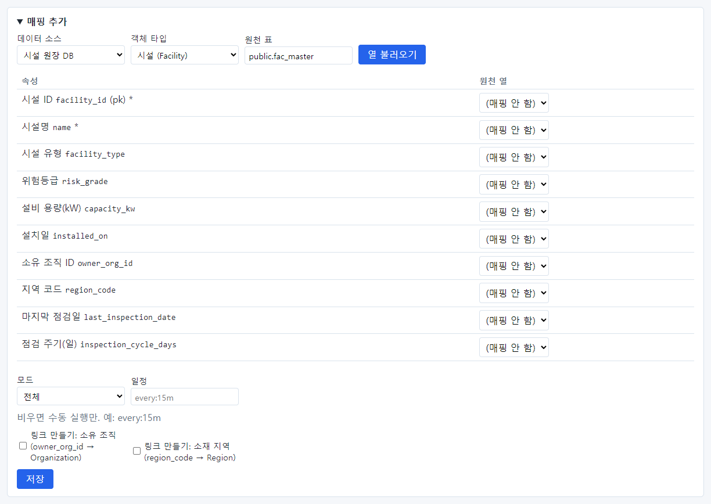

   속성 이름 뒤의 **(pk)** 는 식별자, **\*** 는 빈 값을 허용하지 않는 속성입니다. 이 둘은 반드시 원천 열을 골라야
   합니다.

3. 속성마다 원천 열을 고릅니다(위 표대로). 마지막 점검일과 점검 주기(일)는 원천에 없으므로 "(매핑 안 함)"으로
   둡니다.

4. **모드** 를 고릅니다.

| 모드 | 하는 일 | 언제 |
| --- | --- | --- |
| 전체 | 매번 표 전체를 읽음. 원천에서 없어진 행은 OntoBot 에서 삭제 표시 | 표가 작거나, 지운 행도 반영해야 할 때 |
| 증분 | **워터마크 열**(예: 수정 시각 updated_at)이 지난번보다 커진 행만 읽음 | 표가 크고, 바뀐 행만 빨리 가져올 때 |

   **증분** 을 고르면 **워터마크 열** 목록이 나타납니다.

   이 예제는 **전체** 로 합니다.

5. **링크 만들기**: 이 표의 FK 속성으로 링크(관계)를 만들지 체크합니다. 소유 조직(owner_org_id → Organization),
   소재 지역(region_code → Region) 모두 체크합니다. 체크하지 않으면 "강남지사가 소유한 시설" 같은 관계 질문에
   이 데이터가 쓰이지 않습니다.

6. **일정**: `every:15m`(15분마다), `every:1h`(1시간마다)처럼 적으면 자동으로 동기화합니다. 비우면 손으로만
   합니다. 예제는 비웠습니다.

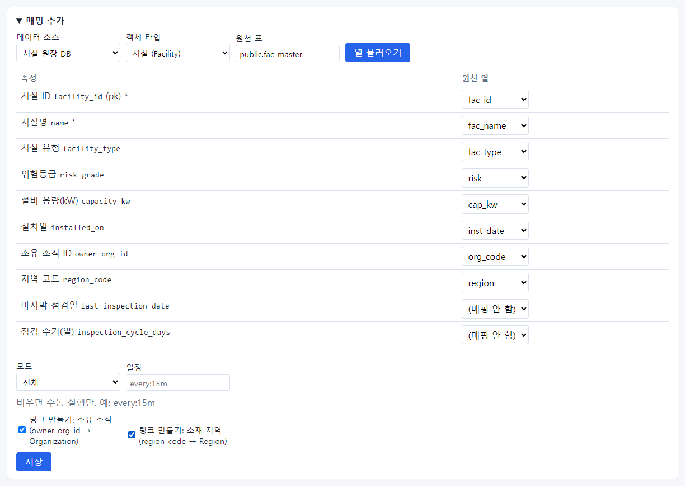

7. **저장** 을 누릅니다.

## 18.5 동기화하기

매핑이 만들어지면 매핑 칸에 "Facility ← public.fac_master · 시설 원장 DB · 전체 · 링크 만들기: owned_by,
located_in"이 보입니다. **지금 동기화**(①)를 누릅니다.

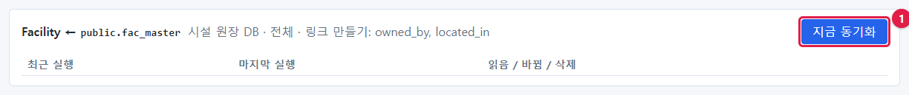

"동기화 작업을 넣었습니다. 워커가 실행합니다."가 나오고, 배경 작업 프로그램(워커)이 실행합니다. 잠시 뒤
화면을 새로 고치면 **최근 실행** 에 결과가 보입니다.

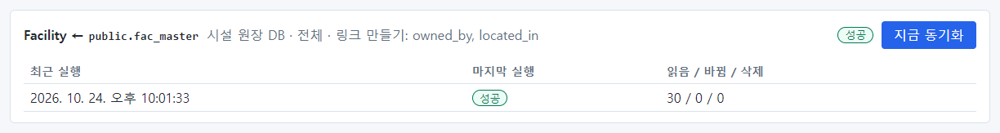

| 칸 | 이 실행 | 뜻 |
| --- | --- | --- |
| 최근 실행 | 시각 | 동기화를 시작한 시각 |
| 마지막 실행 | 성공 | 결과(실행 중 · 성공 · 실패) |
| 읽음 / 바뀜 / 삭제 | 30 / 0 / 0 | 원천에서 읽은 행 · 값이 바뀐 객체 · 삭제 표시한 객체 |

"바뀜 0"인 이유: 예제의 시설 30곳은 처음 설치 때 같은 값으로 들어가 있었기 때문입니다. 바뀐 것은 없지만 이제부터
이 데이터의 출처는 시설 원장 DB 입니다.

동기화한 뒤 채팅에서 시설의 근거 카드를 열면 **값 출처** 가 바뀌어 있습니다(①): "시설 원장 DB ·
public.fac_master · 동기화 실행 #4 (시각)".

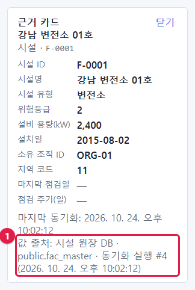

## 18.6 동기화가 실패할 때

원래 시스템에 설계도와 맞지 않는 값이 들어오면 어떻게 될까요? 원천 표에 새 시설 F-0031 을 넣으면서 시설 유형을
"배전함"으로 넣었습니다. 설계도의 시설 유형은 변전소·철탑·전주 중 하나(enum)입니다.

**지금 동기화** 를 누르자 **실패** 했습니다.

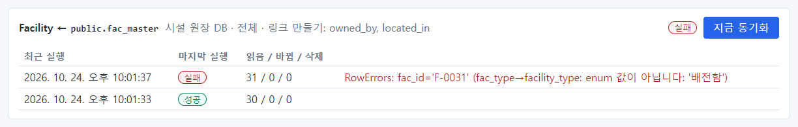

오류: "RowErrors: fac_id='F-0031' (fac_type→facility_type: enum 값이 아닙니다: '배전함')". 어느 행(F-0031)의
어느 열(fac_type → facility_type)이 왜(목록에 없는 값 '배전함') 실패했는지 알려 줍니다.

> **주의** 한 행이라도 변환에 실패하면 **동기화 전체가 실패** 하고 아무것도 바뀌지 않습니다(읽음 31, 바뀜 0).
> 일부만 들어가 데이터가 어긋나는 것을 막기 위한 동작입니다. 실패한 동안 OntoBot 은 마지막으로 성공한 데이터로
> 답합니다.

고치는 방법은 두 가지입니다.

| 방법 | 언제 |
| --- | --- |
| 원천 데이터를 고친다 | 원천 값이 틀렸을 때(오타 등) — 원래 시스템 담당자에게 요청 |
| 설계도를 고친다 | 새 값이 정당할 때(배전함이 실제로 생긴 시설 유형) — enum 값에 "배전함"을 더해 게시 |

이번에는 원천의 시설 유형을 "전주"로 고친 뒤 다시 동기화했습니다. 성공했고 "읽음 31 / 바뀜 1"입니다(새 시설
하나가 들어옴). 그다음 원천에서 F-0031 을 지우고 다시 동기화하자 "읽음 30 / 삭제 1"이 되었습니다(전체 모드라
원천에서 없어진 행을 삭제 표시).

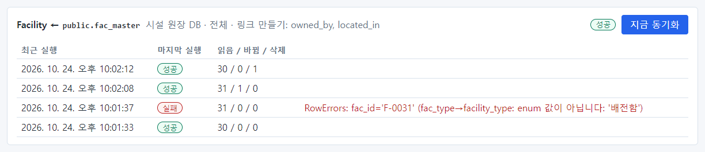

자주 보는 실패 원인입니다.

| 오류 | 원인 | 할 일 |
| --- | --- | --- |
| enum 값이 아닙니다 | 목록에 없는 값 | 원천 수정 또는 enum 값 추가 |
| 정수/숫자가 아닙니다 | 숫자 칸에 글자 | 원천 수정 또는 매핑한 열 확인 |
| 날짜가 아닙니다 | 날짜 형식이 다름 | 원천 수정 |
| 빈 값 | pk·필수 속성에 값이 없음 | 원천 수정 |
| 접속 오류 | 원천 시스템에 연결 못함 | 접속 시험, 운영자 문의 |

## 18.7 동기화 운영 요령

> **요령**
>
> - 매핑을 처음 만들면 바로 **지금 동기화** 해서 "읽음" 건수가 원천 행 수와 같은지 확인합니다.
> - 일정(`every:…`)을 넣으면 자동으로 돕니다. 너무 짧게 잡으면 원천 시스템에 부담이 됩니다(15분~1시간 권장).
> - 이미 대기 중인 동기화가 있으면 "이미 대기 중인 동기화가 있습니다."가 나옵니다. 끝나길 기다리세요.
> - 실패하면 오류의 행·열을 원천 담당자에게 그대로 전달하세요.
> - 원천 열 이름이 바뀌면 매핑도 고쳐야 합니다. 바뀐 줄 모르면 동기화가 실패하거나 값이 비게 됩니다.

## 18.8 문서 넣기(v1)

표로 된 데이터 말고 점검 기준·지침 같은 **문서** 도 넣어 둘 수 있습니다. 위쪽 메뉴 **문서** 에서 합니다.

1. **문서 넣기** 에서 파일(.txt·.md·.pdf, 최대 20MB)을 고르고, 제목(비우면 파일 이름)과 **그룹** 을 정해 **넣기** 를
   누릅니다. 문서는 그 데이터 그룹 구성원만 봅니다(관리자도 소속이 아니면 못 봅니다). 넣을 수 있는 사람은 모델러·
   관리자이면서 그 그룹 구성원입니다.
2. 넣으면 글을 뽑아 **조각** 으로 나누고, 색인(임베딩)은 백그라운드 작업이 합니다. 목록의 **색인** 칸이 "색인 중 0/3"
   → "색인 완료" 로 바뀝니다. 워커가 돌고 있어야 합니다.
3. 문서를 누르면 조각마다 원문이 나옵니다. 앞으로 답이 문서를 인용하면 이 조각 단위로 붙고, 인용한 값이 조각 원문에
   **그대로** 있는지 확인합니다.

받지 않는 것: 스캔한 PDF(글자 층 없음)·암호 PDF·한글(HWP). 같은 파일을 같은 그룹에 두 번 넣을 수 없습니다. 임베딩 모델을
바꾸었거나 색인이 실패했으면 **다시 색인** 을 누릅니다. 문서가 있는 데이터 그룹은 지울 수 없습니다.

> **알아 두기** 지금 판에서는 문서를 넣고 색인하는 데까지입니다. 채팅 질문이 문서를 찾아 답하는 기능은 다음 판에서
> 붙습니다.

## 18.9 이 장의 핵심

> **요령**
>
> - 데이터 소스는 이름과 **시크릿 참조** 만 적습니다. 비밀번호는 운영자가 서버에 넣습니다.
> - 매핑: 데이터 소스 · 객체 타입 · 원천 표 → **열 불러오기** → 속성마다 원천 열 → 모드 · 링크 · 일정 → **저장**.
> - **지금 동기화** 의 결과는 "읽음 / 바뀜 / 삭제"로 봅니다.
> - 한 행이라도 실패하면 전체 실패. 오류의 행·열을 보고 원천이나 설계도를 고칩니다.
