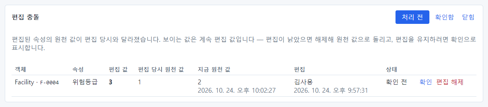
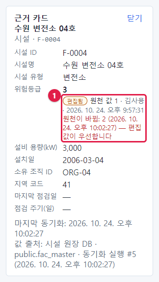
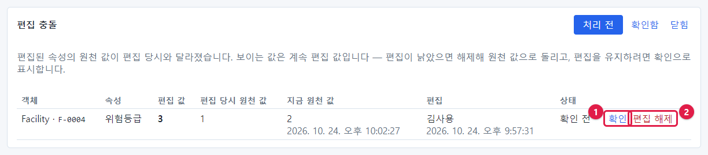
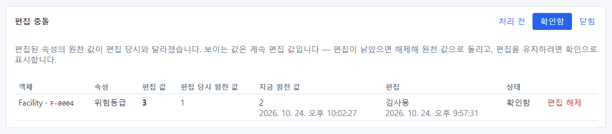
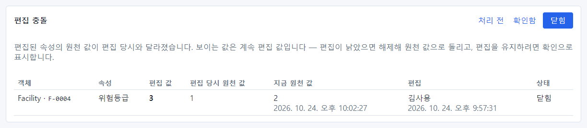
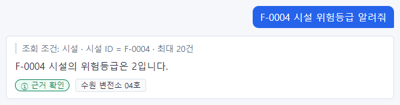
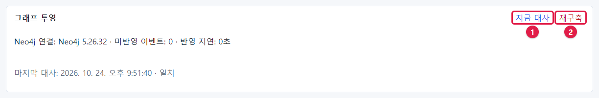

# 19장 모델러: 편집 충돌과 그래프 투영

## 19.1 편집 충돌이란

Action 으로 값을 바꾸면 OntoBot 안의 편집 레이어에 기록되고, 원래 시스템의 값은 그대로입니다(「9장」). 그런데
그 뒤 원래 시스템의 값도 바뀌면, 두 값이 엇갈립니다. 이것을 **편집 충돌** 이라고 합니다.

실제 예: 수원 변전소 04호(F-0004)의 위험등급은 원래 1이었고, Action 으로 3이 되었습니다(「12장」). 그 뒤 원래
시스템(시설 원장 DB)에서 위험등급이 2로 고쳐졌고, 동기화로 들어왔습니다.

| 값 | 무엇 |
| --- | --- |
| 3 | 편집 값(Action 으로 바꾼 값) |
| 1 | 편집 당시 원천 값 |
| 2 | 지금 원천 값(새로 동기화된 값) |

## 19.2 충돌 알아보기

### 데이터 소스 화면의 편집 충돌 칸

동기화가 끝나면 **편집 충돌** 칸의 **처리 전** 목록에 나타납니다.

| 칸 | 이 충돌 |
| --- | --- |
| 객체 | Facility · F-0004 |
| 속성 | 위험등급 |
| 편집 값 | **3** |
| 편집 당시 원천 값 | 1 |
| 지금 원천 값 | 2 (동기화 시각) |
| 편집 | 김사용 (편집 시각) — 그 편집을 만든 요청 |
| 상태 | 확인 전 |

### 채팅과 근거 카드

충돌이 있어도 화면에는 계속 **편집 값** 이 보입니다. 채팅으로 물으면 3이라고 답합니다.

근거 카드에는 빨간 글씨로 "원천이 바뀜: 2 (시각) — 편집 값이 우선합니다"가 보입니다(①). 사용자도 충돌을 알 수
있습니다.

## 19.3 충돌 처리: 확인 또는 편집 해제

충돌 줄 오른쪽에 단추가 둘 있습니다.

| 번호 | 단추 | 뜻 | 언제 |
| --- | --- | --- | --- |
| ① | **확인** | 충돌을 확인했고 **편집 값을 계속 쓴다** | Action 으로 바꾼 값이 여전히 옳을 때(원천이 늦게 따라오는 중 등) |
| ② | **편집 해제** | 편집을 버리고 **원천 값으로 돌아간다** | 원천의 새 값이 옳을 때(편집이 낡았을 때) |

### 확인

**확인** 을 누르면 그 충돌은 **처리 전** 목록에서 빠지고 **확인함** 목록으로 갑니다. 화면의 값은 계속 편집 값(3)이고,
근거 카드의 표시는 "확인됨"으로 바뀝니다.

확인한 뒤에도 **편집 해제** 를 할 수 있습니다.

### 편집 해제

**편집 해제** 를 누르면 확인 창이 뜹니다: "편집을 해제하면 원천 값으로 돌아갑니다. 진행할까요?" — **확인**. 충돌은
**닫힘** 목록으로 가고, 상태가 "닫힘"이 됩니다.

이제 채팅으로 물으면 원천 값 2가 나오고, 근거 카드에 편집됨 표시가 없습니다.

> **알아 두기** 편집 해제는 롤백(「12장」)과 다릅니다. 롤백은 Action 실행 자체를 되돌리고 알림 받은 사람에게 정정을
> 보냅니다. 편집 해제는 값만 원천으로 돌리고 알림을 보내지 않습니다. 편집 해제는 모델러와 관리자가, 롤백은 승인
> 역할과 관리자가 합니다.

### 처리 기준

| 상황 | 처리 |
| --- | --- |
| 원천 담당자가 Action 결과를 반영해 같은 값으로 고침 | (충돌이 생기지 않음 — 같은 값이면 충돌 아님) |
| 원천이 다른 값으로 고쳐졌고 그 값이 맞음 | **편집 해제** |
| 원천 값이 낡았고 편집 값이 맞음 | **확인**, 원천 담당자에게 고쳐 달라고 요청 |
| 판단이 어려움 | 확인 전으로 두고 요청자·승인자와 상의 |

## 19.4 그래프 투영

시설–조직–지역 같은 **관계** 는 PostgreSQL(기록의 원본)에서 관계 전용 저장소(Neo4j)로 옮겨 두고 관계 질문에
씁니다. 이것을 **그래프 투영** 이라고 합니다. 데이터 소스 화면 맨 위 칸에서 상태를 봅니다.

| 표시 | 뜻 | 정상 |
| --- | --- | --- |
| Neo4j 연결 | 관계 저장소 버전. 연결이 안 되면 "Neo4j 에 연결할 수 없습니다" | 버전이 보임 |
| 미반영 이벤트 | 아직 관계 저장소에 옮기지 못한 변경 수 | 0 또는 작은 수 |
| 반영 지연 | 가장 오래된 미반영 변경이 기다린 시간 | 몇 초. 10분을 넘으면 경고 |
| 마지막 대사 · 일치 | 원본과 관계 저장소를 마지막으로 맞춰 본 결과 | 일치 |
| 어긋난 항목 · 참조 대상 없음 | 대사에서 찾은 차이 | 없음 |

오른쪽 단추 둘은 **관리자 전용** 입니다.

| 번호 | 단추 | 하는 일 |
| --- | --- | --- |
| ① | **지금 대사** | 원본과 관계 저장소를 지금 맞춰 봄 |
| ② | **재구축** | 관계 저장소를 비우고 원본에서 다시 만듦(확인 창). 그동안 관계 질문이 잠시 실패할 수 있음 |

> **주의** 지금 판에서는 이 두 단추가 모델러에게도 보이지만, 모델러가 누르면 실행되지 않습니다(안내도 나오지
> 않습니다). 실제로 이모델이 **지금 대사** 를 누른 뒤에도 마지막 대사 시각이 바뀌지 않았습니다. 대사·재구축이
> 필요하면 관리자에게 요청하세요.

관계 질문에 "관계 정보는 ○○ 기준입니다(그래프 반영 지연)"가 자주 보이거나 "관계 저장소 연결 불가"가 나오면 이
칸을 확인하고, 반영 지연이 길거나 연결이 안 되면 운영자에게 알리세요.

## 19.5 이 장의 핵심

> **요령**
>
> - 편집 충돌 = Action 으로 바꾼 뒤 원천 값도 바뀐 상태. 화면에는 계속 편집 값이 보입니다.
> - **확인**: 편집 값을 유지. **편집 해제**: 원천 값으로 돌아감.
> - 충돌은 **처리 전 · 확인함 · 닫힘** 으로 나누어 봅니다.
> - 그래프 투영 칸으로 관계 저장소의 연결·지연·대사 결과를 봅니다. 대사·재구축은 관리자 전용입니다.
