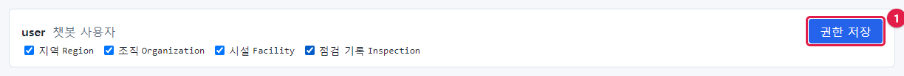
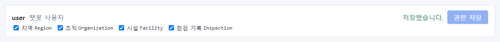

# 21장 관리자: 사용자·권한·감사 로그·트레이스

이 장은 관리자(`admin`)를 위한 장입니다. 관리자 박관리(`park.admin`)가 새 사용자를 만들고, 역할과 읽기 권한을
정하고, 기록을 확인합니다. 서버 설치·업그레이드·백업은 「시스템 운영자 매뉴얼」을 보세요.

## 21.1 관리 화면

맨 위 **관리** 메뉴를 누릅니다(관리자에게만 보임).

맨 위 상자는 지금 설치된 버전과 배포 콘솔 링크입니다.

- **지금 버전**: 설치된 OntoBot 버전(예제는 개발용이라 dev).
- **배포 콘솔 열기(업그레이드·롤백·백업)**: 운영자가 배포 콘솔 주소를 설정하면 링크가 보입니다. 설정하지 않으면
  "배포 콘솔 주소가 설정되지 않았습니다(ONTOBOT_DEPLOYER_URL)"가 보입니다.

아래에 탭 넷이 있습니다: **사용자** · **역할별 읽기 권한** · **감사 로그** · **트레이스**.

## 21.2 사용자 탭

### 사용자 표 읽기

| 칸 | 뜻 |
| --- | --- |
| 아이디 · 표시 이름 | 로그인 아이디와 화면에 보이는 이름 |
| 인증 | local(OntoBot 계정) 또는 oidc(회사 통합 로그인) |
| 역할 | 체크된 역할. 여기서 바로 바꿀 수 있음 |
| 상태 | 사용 / 정지, 그리고 **정지** · **다시 사용** 단추 |
| 알림 연락처 | 메일·휴대전화(가려서 보임)와 **고치기** |

표 위 안내: "역할을 바꾸거나 정지하면 그 사용자의 로그인 세션이 끊깁니다. 자기 계정은 정지하거나 관리자 역할을
뺄 수 없습니다."

### 로컬 계정 추가

새 직원 한신입에게 계정을 만들어 줍니다.

1. 표 아래 **▶ 로컬 계정 추가** 를 펼칩니다.
2. **아이디** `han.new`, **표시 이름** `한신입`, **초기 비밀번호(12자 이상)**, **역할** 에서 `user` 체크.

3. **추가** 를 누릅니다. 사용자 표에 한신입이 생깁니다.
4. 초기 비밀번호는 본인에게 안전한 방법으로 따로 알려 주세요(메신저 단체방·메일 본문 피하기).

> **알아 두기** 회사 통합 로그인(SSO)을 쓰면 처음 로그인한 사람의 계정이 자동으로 생깁니다(인증 oidc). 기본 역할은
> 설치 때 정한 값입니다. 필요한 역할을 여기서 더해 주세요.

### 역할 바꾸기

한신입에게 `bot_builder` 역할을 더합니다. 그 줄에서 `bot_builder` 를 체크하면 **역할 저장**(①)이 나타납니다.
눌러야 저장됩니다.

역할을 바꾸면 그 사용자의 로그인이 끊기고, 다시 로그인하면 바뀐 메뉴가 보입니다(「3장」).

> **요령** 역할은 업무에 꼭 필요한 것만 주세요(가장 작은 권한). 역할마다 할 수 있는 일은 「29장 역할별 권한표」에
> 정리했습니다.

### 정지와 다시 사용

퇴사·휴직·부서 이동으로 쓰지 않게 된 계정은 지우지 않고 **정지** 합니다. 기록(감사 로그, 요청 기록)이 그 사람
이름으로 남아 있어야 하기 때문입니다. **정지** 를 누르면 상태가 "정지"가 되고 단추가 **다시 사용** 으로 바뀝니다.

### 자기 계정

내 줄에는 **정지** 단추가 없고, admin 역할 체크를 뺄 수 없습니다. 관리자가 실수로 스스로를 잠가 아무도 관리할 수
없게 되는 것을 막습니다.

### 알림 연락처

Action 알림을 메일·SMS 로 받으려면 연락처가 있어야 합니다. 김사용의 **고치기** 를 누르면 **메일 주소** 와
**휴대전화(숫자와 -)** 칸이 나타납니다.

**저장** 하면 두 칸 모두 입력한 값으로 바뀝니다(비우면 지웁니다). 화면에는 가려서 보입니다:
"k\*\*\*@example.local · \*\*\*-1234".

## 21.3 역할별 읽기 권한 탭

역할마다 **읽을 수 있는 객체 타입** 을 고릅니다. 안내: "역할마다 읽을 수 있는 객체 타입을 고릅니다. 관리자 역할도
여기서 고르지 않으면 데이터를 읽지 못합니다."

예제에서는 user · modeler · bot_builder · admin 에 지역 · 조직 · 시설이 체크되어 있고, domain_expert 에는 아무것도
없습니다(그래서 최현업은 데이터를 물을 수 없었습니다 — 「8장 8.2」). 16장에서 새로 게시한 **점검 기록
Inspection** 은 아무 역할에도 체크되어 있지 않습니다.

`user` 역할에 점검 기록을 체크하면 **권한 저장**(①)이 진해집니다. 누르면 저장되고 "저장했습니다."가 보입니다.

> **주의** 읽기 권한은 그 역할을 가진 **모든 사람**에게 적용됩니다. 개인정보가 담긴 타입은 꼭 필요한 역할에만
> 주세요. 설계도에서 빠진 타입에 권한이 남아 있으면 "(게시본에 없음)"으로 보이니 정리하세요.

## 21.4 감사 로그 탭

로그인, 권한 변경, 사용자 변경, 설계도 게시, Action 실행 같은 중요한 일이 모두 기록됩니다. 최근 것이 위에 옵니다.
감사 로그는 **아무도 지우거나 고칠 수 없습니다.** 안내: "감사 로그 조회도 감사 로그에 남습니다."

| 칸 | 뜻 | 예 |
| --- | --- | --- |
| 시각 | 일이 일어난 시각 | |
| 이벤트 | 무슨 일 | security.permission_changed |
| 사용자 id | 한 사람의 번호(사용자 표 순서) | 3 = 박관리 |
| 대상 | 무엇에 대해 | role:user, app_user:6 |
| 내용 | 바뀌기 전·후 등(개인정보는 가려짐) | {"after":[…],"before":[…]} |

**이벤트로 거르기** 칸에 이벤트 이름을 넣으면 그 이벤트만 보입니다. 예: `action.executed`(Action 실행).

자주 찾는 이벤트:

| 이벤트 | 언제 |
| --- | --- |
| auth.login / auth.login_failed / auth.logout | 로그인 성공 / 실패 / 로그아웃 |
| security.user_created / security.role_changed / security.user_status_changed | 계정 생성 / 역할 변경 / 정지·다시 사용 |
| security.permission_changed | 읽기 권한 변경 |
| security.user_contacts_changed | 알림 연락처 변경 |
| security.audit_viewed / security.trace_viewed | 감사 로그 조회 / 트레이스 열람 |
| ontology.draft_created / draft_edited / draft_imported / version_published | 설계도 초안 만들기 / 고치기 / 임포트 / 게시 |
| action.previewed / action.executed / action.rejected / action.rolled_back | Action 요청 / 실행 / 거부 / 롤백 |
| objects.conflict_acknowledged / objects.edit_cleared | 편집 충돌 확인 / 편집 해제 |
| sync.source_changed / sync.mapping_changed / sync.manual_run | 데이터 소스·매핑 변경 / 손 동기화 |
| workshop.session_started / element_reviewed / submitted / published | 인터뷰 시작 / 후보 검토 / 제출 / 초안 게시 |
| eval.golden_changed / eval.run_started | 골든셋 변경 / 평가 실행 |

목록 아래 **더 보기** 로 오래된 기록을 이어서 봅니다.

## 21.5 트레이스 탭

**트레이스** 는 질문 한 건의 처리 기록입니다. 사용자가 "답이 이상하다"고 신고하면 원인을 찾는 데 씁니다. 안내:
"트레이스의 질문·계획·프롬프트는 마스킹돼 있습니다. 열어 본 기록이 감사 로그에 남습니다."

**트레이스 id** 를 넣고 **열기** 를 누릅니다.

아래는 8장에서 관계 저장소를 멈췄을 때 "강남지사가 소유한 시설 목록 보여줘"의 트레이스(#39)를 펼친 모습입니다.

| 부분 | 이 트레이스에서 | 읽는 법 |
| --- | --- | --- |
| 머리 | #39 · failed · graph_unavailable · 시각 | 결과와 실패 이유 |
| 계획 | target Facility, traverse owned_by → Organization(name eq 강남지사) | AI 가 세운 조회 계획 |
| attempts · rewrites | `owner_org_id eq ['강남지사'] → traverse owned_by.name` | AI 는 처음에 소유 조직 ID 칸에 이름 "강남지사"를 넣었고, 프로그램이 이름이 조직 이름과 정확히 같은 것을 보고 관계 조건으로 고쳤다 |
| 조회문 | MATCH … | 실제 실행한 관계 조회(값은 별도로 넘김) |
| 단계별 지연(ms) | planning 962, querying 9406 | 계획 0.96초, 조회 9.4초(관계 저장소가 응답하지 않아 기다림) |
| LLM 호출 | planner · gemma4:e4b · 957ms · 토큰 수 · 보낸 메시지 | AI 에게 무엇을 보냈고 무엇을 받았나 |

트레이스를 열면 감사 로그에 `security.trace_viewed` 로 남습니다(대상 trace:39).

> **알아 두기** 지금 판에서는 채팅 화면에 트레이스 id 가 보이지 않습니다. 신고를 받으면 사용자에게 **질문 시각과
> 질문 그대로** 를 받아, 운영자에게 그 시각의 트레이스 id 를 찾아 달라고 요청하세요(운영자는 서버 기록에서 찾을 수
> 있습니다).

## 21.6 관리자의 정기 점검

| 주기 | 할 일 |
| --- | --- |
| 매일 | Action 승인 대기 확인(「12장」), 알림함 확인 |
| 매주 | 감사 로그에서 auth.login_failed 가 몰린 계정 확인, 정지할 계정 확인 |
| 설계도 게시 때 | 새 객체 타입의 읽기 권한 정하기 |
| 사람이 들고 날 때 | 계정 만들기·정지, 역할 조정, 알림 연락처 |
| 신고가 올 때 | 트레이스로 원인 확인 → 모델러·운영자에게 전달 |

## 21.7 이 장의 핵심

> **요령**
>
> - 사용자: 로컬 계정 추가, 역할 체크 후 **역할 저장**, 안 쓰는 계정은 지우지 말고 **정지**.
> - 역할을 바꾸거나 정지하면 그 사람의 로그인이 끊깁니다. 자기 계정은 잠글 수 없습니다.
> - 역할별 읽기 권한: 새로 게시된 타입은 여기서 권한을 줘야 물을 수 있습니다.
> - 감사 로그는 지울 수 없고, 조회도 기록됩니다. 이벤트 이름으로 거릅니다.
> - 트레이스로 질문 한 건의 계획·조회·AI 호출·시간을 봅니다. 열람은 기록됩니다.
