# 21장 관리자: 사용자·권한·감사 로그·트레이스

이 장은 관리자(`admin`)를 위한 장입니다. 관리자 박관리(`park.admin`)가 새 사용자를 만들고, 역할과 읽기 권한을
정하고, 기록을 확인합니다. 서버 설치·업그레이드·백업은 「시스템 운영자 매뉴얼」을 보세요.

## 21.1 관리 화면

맨 위 **관리** 메뉴를 누릅니다(관리자에게만 보임).

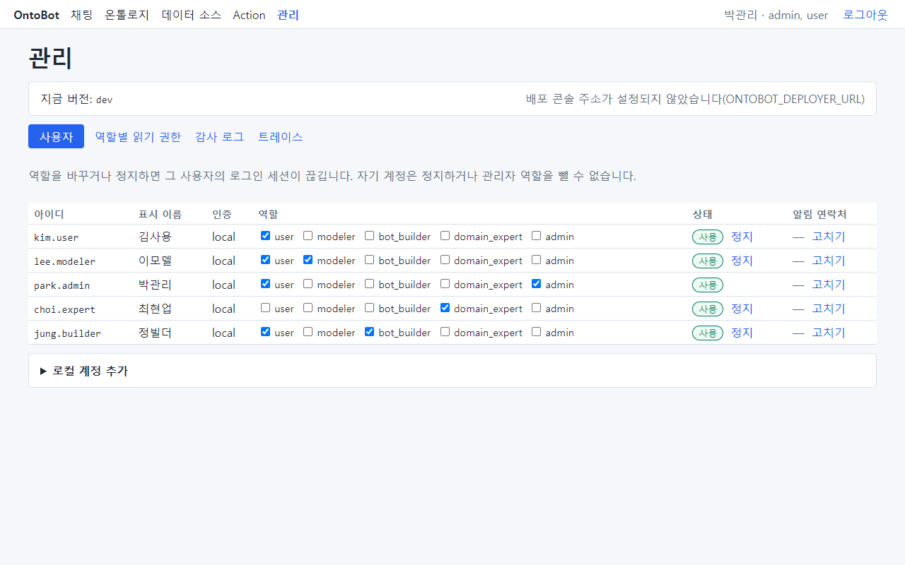

맨 위 상자는 지금 설치된 버전과 배포 콘솔 링크입니다.

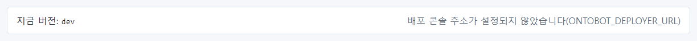

- **지금 버전**: 설치된 OntoBot 버전(예제는 개발용이라 dev).
- **배포 콘솔 열기(업그레이드·롤백·백업)**: 운영자가 배포 콘솔 주소를 설정하면 링크가 보입니다. 설정하지 않으면
  "배포 콘솔 주소가 설정되지 않았습니다(ONTOBOT_DEPLOYER_URL)"가 보입니다.

아래에 탭 넷이 있습니다: **사용자** · **데이터 그룹** · **감사 로그** · **트레이스**.

### 운영 지표와 성공 지표 목표

관리 화면 맨 위의 두 카드입니다.

- **운영 지표(최근 30일)**: Action 실행 성공률(실행 + 롤백 ÷ 실행 + 롤백 + 실패), 승인 거부율(요청자가 거둔 것은 빼고 셈),
  확인되지 않은 편집 충돌 수, 상태별 요청 수. 분모가 없으면 "—".
- **성공 지표 목표(PRD 7절)**: 지표마다 목표·지금 측정·판정(충족/미달)·근거. **목표 고치기** 로 값을 정하고 저장합니다.
  비율은 %로 넣고, 칸을 비우면 측정 근거가 있는 **제안값**(예: 정답률 90%, 동시 8명 P95 25초)으로 돌아가며, 근거가 없는
  지표는 **미정** 으로 남습니다. 바꾸면 감사 로그에 `ops.targets_changed` 가 남습니다.
  - 정답률·추정 비율·파라미터 정확도는 마지막 평가 실행(녹화 재생 제외), 조회 실패율·P95·주간 활성 사용자는 실제 질문
    트레이스(실패율은 실행 오류·시간 초과·저장소·LLM 장애만 — 해석 실패·권한 없음은 정상 동작이라 넣지 않음)에서 잽니다.
  - 이 목표는 평가 게이트 기준(`evaluation/gate.yaml`)을 바꾸지 않습니다. 게이트는 개발·배포 검사에서 같은 기준으로 돕니다.
- **객체 탐색 확장 한도**: 객체 탐색 화면의 최대 깊이(1~5, 기본 3)와 화면 노드 수(10~1000, 기본 200). 서버도 이웃 조회를
  같은 노드 수로 자릅니다. 바꾸면 감사 로그에 `ops.explorer_limits_changed` 가 남습니다. 이웃 조회 한 번마다
  `objects.explored` 도 남습니다(대량으로 훑는 경로를 추적하려고).

## 21.2 사용자 탭

### 사용자 표 읽기

| 칸 | 뜻 |
| --- | --- |
| 아이디 · 표시 이름 | 로그인 아이디와 화면에 보이는 이름 |
| 인증 | local(OntoBot 계정) 또는 oidc(회사 통합 로그인) |
| 역할 | 체크된 역할. 여기서 바로 바꿀 수 있음 |
| 상태 | 사용 / 정지, 그리고 **정지** · **다시 사용** 단추 |
| 알림 연락처 | 메일·휴대전화(가려서 보임)와 **고치기** |

표 위 안내: "역할을 바꾸거나 정지하면 그 사용자의 로그인 세션이 끊깁니다. 자기 계정은 정지하거나 관리자 역할을
뺄 수 없습니다."

### 로컬 계정 추가

새 직원 한신입에게 계정을 만들어 줍니다.

1. 표 아래 **▶ 로컬 계정 추가** 를 펼칩니다.
2. **아이디** `han.new`, **표시 이름** `한신입`, **초기 비밀번호(12자 이상)**, **역할** 에서 `user` 체크.

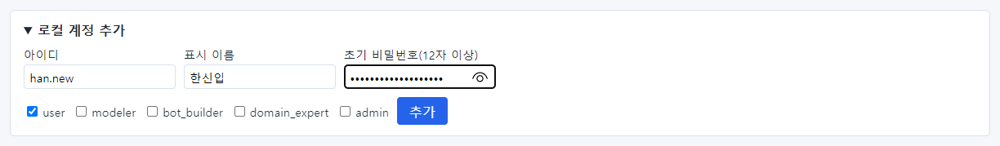

3. **추가** 를 누릅니다. 사용자 표에 한신입이 생깁니다.
4. 초기 비밀번호는 본인에게 안전한 방법으로 따로 알려 주세요(메신저 단체방·메일 본문 피하기).

> **알아 두기** 회사 통합 로그인(SSO)을 쓰면 처음 로그인한 사람의 계정이 자동으로 생깁니다(인증 oidc). 기본 역할은
> 설치 때 정한 값입니다. 필요한 역할을 여기서 더해 주세요.

### 역할 바꾸기

한신입에게 `bot_builder` 역할을 더합니다. 그 줄에서 `bot_builder` 를 체크하면 **역할 저장**(①)이 나타납니다.
눌러야 저장됩니다.

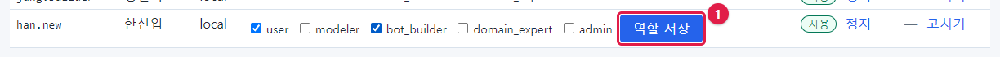

역할을 바꾸면 그 사용자의 로그인이 끊기고, 다시 로그인하면 바뀐 메뉴가 보입니다(「3장」).

> **요령** 역할은 업무에 꼭 필요한 것만 주세요(가장 작은 권한). 역할마다 할 수 있는 일은 「29장 역할별 권한표」에
> 정리했습니다.

### 정지와 다시 사용

퇴사·휴직·부서 이동으로 쓰지 않게 된 계정은 지우지 않고 **정지** 합니다. 기록(감사 로그, 요청 기록)이 그 사람
이름으로 남아 있어야 하기 때문입니다. **정지** 를 누르면 상태가 "정지"가 되고 단추가 **다시 사용** 으로 바뀝니다.

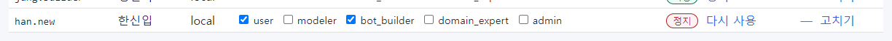

### 자기 계정

내 줄에는 **정지** 단추가 없고, admin 역할 체크를 뺄 수 없습니다. 관리자가 실수로 스스로를 잠가 아무도 관리할 수
없게 되는 것을 막습니다.

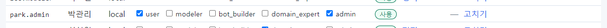

### 알림 연락처

Action 알림을 메일·SMS 로 받으려면 연락처가 있어야 합니다. 김사용의 **고치기** 를 누르면 **메일 주소** 와
**휴대전화(숫자와 -)** 칸이 나타납니다.

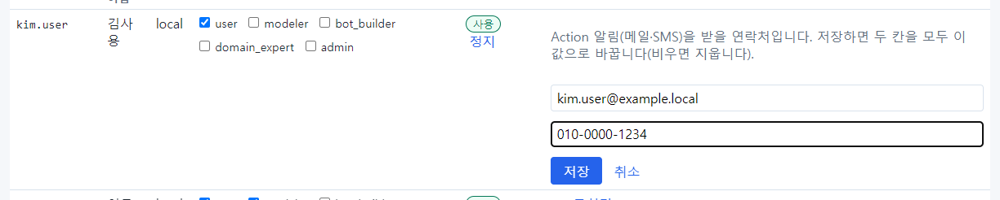

**저장** 하면 두 칸 모두 입력한 값으로 바뀝니다(비우면 지웁니다). 화면에는 가려서 보입니다:
"k\*\*\*@example.local · \*\*\*-1234".

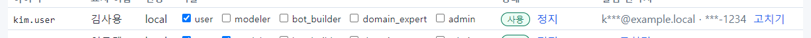

## 21.3 데이터 그룹 탭

**역할은 화면·기능, 데이터 권한은 그룹이 줍니다.** 사용자가 읽고·만들고·고치고·지울 수 있는 데이터는 속한 그룹
권한을 모두 합친 것입니다(거부 규칙은 없습니다). 그룹마다 카드 하나가 있습니다.

| 카드의 부분 | 뜻 |
| --- | --- |
| 이름 · `name` · **SSO …** | 표시 이름, 그룹 이름. SSO 표시가 있으면 SSO 로그인 때 그룹 클레임에 그 값이 있는 사용자가 자동으로 구성원이 됩니다(정확 일치) |
| **구성원 n명** | 펼쳐서 사용자를 체크하고 **구성원 저장**. 저장은 체크한 사람으로 **바꿉니다** |
| 객체 타입 × **읽기·생성·편집·삭제** | 체크하고 **권한 저장**. 쓰기(생성·편집·삭제)를 켜면 읽기도 켜집니다 |
| **연결할 수 있는 링크** | 링크를 만들고 끊는 권한(데이터 그래프 편집에서 씁니다) |

- **읽기** 가 없는 타입은 그 사람의 챗봇에게 존재 자체가 보이지 않습니다.
- **Action 을 요청하려면 대상 타입의 '편집'** 이 필요합니다. 읽기만 있으면 Action 화면에서 요청 단추가 꺼지고, 채팅도
  Action 을 제안하지 않습니다. 승인은 Action 정의의 승인 역할이 정합니다.
- 생성·삭제·연결은 지금은 저장만 되고, 데이터 그래프 편집(다음 단계)에서 쓰입니다.
- 타입 행 끝의 **제한 없음/제한 있음** 을 누르면 속성·행 제한을 정합니다(읽기를 켠 타입만).
  - **숨길 속성**: 체크한 속성은 이 그룹 구성원에게 없는 속성이 됩니다(채팅·근거 카드 모두). 단 같은 사람이 속한 다른
    그룹이 그 속성을 보여 주면 보입니다 — 모든 그룹이 숨겨야 숨겨집니다. pk·제목 속성은 숨길 수 없습니다.
  - **읽기 행 정책**: 조건을 만족하는 객체만 보입니다(목록·개수·관계·계산 모두). 예: `[{"property":"facility_type","op":"eq","value":"철탑"}]`.
    비우면 제한 없음. 같은 사람이 정책 없는 그룹에도 속하면 제한이 없습니다.
  - **쓰기 행 정책**: Action 을 요청할 수 있는 대상 객체를 제한합니다(승인 때 다시 확인).
  - 조건이 틀리면 저장이 거부됩니다. 실행 때 정책이 깨져 있으면(예: 속성이 지워짐) 그 정책은 **아무 행도 보여 주지 않는
    쪽**으로 동작합니다.
- 새 사용자는 **사용자 → 로컬 계정 추가** 에서 그룹을 함께 고를 수 있습니다. 사용자 표의 **데이터 그룹** 칸에 소속이 보입니다.
- 업그레이드하면 예전 "역할별 읽기 권한" 이 **같은 이름의 그룹** 으로 옮겨집니다(그 역할 사용자 = 구성원, 읽던 타입 =
  읽기·편집). 그 뒤 조직에 맞게 그룹을 새로 만들고 정리하세요.
- 그룹 추가·구성원·권한 변경은 감사 로그(`security.group_changed`·`group_members_changed`·`permission_changed`)에 남습니다.

> 사진은 이전 화면("역할별 읽기 권한")입니다. 다시 찍으면 바뀝니다.

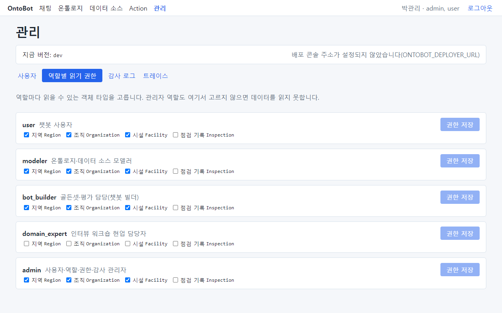

## 21.4 감사 로그 탭

로그인, 권한 변경, 사용자 변경, 설계도 게시, Action 실행 같은 중요한 일이 모두 기록됩니다. 최근 것이 위에 옵니다.
감사 로그는 **아무도 지우거나 고칠 수 없습니다.** 안내: "감사 로그 조회도 감사 로그에 남습니다."

맨 위 **해시 체인 검증** 을 누르면 감사 로그가 사슬처럼 이어져 있는지(중간에 바뀌거나 지워진 기록이 없는지) 확인합니다.
"정상 — n행"이면 문제없습니다. "끊김"이 나오면 **고치지 말고** 운영자에게 알리세요 — 끊긴 순번과 이유(내용이 바뀜·중간
삭제·마지막 행이 사라짐 등)를 함께 전합니다. 매일 자동으로도 검증합니다.

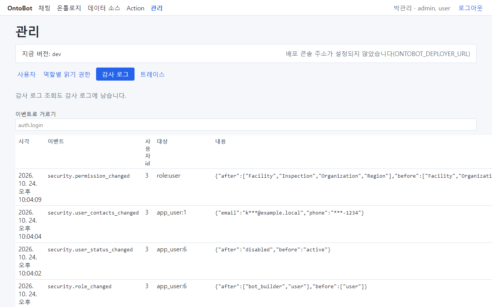

| 칸 | 뜻 | 예 |
| --- | --- | --- |
| 시각 | 일이 일어난 시각 | |
| 이벤트 | 무슨 일 | security.permission_changed |
| 사용자 id | 한 사람의 번호(사용자 표 순서) | 3 = 박관리 |
| 대상 | 무엇에 대해 | role:user, app_user:6 |
| 내용 | 바뀌기 전·후 등(개인정보는 가려짐) | {"after":[…],"before":[…]} |

**이벤트로 거르기** 칸에 이벤트 이름을 넣으면 그 이벤트만 보입니다. 예: `action.executed`(Action 실행).

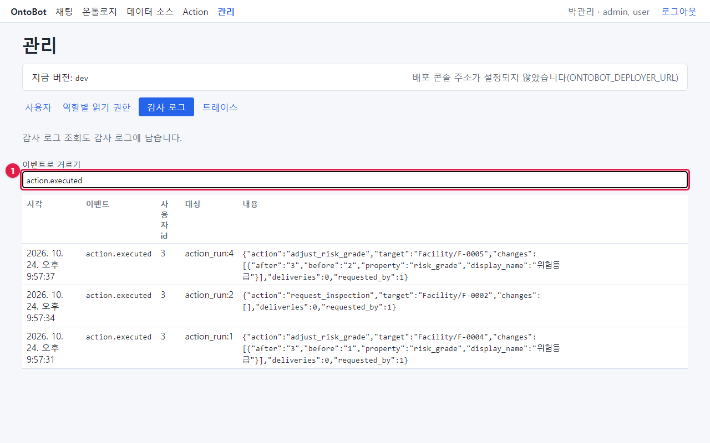

자주 찾는 이벤트:

| 이벤트 | 언제 |
| --- | --- |
| auth.login / auth.login_failed / auth.logout | 로그인 성공 / 실패 / 로그아웃 |
| security.user_created / security.role_changed / security.user_status_changed | 계정 생성 / 역할 변경 / 정지·다시 사용 |
| security.permission_changed | 읽기 권한 변경 |
| security.user_contacts_changed | 알림 연락처 변경 |
| security.audit_viewed / security.trace_viewed | 감사 로그 조회 / 트레이스 열람 |
| ontology.draft_created / draft_edited / draft_imported / version_published | 설계도 초안 만들기 / 고치기 / 임포트 / 게시 |
| action.previewed / action.executed / action.rejected / action.rolled_back | Action 요청 / 실행 / 거부 / 롤백 |
| objects.conflict_acknowledged / objects.edit_cleared | 편집 충돌 확인 / 편집 해제 |
| sync.source_changed / sync.mapping_changed / sync.manual_run | 데이터 소스·매핑 변경 / 손 동기화 |
| workshop.session_started / element_reviewed / submitted / published | 인터뷰 시작 / 후보 검토 / 제출 / 초안 게시 |
| eval.golden_changed / eval.run_started | 골든셋 변경 / 평가 실행 |

목록 아래 **더 보기** 로 오래된 기록을 이어서 봅니다.

## 21.5 트레이스 탭

**트레이스** 는 질문 한 건의 처리 기록입니다. 사용자가 "답이 이상하다"고 신고하면 원인을 찾는 데 씁니다. 안내:
"트레이스의 질문·계획·프롬프트는 마스킹돼 있습니다. 열어 본 기록이 감사 로그에 남습니다."

**트레이스 id** 를 넣고 **열기** 를 누릅니다.

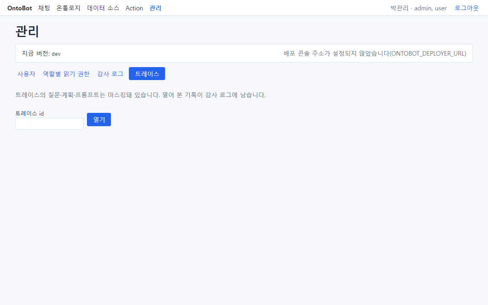

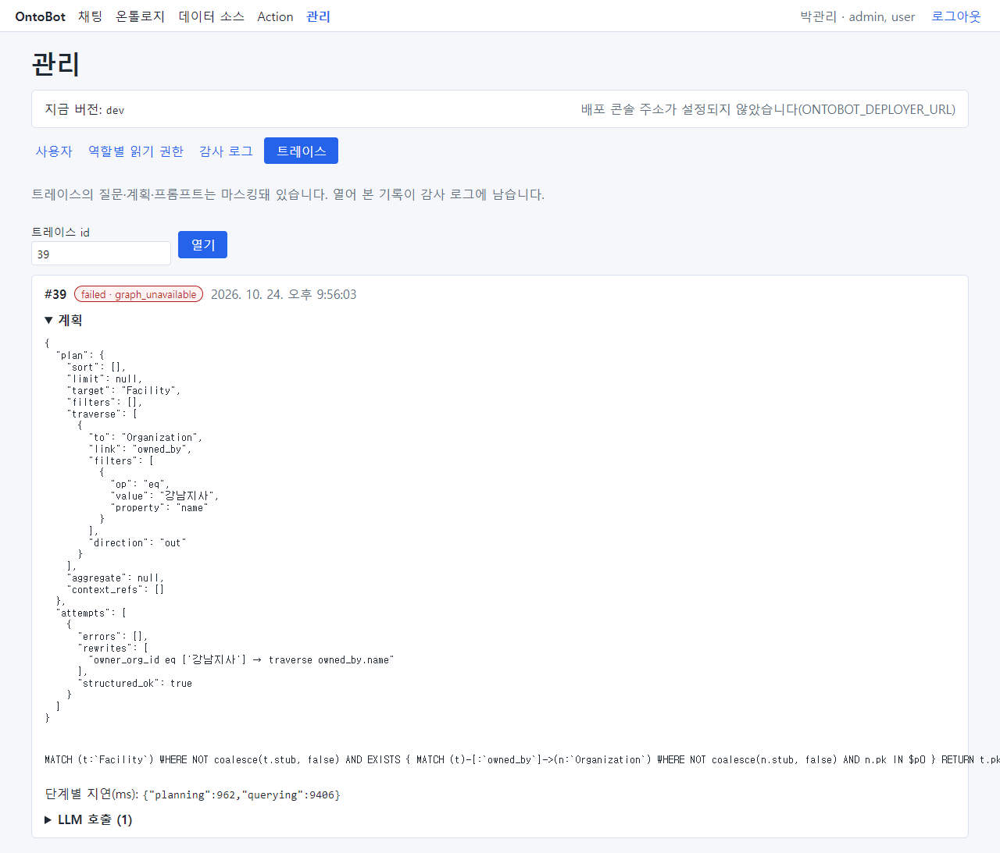

아래는 8장에서 관계 저장소를 멈췄을 때 "강남지사가 소유한 시설 목록 보여줘"의 트레이스(#39)를 펼친 모습입니다.

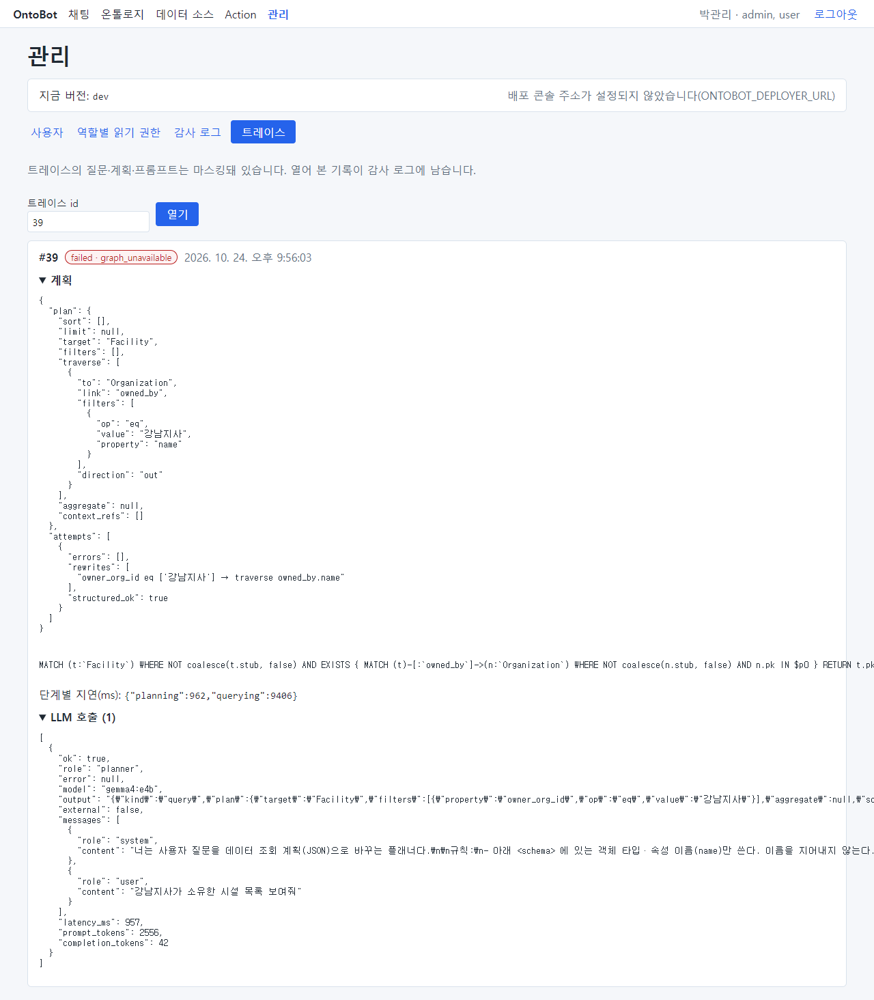

| 부분 | 이 트레이스에서 | 읽는 법 |
| --- | --- | --- |
| 머리 | #39 · failed · graph_unavailable · 시각 | 결과와 실패 이유 |
| 계획 | target Facility, traverse owned_by → Organization(name eq 강남지사) | AI 가 세운 조회 계획 |
| attempts · rewrites | `owner_org_id eq ['강남지사'] → traverse owned_by.name` | AI 는 처음에 소유 조직 ID 칸에 이름 "강남지사"를 넣었고, 프로그램이 이름이 조직 이름과 정확히 같은 것을 보고 관계 조건으로 고쳤다 |
| 조회문 | MATCH … | 실제 실행한 관계 조회(값은 별도로 넘김) |
| 단계별 지연(ms) | planning 962, querying 9406 | 계획 0.96초, 조회 9.4초(관계 저장소가 응답하지 않아 기다림) |
| LLM 호출 | planner · gemma4:e4b · 957ms · 토큰 수 · 보낸 메시지 | AI 에게 무엇을 보냈고 무엇을 받았나 |

트레이스를 열면 감사 로그에 `security.trace_viewed` 로 남습니다(대상 trace:39).

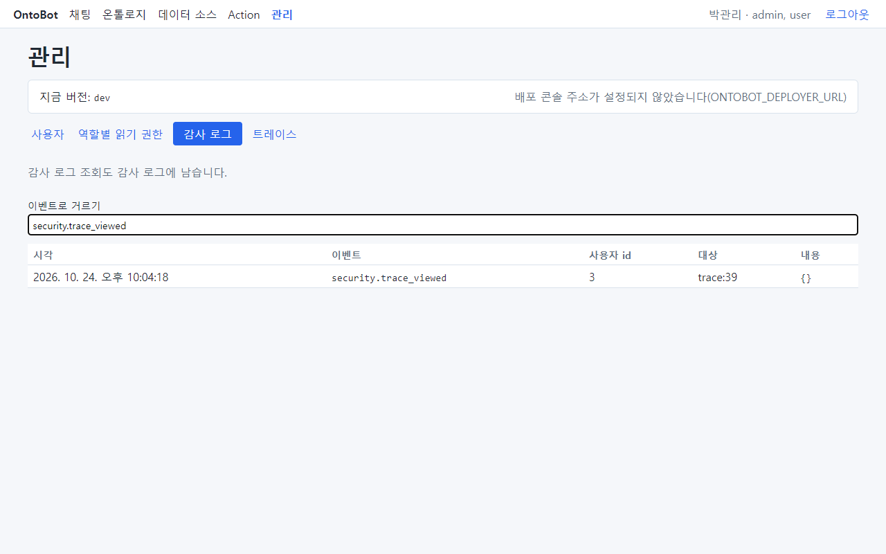

> **알아 두기** 지금 판에서는 채팅 화면에 트레이스 id 가 보이지 않습니다. 신고를 받으면 사용자에게 **질문 시각과
> 질문 그대로** 를 받아, 운영자에게 그 시각의 트레이스 id 를 찾아 달라고 요청하세요(운영자는 서버 기록에서 찾을 수
> 있습니다).

## 21.6 관리자의 정기 점검

| 주기 | 할 일 |
| --- | --- |
| 매일 | Action 승인 대기 확인(「12장」), 알림함 확인 |
| 매주 | 감사 로그에서 auth.login_failed 가 몰린 계정 확인, 정지할 계정 확인 |
| 설계도 게시 때 | 새 객체 타입의 읽기 권한 정하기 |
| 사람이 들고 날 때 | 계정 만들기·정지, 역할 조정, 알림 연락처 |
| 신고가 올 때 | 트레이스로 원인 확인 → 모델러·운영자에게 전달 |

## 21.7 이 장의 핵심

> **요령**
>
> - 사용자: 로컬 계정 추가, 역할 체크 후 **역할 저장**, 안 쓰는 계정은 지우지 말고 **정지**.
> - 역할을 바꾸거나 정지하면 그 사람의 로그인이 끊깁니다. 자기 계정은 잠글 수 없습니다.
> - 데이터 그룹 권한: 새로 게시된 타입은 여기서 권한을 줘야 물을 수 있습니다.
> - 감사 로그는 지울 수 없고, 조회도 기록됩니다. 이벤트 이름으로 거릅니다.
> - 트레이스로 질문 한 건의 계획·조회·AI 호출·시간을 봅니다. 열람은 기록됩니다.
