# 22장 업무 시나리오: 처음부터 끝까지 따라 하기

앞 장들은 기능별로 설명했습니다. 이 장은 실제 업무 하루를 따라가며 여러 기능을 이어서 씁니다. 각 시나리오는
처음부터 끝까지 실제로 실행한 화면입니다. 내 업무와 비슷한 시나리오를 골라 따라 해 보세요.

| 시나리오 | 누가 | 쓰는 기능 | 걸리는 시간 |
| --- | --- | --- | --- |
| 22.1 월요일 아침: 위험 시설 현황과 점검 요청 | 사용자 | 개수·목록·이어서 묻기·Action 요청 | 5분 |
| 22.2 지사별 보고 자료 만들기 | 사용자 | 관계 질문·묶어 세기·순위 | 5분 |
| 22.3 점검 결과 반영하기 | 사용자 → 승인자 | Action 화면·승인·근거 카드 | 5분 |
| 22.4 "답이 이상해요" 신고 처리 | 사용자 → 관리자 → 모델러 → 빌더 | 조회 조건·트레이스·평가 | 30분 |
| 22.5 조직 데이터 연결하기 | 모델러 → 사용자 | 매핑·동기화·값 출처 | 10분 |
| 22.6 새 직원 맞이하기 | 관리자 | 계정·역할·읽기 권한·연락처 | 5분 |
| 22.7 워크숍 질문으로 정기 품질 점검 | 챗봇 빌더 | 골든셋 다듬기·평가 | 10분 |
| 22.8 원래 시스템 값이 바뀌었을 때 | 모델러 | 편집 충돌 | 5분 |

## 22.1 월요일 아침: 위험 시설 현황과 점검 요청

**상황** 김사용은 매주 월요일 아침, 위험등급이 높은 시설을 확인하고 부산지사 시설 중 점검이 필요한 곳에 점검을
요청합니다. 새 대화를 열고 차례로 묻습니다.

**1. 전체 규모 파악** — `위험등급이 4 이상인 시설은 몇 개야?`

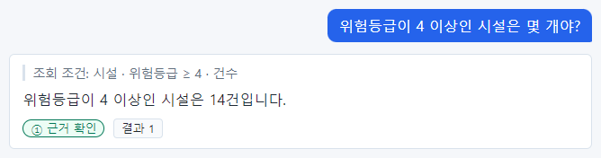

조회 조건 "시설 · 위험등급 ≥ 4 · 건수", 14건. 조건이 맞으니 14건을 믿습니다.

**2. 목록 보기** — `위험등급이 4 이상인 시설 목록 보여줘`

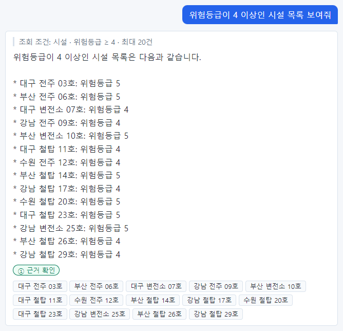

14곳이 모두 나왔습니다(20건 이하이므로 빠짐없이). 이 목록이 다음 질문의 "그 중"이 됩니다.

**3. 좁히기** — `그 중 부산지사가 소유한 것만`


조회 조건 "시설 · 직전 결과 14건 중 · 소유 조직[조직: 조직명 = 부산지사] · 최대 20건"은 맞게 이해했습니다. 그런데
등급이 **③ 근거 부족** 입니다. AI 가 근거와 맞는 답 문장을 만들지 못해, 본문 대신 "조회 결과에서 근거를 확인할 수
있는 답을 만들지 못했습니다. … 아래 근거 목록에서 직접 확인해 주세요."가 나왔습니다.

이럴 때는 당황하지 말고, 조회 조건이 맞는지 확인한 뒤 다음 질문으로 이어 가거나 같은 질문을 다시 해 봅니다.
조회 자체는 성공했으므로 "그 중"이 가리킬 목록(부산지사 소유 4곳)은 만들어져 있습니다.

**4. 이어서 묻기** — `그 시설들 설치일 알려줘`

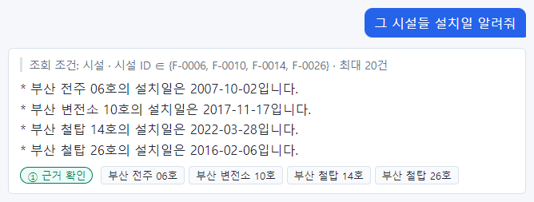

조회 조건 "시설 · 시설 ID ∈ {F-0006, F-0010, F-0014, F-0026}". 3단계 결과의 4곳을 정확히 가리켰고, 이번에는
① 로 답했습니다. 부산 전주 06호(2007년), 부산 변전소 10호(2017년), 부산 철탑 14호(2022년), 부산 철탑 26호(2016년).

**5. 점검 요청** — `부산 철탑 26호 긴급 점검 요청해줘`

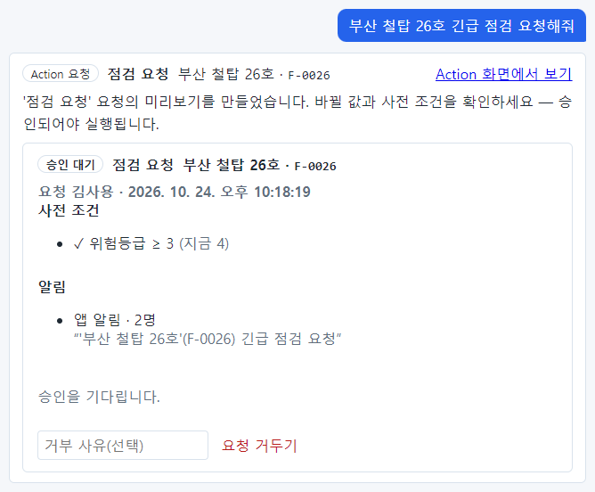

사전 조건 ✓ 위험등급 ≥ 3(지금 4), 알림 2명, 상태 **승인 대기**. 승인자가 승인하면 관리자와 현업 전문가에게 앱
알림이 갑니다.

대화 전체입니다.

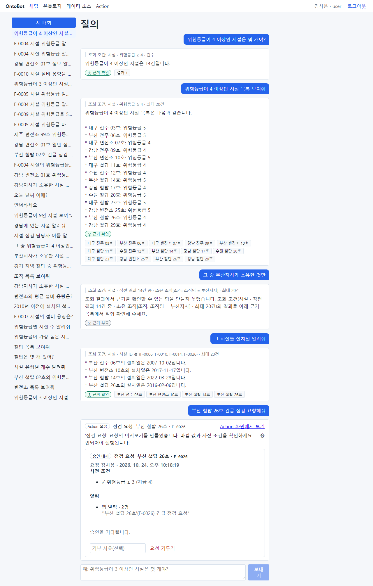

> **요령** 큰 범위(개수) → 목록 → "그 중"으로 좁히기 → 필요한 정보 → 요청. 이 순서를 쓰면 매 단계의 조회 조건을
> 확인하며 안전하게 좁혀 갈 수 있습니다.

## 22.2 지사별 보고 자료 만들기

**상황** 김사용은 월간 보고서에 지사별 시설 수, 시설 유형별 위험 수준, 노후 시설을 넣어야 합니다.

**1~4. 지사별 시설 수** — 지사마다 같은 모양으로 묻습니다.

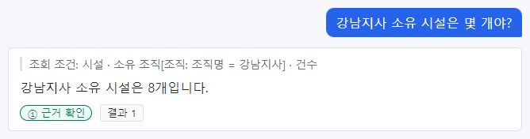


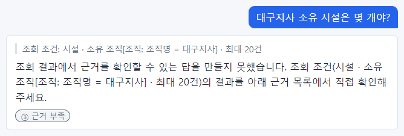

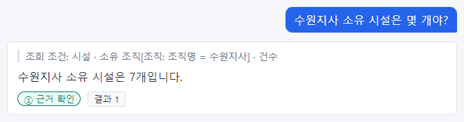

강남·부산·수원은 조회 조건이 "시설 · 소유 조직[조직: 조직명 = ○○지사] · **건수**"로 8개, 8개, 7개입니다. 그런데
**대구지사** 는 같은 모양으로 물었는데도 조회 조건 끝이 "건수"가 아니라 "**최대 20건**"(목록 조회)이었고, 등급이 ③
근거 부족이라 숫자가 나오지 않았습니다. 같은 모양의 질문도 이렇게 다르게 이해될 수 있습니다.

이럴 때는 다시 묻거나(`대구지사 소유 시설 수를 세어줘`), 다른 값으로 거꾸로 확인합니다. 시설은 모두 30곳이므로
30 − (8 + 8 + 7) = 7, 대구지사는 7개입니다. 보고서의 숫자는 이렇게 **합을 맞춰 보는 것**만으로도 많은 실수를 잡을 수
있습니다.

> **알아 두기** "소유 조직별 시설 수는?"처럼 한 번에 물으면 편하겠지만, 이 질문은 조직을 세는 것으로 잘못
> 이해된 적이 있습니다(「25장」). 보고서처럼 정확해야 하는 숫자는 지사마다 따로 묻고 합을 확인하는 편이 안전합니다.

**5. 유형별 위험 수준** — `시설 유형별 평균 위험등급은?`

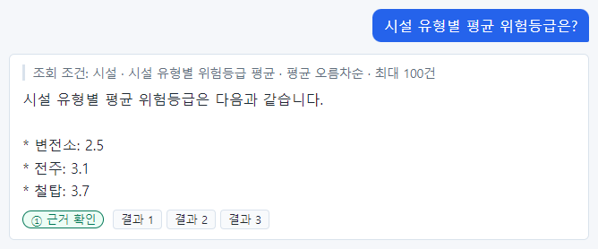

변전소 2.5, 전주 3.1, 철탑 3.7. 평균은 서버가 계산하고 반올림합니다.

**6. 노후 시설** — `가장 오래된 시설 5개 보여줘`

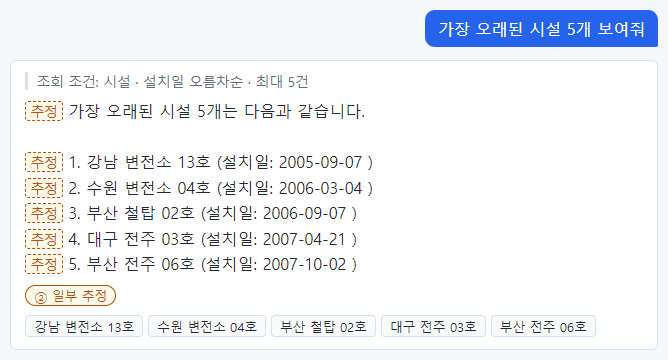

조회 조건 "시설 · 설치일 오름차순 · 최대 5건". 등급 ② 는 순번과 첫 문장이 추정으로 표시되었기 때문입니다. 시설명과
설치일은 근거 칩으로 확인할 수 있습니다.

보고서에 옮길 때는 숫자마다 그 질문의 조회 조건을 함께 적어 두면, 나중에 누가 같은 숫자를 다시 확인할 수 있습니다.

## 22.3 점검 결과 반영하기(요청 → 승인 → 확인)

**상황** 대구 철탑 11호(F-0011)의 보수 공사가 끝나 위험등급을 4에서 3으로 낮춥니다.

**1. 요청(김사용)** — **Action** 화면에서 위험등급 조정, 대상 F-0011, 새 위험등급 3, 사유 "보수 공사 완료"로
**미리보기**.

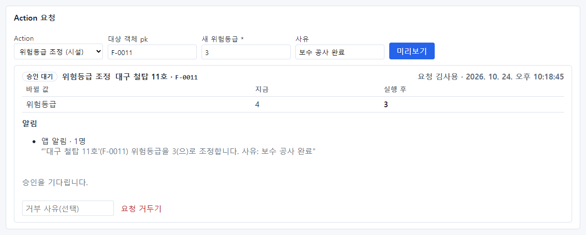

**2. 승인(박관리)** — **승인 대기** 탭에서 요청을 펼쳐 바뀔 값(4 → 3)과 사유를 확인합니다.

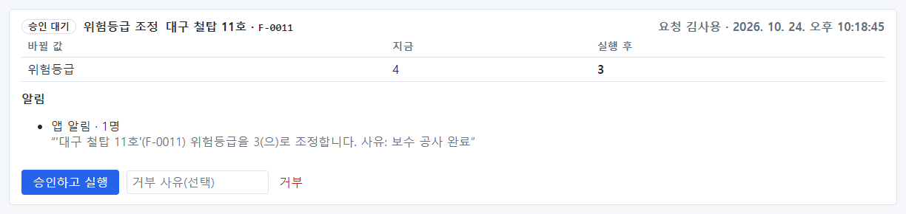

**승인하고 실행** 을 누르면 실행됩니다.

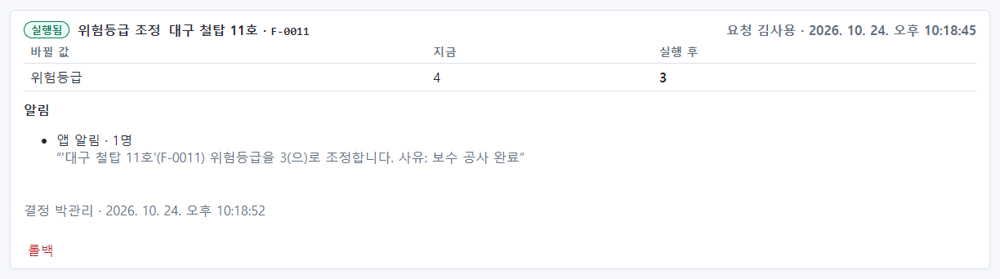

**3. 확인(김사용)** — 채팅으로 `대구 철탑 11호 위험등급 알려줘`.

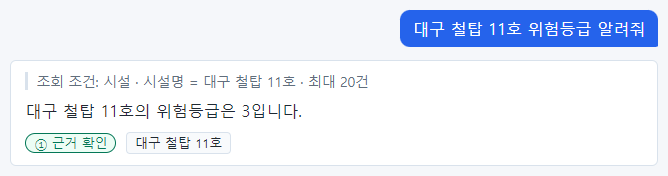

근거 카드에 위험등급 3, **편집됨** · 원천 값 4 · 요청자와 시각이 보입니다. 값 출처는 시설 원장 DB 입니다.

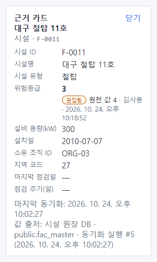

> **알아 두기** 원래 시스템(시설 원장 DB)의 위험등급은 여전히 4입니다. 원래 시스템 담당자도 3으로 고치면, 다음 동기화
> 때 원천 값과 편집 값이 같아집니다. 담당자가 다른 값으로 고치면 편집 충돌이 생깁니다(22.8).

## 22.4 "답이 이상해요" 신고 처리

**상황** 사용자가 "위험등급이 5인 전주를 물었는데 3건이라고 나와요. 제가 알기로는 2건이에요."라고 신고했습니다. 이
책 6장에서 실제로 일어난 일입니다. 여러 역할이 함께 처리합니다.

| 단계 | 누가 | 할 일 | 참고 |
| --- | --- | --- | --- |
| 1 | 사용자 | 질문 그대로, 시각, 화면 사진(조회 조건이 보이게)을 관리자에게 보냄 | 「27장 27.9」 |
| 2 | 관리자 | 사진의 조회 조건을 본다: "시설 유형 = 철탑" — 질문(전주)과 다름. 잘못 이해한 경우로 판단 | 「8장 8.1」 |
| 3 | 관리자 | 필요하면 운영자에게 그 시각의 트레이스 id 를 받아 **트레이스** 로 계획과 AI 호출을 확인 | 「21장 21.5」 |
| 4 | 관리자 | 사용자에게 임시 방법 안내: "시설 유형이 전주이고 위험등급이 5인 시설은 몇 개야?"처럼 묻기 | 「6장」 |
| 5 | 모델러 | 설계도의 시설 유형 설명·enum 값 표시를 다듬어 다시 게시 | 「16장」 |
| 6 | 챗봇 빌더 | 그 질문을 골든셋 문항으로 추가(기대 ok, 필수 값 2)하고 평가를 돌려 감시 | 「20장」 m04 |
| 7 | 챗봇 빌더 | 고친 뒤에도 틀리면 질문·결과를 개발팀에 전달 | |

> **요령** 신고된 질문은 반드시 골든셋에 넣으세요. 고쳤다고 생각한 문제가 나중에 다시 생기는지 평가가 알려 줍니다.
> 실제로 이 질문은 한 번은 틀리고 한 번은 맞았습니다 — 한 번의 확인으로는 부족합니다.

## 22.5 조직 데이터 연결하기

**상황** 조직(지사)의 담당자 정보도 원래 시스템(org_master 표)에서 가져오기로 했습니다. 모델러 이모델이 매핑을 더합니다.

**1. 매핑 추가** — **데이터 소스** → **▶ 매핑 추가**: 데이터 소스 "시설 원장 DB", 객체 타입 "조직 (Organization)",
원천 표 `public.org_master` → **열 불러오기**. 원천 열을 짝짓습니다.

| 속성 | 원천 열 |
| --- | --- |
| 조직 ID org_id (pk) | org_id(이름이 같아 미리 골라짐) |
| 조직명 name | org_name |
| 담당자 manager_name | manager |
| 담당자 연락처 manager_phone | phone |

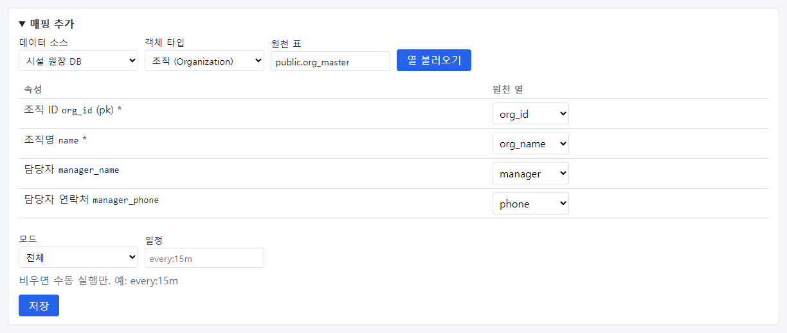

**2. 동기화** — **저장** → **지금 동기화**. 읽음 4.

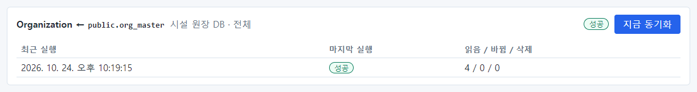

매핑 칸에는 이제 시설과 조직 두 매핑이 있습니다.

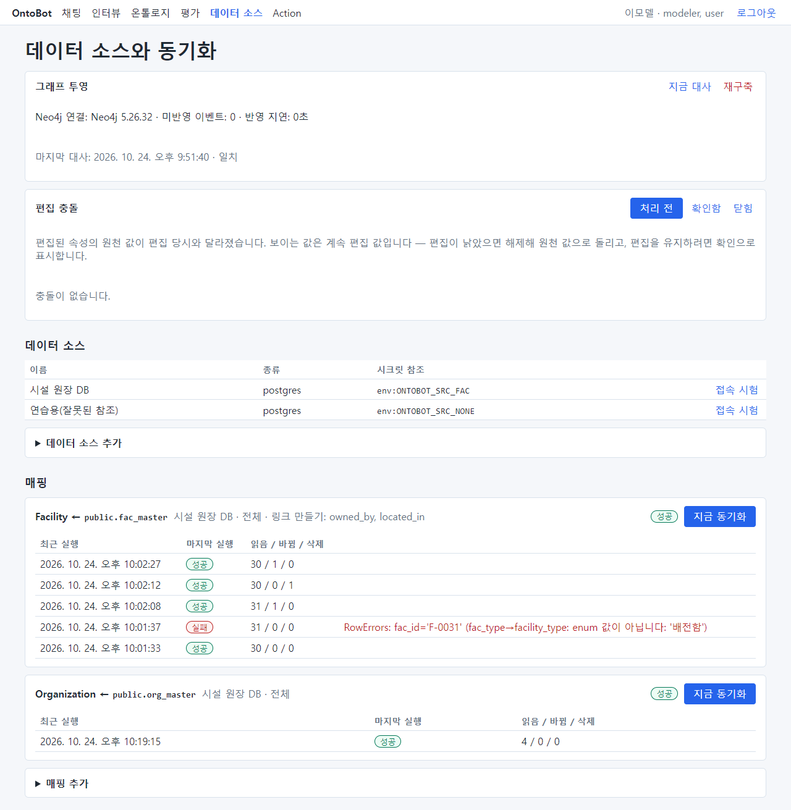

**3. 확인(김사용)** — `부산지사 담당자 알려줘`

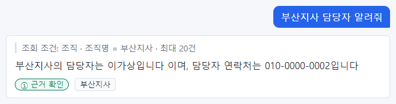

근거 카드의 값 출처가 "시설 원장 DB · public.org_master · 동기화 실행 #6"으로 바뀌었습니다. 담당자와 연락처가 굵게
보입니다(답에 인용됨).

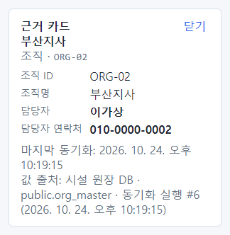

## 22.6 새 직원 맞이하기

**상황** 새로 온 한신입에게 OntoBot 을 쓸 수 있게 해 줍니다. 관리자 박관리가 처리합니다(「21장」의 화면).

| 순서 | 화면 | 할 일 |
| --- | --- | --- |
| 1 | 관리 → 사용자 → ▶ 로컬 계정 추가 | 아이디 `han.new`, 표시 이름 `한신입`, 초기 비밀번호, 역할 `user` |
| 2 | (같은 화면) | 초기 비밀번호를 본인에게 안전하게 전달 |
| 3 | 관리 → 역할별 읽기 권한 | `user` 역할에 필요한 타입이 체크되어 있는지 확인(개인에게 따로 주는 권한은 없음) |
| 4 | 관리 → 사용자 → 알림 연락처 **고치기** | 메일·SMS 알림을 받을 일이 있으면 메일·휴대전화 입력 |
| 5 | (본인) | 로그인 → 오른쪽 위 이름·역할 확인 → 이 책 1~8장 |
| 6 | (나중에) | 업무가 바뀌면 역할 추가·제거, 퇴사하면 **정지** |

> **주의** 계정을 여럿이 함께 쓰지 않게 하세요. 모든 기록이 계정 이름으로 남으므로, 공유 계정은 누가 무엇을 했는지
> 알 수 없게 만듭니다.

## 22.7 워크숍 질문으로 정기 품질 점검

**상황** 정빌더는 인터뷰에서 나온 "자주 묻는 질문" 2개를 정기 점검에 쓰기로 했습니다.

**1. 워크숍 골든셋 열기** — **평가** → "workshop-session-…". 문항에 기대 답변(→ 18개 정도, → 변전소 10곳의 목록)만
있고 필수 값이 없습니다.

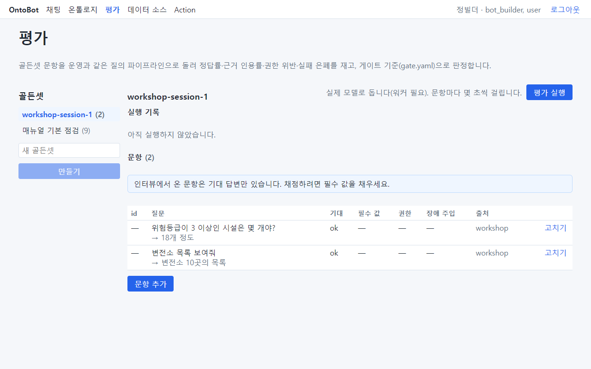

**2. 필수 값 채우기** — 문항마다 **고치기** → **필수 값**: 첫 문항 `18`, 둘째 문항 `강남 변전소 01호, 수원 변전소
28호`(목록에 반드시 있어야 할 이름 둘) → **저장**.

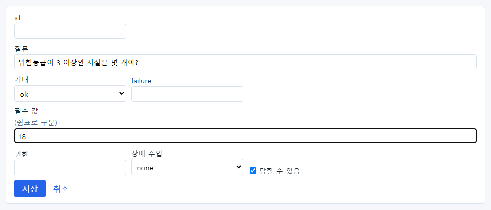

**3. 평가 실행** — **평가 실행** → 완료 → **보기**. 정답률 100%, **게이트 통과**.

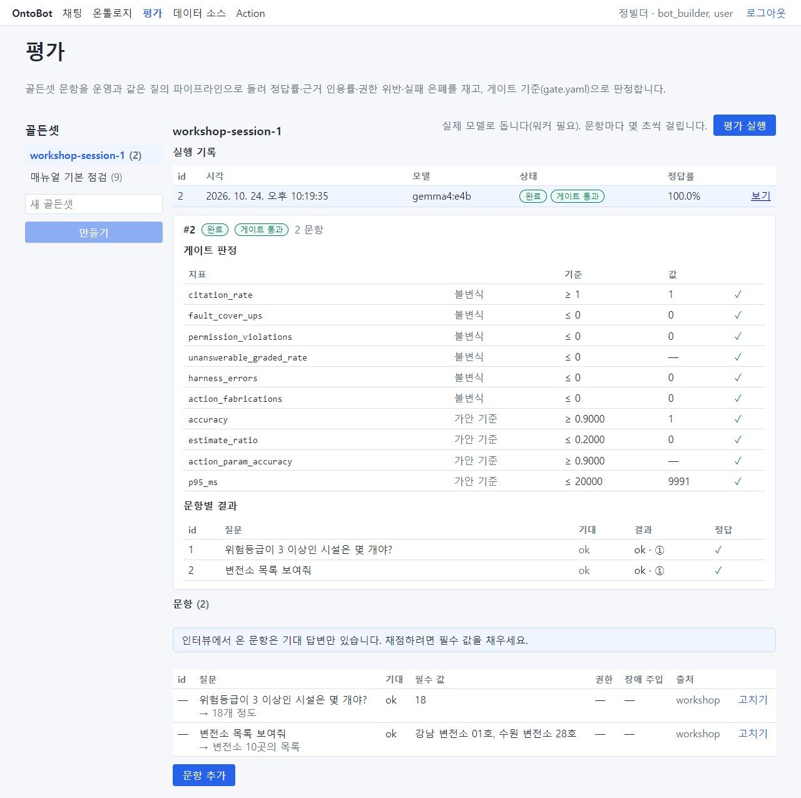

> **요령** 목록 질문의 필수 값에는 목록 전체가 아니라 "반드시 들어 있어야 할 대표 이름" 몇 개를 넣으세요. 목록 전체를
> 넣으면 표현이 조금만 달라도 틀린 것으로 채점될 수 있습니다.

## 22.8 원래 시스템 값이 바뀌었을 때

**상황** 22.3 에서 대구 철탑 11호의 위험등급을 Action 으로 4 → 3 으로 낮췄습니다. 그런데 원래 시스템 담당자가 정밀
점검 뒤 위험등급을 2로 고쳤습니다. 다음 동기화 때 편집 충돌이 생깁니다(화면은 「19장」과 같은 모양).

| 순서 | 누가 | 할 일 |
| --- | --- | --- |
| 1 | 모델러 | 데이터 소스 → 편집 충돌 → **처리 전** 에서 F-0011 확인: 편집 값 3, 편집 당시 원천 값 4, 지금 원천 값 2 |
| 2 | 모델러 | 요청자(김사용)·승인자(박관리)에게 어느 값이 맞는지 확인 |
| 3a | 모델러 | 원천 값 2가 맞음(정밀 점검 결과가 더 최신) → **편집 해제** → 화면 값 2 |
| 3b | 모델러 | 편집 값 3이 맞음(원천 입력 오류) → **확인** → 원천 담당자에게 3으로 고쳐 달라고 요청 |
| 4 | 사용자 | 채팅·근거 카드로 값과 표시(편집됨 유무)를 확인 |

## 22.9 새 객체 타입을 끝까지: 점검 기록

**상황** 16장에서 설계도에 "점검 기록(Inspection)" 타입을 만들어 게시했고, 21장에서 `user` 역할에 읽기 권한을
주었습니다. 이제 원래 시스템의 점검 기록 표(`inspection_log`, 12건)를 연결해 실제로 물어봅니다. 새 타입이 질문할 수
있게 되기까지의 전 과정입니다.

| 순서 | 누가 | 한 일 | 장 |
| --- | --- | --- | --- |
| 1 | 모델러 | 설계도에 타입·속성·링크(inspects) 추가, 게시 | 16장 |
| 2 | 관리자 | 역할별 읽기 권한에 점검 기록 추가 | 21장 |
| 3 | 모델러 | 매핑 추가, 동기화 | 이 절 |
| 4 | 사용자 | 질문 | 이 절 |

**1. 매핑** — 객체 타입 "점검 기록 (Inspection)", 원천 표 `public.inspection_log`. 점검 ID ← insp_id, 시설 ID ←
fac_id, 점검일 ← insp_date, 점검 결과 ← result. **링크 만들기: 점검 대상 시설(facility_id → Facility)** 를 체크합니다.

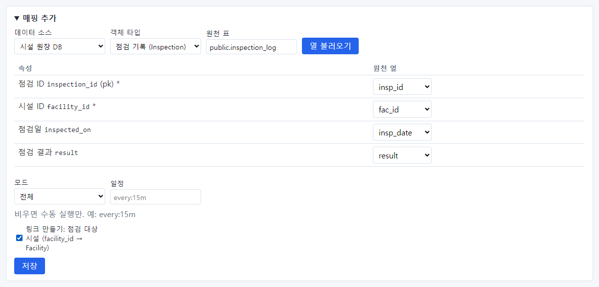

**2. 동기화 — 처음에는 실패했습니다.** "SyncFailed: 매핑이 현재 게시 버전과 맞지 않습니다: 게시 버전에 객체 타입
'Inspection' 이 없습니다". 분명히 게시한 타입인데 없다고 합니다.

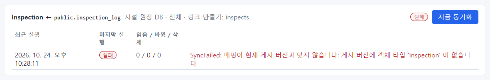

원인은 동기화를 실행하는 **워커(배경 작업 프로그램)가 시작할 때 읽어 둔 설계도를 계속 쓰기** 때문입니다. 워커는 그
뒤에 게시된 새 버전을 다시 읽지 않습니다(지금 판의 결함). 운영자에게 워커를 다시 시작해 달라고 요청한 뒤 동기화하니
성공했습니다: 처음 12 / 12 / 0, 다시 한 번 12 / 0 / 0.

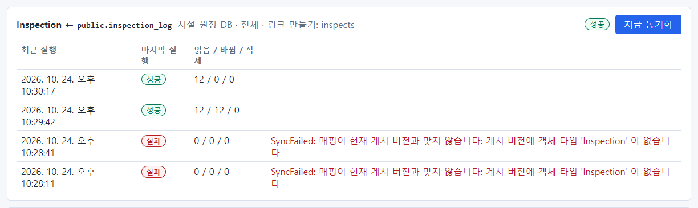

> **주의** 지금 판에서는 설계도를 게시한 뒤 **워커를 다시 시작해야** 새 타입·새 속성의 동기화와 평가가 제대로
> 됩니다. 채팅(API)은 게시 즉시 새 설계도를 쓰지만, 워커는 다시 시작하기 전까지 옛 설계도를 씁니다. 게시 직후
> 동기화가 "게시 버전에 … 이 없습니다"로 실패하거나, 평가 결과가 이상하면 운영자에게 워커 재시작을 요청하세요.

관계(점검 대상 시설)는 그래프 투영으로 관계 저장소에 반영됩니다.

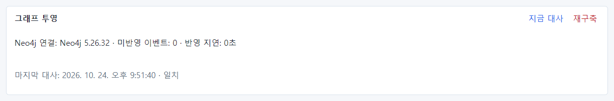

**3. 질문** — 김사용이 새 대화에서 물어봅니다.

`점검 기록은 몇 건이야?`

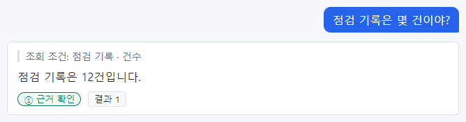

`점검 결과가 이상인 점검 기록 보여줘`

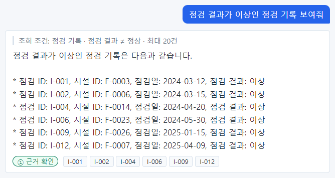

조회 조건이 "점검 결과 = 이상"이 아니라 "**점검 결과 ≠ 정상**"입니다. "이상"을 "정상이 아님"으로 이해한 것입니다.
점검 결과 값이 "이상"과 "정상" 둘뿐이라 이번에는 같은 결과(6건)가 나왔지만, "보류" 같은 다른 값이 있으면 섞여
나옵니다. 값으로 정확히 거르고 싶으면 "점검 결과 값이 '이상'인"처럼 말하세요.

`2025년에 한 점검 기록 목록 알려줘`

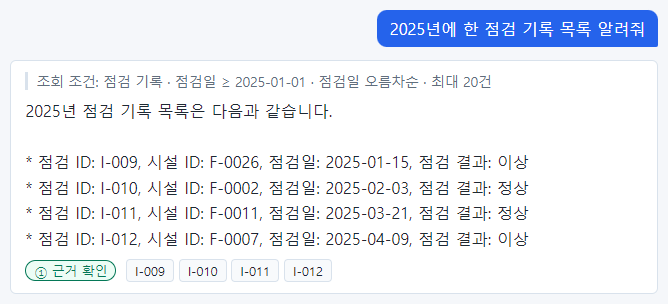

"점검일 ≥ 2025-01-01"만 있고 끝(2025-12-31)이 없습니다. 지금은 2026년 기록이 없어 결과가 같지만, 범위는 시작과 끝을
함께 말하는 것이 안전합니다(「24장」 g27·g28).

`점검 대상 시설이 부산 철탑 26호인 점검 기록 보여줘`

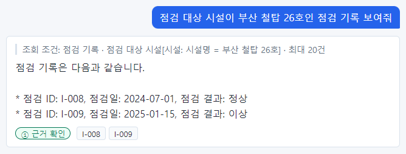

새로 만든 링크(점검 대상 시설)를 따라 조건을 걸었습니다: "점검 대상 시설[시설: 시설명 = 부산 철탑 26호]". 두 건이
나왔습니다.

`점검 결과별 점검 기록 수 알려줘`

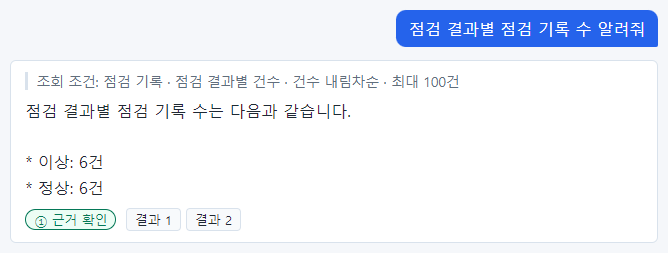

`I-009 점검 기록 알려줘` 의 근거 카드에는 값 출처 "시설 원장 DB · public.inspection_log · 동기화 실행 #10"이
보입니다.

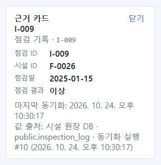

**4. 읽기 권한이 없는 사람** — 최현업(domain_expert)은 점검 기록 읽기 권한이 없으므로 같은 질문이 질문 해석 실패입니다.

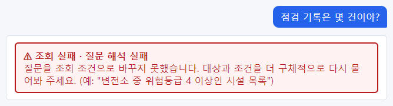

> **요령** 새 객체 타입을 쓰게 하려면 네 가지가 모두 필요합니다: ① 설계도 게시 ② 워커 재시작(지금 판) ③ 매핑·동기화
> ④ 역할별 읽기 권한. 하나라도 빠지면 "질문 해석 실패"나 "결과 0건"이 납니다. 실제로 동기화 전에 물었을 때는 "점검
> 기록은 0건입니다"가 나왔습니다 — 타입은 있지만 데이터가 없었기 때문입니다.

## 22.10 이름이 같은 대상이 둘일 때

**상황** 원래 시스템에 실수로 "강남 변전소 01호"라는 이름의 시설이 하나 더(F-0031) 들어왔습니다. 동기화 뒤 이름으로
물으면 어떻게 될까요?

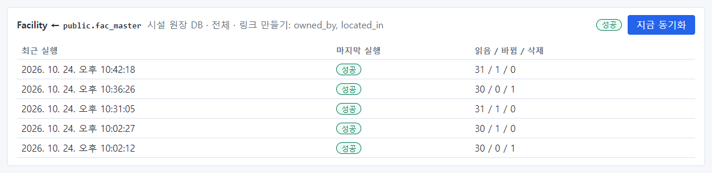

`강남 변전소 01호 위험등급 알려줘`

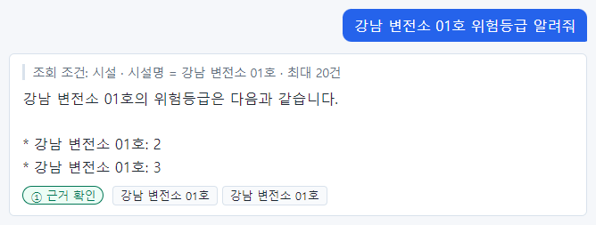

조회는 두 곳을 모두 찾아 "강남 변전소 01호: 2", "강남 변전소 01호: 3"으로 답했습니다. 근거 칩도 둘입니다. 칩을 눌러
식별자(F-0001, F-0031)로 구분하세요.

`강남 변전소 01호 위험등급을 4로 바꿔줘`

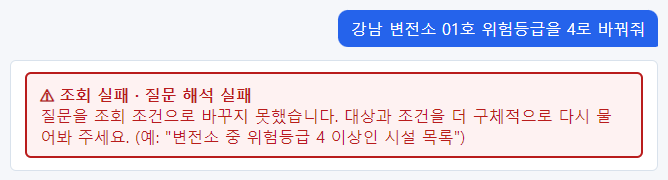

변경 요청은 **질문 해석 실패** 입니다. 어느 시설인지 확실하지 않으면 요청을 만들지 않습니다(짐작하지 않음).
식별자로 다시 요청하세요: `F-0031 위험등급을 4로 바꿔줘`.

> **알아 두기** 이름이 같은 대상이 있으면 이름 대신 **식별자** 를 쓰는 습관이 가장 확실합니다. 중복된 이름 자체가
> 데이터 오류라면 원래 시스템 담당자에게 알려 고치게 하세요. 이 실습에서는 확인 뒤 원천에서 F-0031 을 지우고 다시
> 동기화했습니다.

## 22.11 메일·SMS 알림이 있는 Action

**상황** 현장에서 철탑이 기운 것이 확인되면, 관리자에게 메일과 문자로 즉시 알려야 합니다. 모델러가 "긴급 정비 통보"
Action 을 만들고, 김사용이 요청하고, 박관리가 승인합니다. 이 실습은 메일·SMS 를 실제로 보내지 않고 기록 파일에만 남기는
**개발용 가짜 게이트웨이** 로 했습니다(운영에서는 운영자가 사내 메일·SMS 게이트웨이를 설정합니다).

**1. 받는 사람의 연락처** — 관리자는 알림 받을 사람(박관리)의 메일·휴대전화를 **알림 연락처** 에 넣습니다(「21장」).
화면에는 가려서 보입니다.

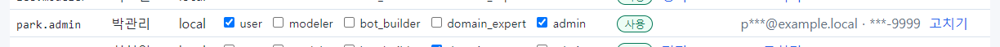

**2. Action 정의(모델러)** — api_name `urgent_notice`, 표시 이름 "긴급 정비 통보", 대상 시설, 승인 역할 admin, 파라미터
"통보 내용(message)". 알림 두 줄: **메일** → 받는 역할 admin, **SMS** → 받는 역할 admin, 문구
`[긴급] '{target}'({target_pk}) {message}`. 메일·SMS 가 있으므로 **정정 문구** 가 필수입니다:
`[정정] '{target}'({target_pk}) 긴급 정비 통보를 취소합니다.`

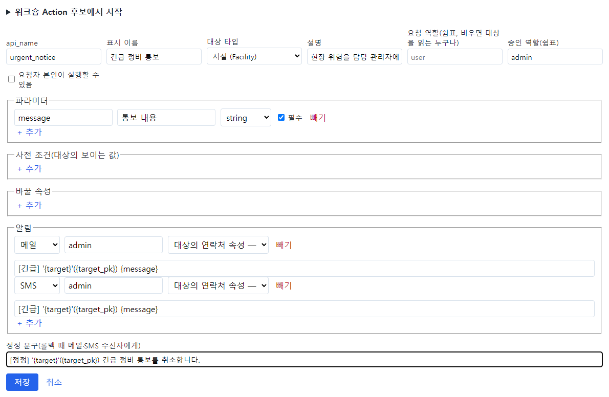

게시 전 검사를 통과하면 게시합니다(게시 뒤 워커 재시작 — 지금 판).


**3. 요청(김사용)** — `F-0020 시설 긴급 정비 통보 요청해줘. 통보 내용은 철탑 기울어짐 확인`

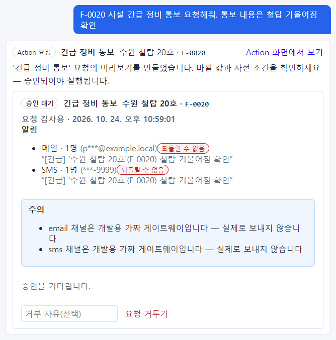

요청 카드의 알림에 **메일 · 1명 (p\*\*\*@example.local) 되돌릴 수 없음**, **SMS · 1명 (\*\*\*-9999) 되돌릴 수 없음** 이
보입니다. 받는 사람 연락처는 가려서 보입니다. **주의** 칸에는 "email 채널은 개발용 가짜 게이트웨이입니다 — 실제로 보내지
않습니다"가 보입니다(연습 환경 표시).

**4. 승인(박관리)** — 펼쳐서 받는 사람·문구를 확인합니다.

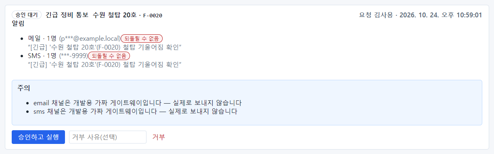

**승인하고 실행** 을 누르면 확인 창이 한 번 더 뜹니다: "실행하면 편집 레이어에 쓰고 알림을 보냅니다. 메일·SMS 는
되돌릴 수 없습니다. 실행할까요?" — **확인**.

**5. 발송 확인** — 실행되면 카드 아래에 **발송** 목록이 생깁니다. 메일·SMS 는 실행이 확정된 **뒤에** 워커가 보내므로,
잠시 "대기"였다가 "보냄"이 됩니다.

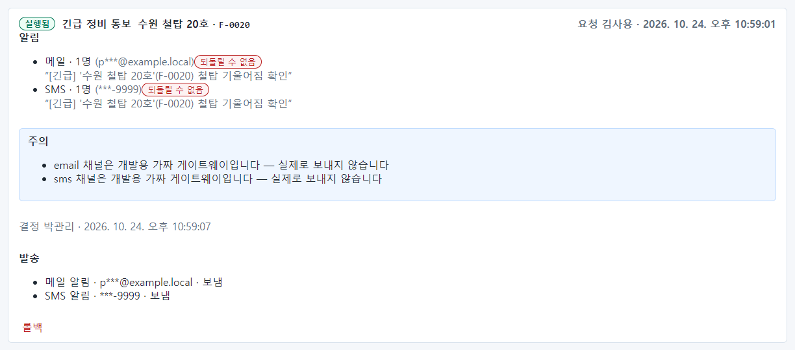

가짜 게이트웨이는 서버의 기록 파일에 이렇게 남깁니다(운영에서는 실제 메일·문자가 나갑니다).

```
{"channel": "email", "recipient": "park.admin@example.local", "subject": "[OntoBot] 긴급 정비 통보",
 "body": "[긴급] '수원 철탑 20호'(F-0020) 철탑 기울어짐 확인"}
```

**6. 롤백** — 잘못된 통보였다고 해 봅시다. **롤백** 을 누르면 확인 창 "편집을 해제하고, 아직 안 나간 발송은 취소하며,
이미 나간 메일·SMS 수신자에게 정정 문구를 보냅니다. 진행할까요?" 뒤에 **롤백됨** 이 되고, 발송 목록에 **메일 정정** ·
**SMS 정정** 이 더해져 "보냄"이 됩니다.

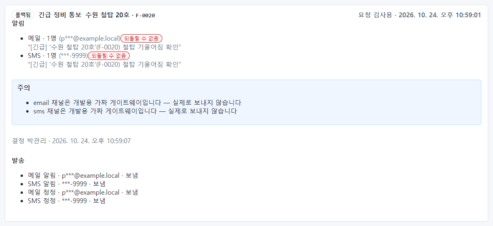

```
{"channel": "email", "recipient": "park.admin@example.local", "subject": "[OntoBot 정정] 긴급 정비 통보",
 "body": "[정정] '수원 철탑 20호'(F-0020) 긴급 정비 통보를 취소합니다."}
```

> **주의** 이미 나간 메일·문자는 되돌릴 수 없습니다. 롤백은 정정 문구를 **한 번 더 보내는** 것입니다. 받는 사람이 정정을
> 보기 전에 그 내용으로 움직였을 수 있으니, 메일·SMS 가 붙은 요청은 승인 전에 특히 신중하게 확인하세요.

| 발송 상태 | 뜻 |
| --- | --- |
| 대기 | 실행은 확정, 워커가 곧 보냄 |
| 보냄 | 게이트웨이에 넘김 |
| 실패 | 보내지 못함(정해진 횟수만큼 다시 시도). 이유가 함께 보임 |
| 취소 | 롤백으로 보내기 전에 취소됨 |

> **알아 두기** 메일·SMS 채널이 설정되지 않은 환경이면, 이런 Action 의 요청은 미리보기에서 **막힘**("발송 채널이 설정되지
> 않았습니다")이 됩니다. 보낸 척하지 않습니다.

## 22.12 승인하는 순간 실패하는 경우

**상황** 요청을 만든 뒤 승인하기 전에 대상의 값이 바뀌면 어떻게 될까요? 실습으로 확인합니다.

**1.** 김사용이 `F-0030 시설 일반 점검 요청해줘` — 부산 전주 30호는 위험등급 3이라 사전 조건(≥ 3) 통과, 승인 대기.

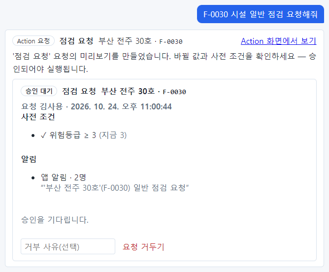

**2.** 이어서 `F-0030 시설 위험등급을 2로 바꿔줘. 사유는 보강 공사 완료`.

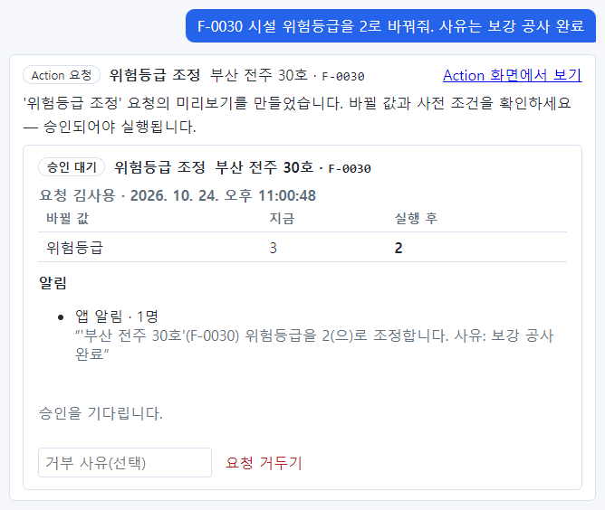

**3.** 박관리가 **위험등급 조정** 을 먼저 승인합니다. 이제 부산 전주 30호의 위험등급은 2입니다.

**4.** 박관리가 이어서 **점검 요청** 을 펼칩니다. 카드의 사전 조건은 요청을 만들 때 기록한 그대로 "✓ 위험등급 ≥ 3
(지금 3)"으로 보입니다.

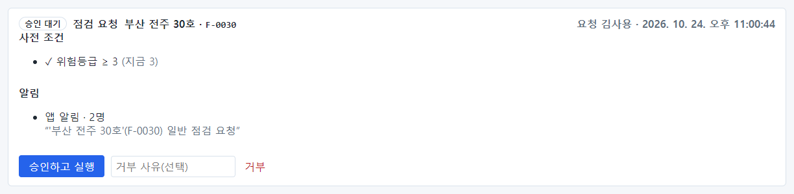

**5.** **승인하고 실행** 을 누르면 실행되지 않고 **실패** 로 기록됩니다. "실패 사유: 실행 직전 다시 확인했더니
막혔습니다: 사전 조건: 위험등급 gte 3 (지금 2)".

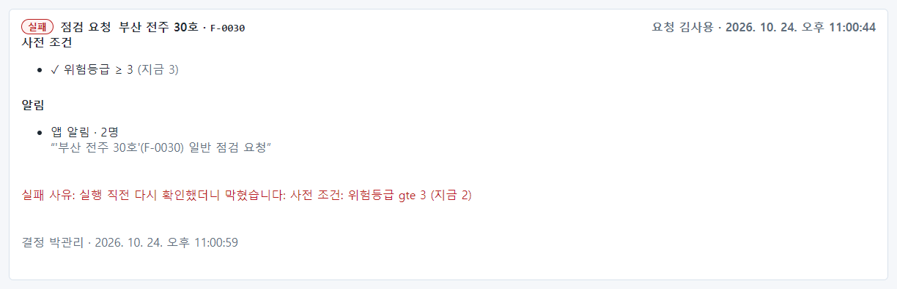

> **알아 두기** 요청 카드의 사전 조건·바뀔 값은 **요청을 만든 때** 의 값입니다. 서버는 승인하는 순간 대상의 지금 값과
> 지금 게시된 설계도로 다시 확인하고, 맞지 않으면 실행하지 않습니다. 실패는 오류가 아니라 안전장치입니다. 요청자는
> 실패 사유를 보고 필요하면 새로 요청합니다.

이름으로 요청했을 때 질문 해석 실패가 나온 적도 있습니다(`수원 변전소 28호 일반 점검 요청해줘`). 변경 요청은 식별자로
하는 것이 가장 확실합니다.

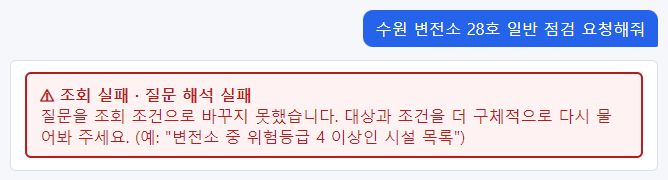

## 22.13 이 장의 핵심

> **요령**
>
> - 넓게 묻고 "그 중"으로 좁히며, 단계마다 조회 조건을 확인합니다.
> - 보고서 숫자는 따로 묻고 합을 확인하며, 조회 조건을 함께 적어 둡니다.
> - 요청 → 승인 → 근거 카드 확인까지가 한 묶음입니다.
> - 신고된 질문은 골든셋에 넣어 계속 감시합니다.
> - 원천 값과 편집 값이 엇갈리면 관계자와 확인한 뒤 확인·편집 해제를 정합니다.
