# 24장 답 화면 모음

이 장은 질문 40개를 실제로 묻고 받은 답 화면을 모은 것입니다. 질문 유형별로 묶었고, 화면마다 조회 조건을 읽는
법과 눈여겨볼 점을 적었습니다. 「6장」에서 다루지 않은 질문들이므로 함께 보면 질문을 만드는 감각이 생깁니다.

> **알아 두기** 이 화면들은 22장의 실습까지 마친 뒤에 찍었습니다. 그래서 대구 철탑 11호(위험등급 4 → 3)처럼
> 실습으로 바뀐 값이 반영되어, 처음 설치 상태와 숫자가 조금 다른 답이 있습니다. 해설에 차이를 적었습니다.

> **요령** 화면마다 먼저 회색 줄의 조회 조건을 읽고, 질문과 비교한 뒤 답을 읽는 연습을 해 보세요. 해설에
> **잘못 이해한 예** 로 표시한 화면이 세 개 있습니다. 해설을 보기 전에 스스로 찾아보세요.

## 24.1 개수 세기

### 시설은 모두 몇 개야?

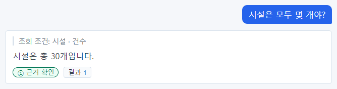

가장 단순한 개수 질문입니다. 조회 조건에 조건 없이 "시설 · 건수" — 시설 전체 30개.

### 전주 개수 알려줘

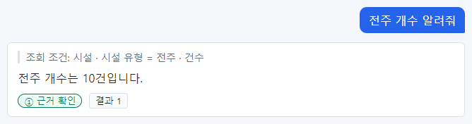

"개수 알려줘"도 "몇 개야?"와 같이 건수로 이해합니다. 전주 10개.

### 위험등급이 4 이상인 시설 수는?

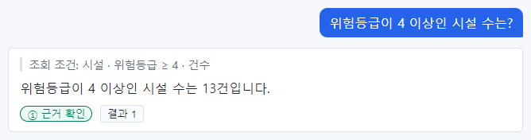

13건입니다. 처음 설치 상태에서는 14건이었는데, 22장에서 대구 철탑 11호를 4 → 3 으로 낮췄기 때문에 하나 줄었습니다. 데이터가 바뀌면 답도 바로 바뀝니다.

### 위험등급이 1인 시설은 몇 곳이야?

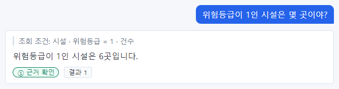

"몇 곳"도 건수입니다. 6곳(처음 상태에서는 7곳 — 수원 변전소 04호가 동기화로 2가 됨).

### 위험등급이 5인 변전소는 몇 개야?

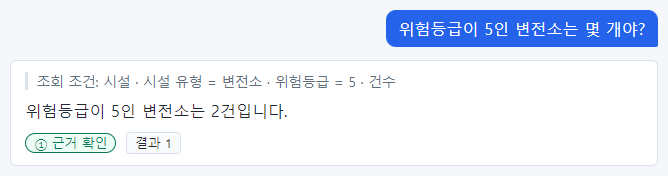

조건 둘(변전소, 위험등급 5)이 모두 들어갔습니다. 부산 변전소 10호, 강남 변전소 25호 2건.

### 위험등급이 2 이하인 철탑은 몇 개?

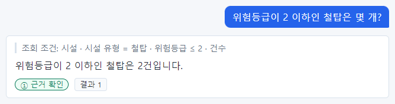

"이하"는 ≤ 입니다. 강남 철탑 05호(2), 수원 철탑 08호(1) 2건.

### 설비 용량이 1000kW 넘는 시설은 몇 개야?

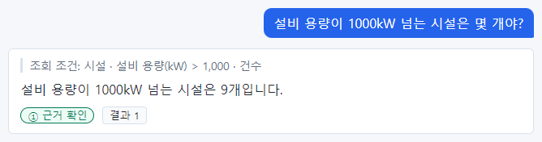

"넘는"은 > 입니다(1,000 은 포함하지 않음). 1,000kW 를 포함하려면 "1000kW 이상"이라고 하세요.

### 조직은 몇 개야?

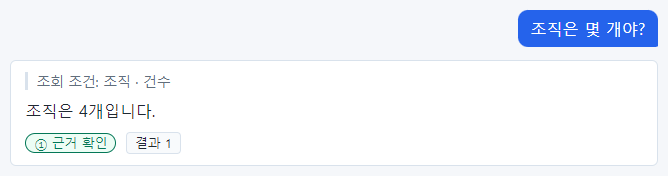

시설이 아닌 다른 종류도 같은 방법으로 셉니다. 조직 4개.

### 지역은 몇 개 등록돼 있어?

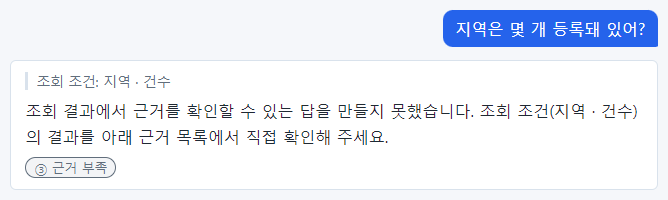

조회 조건은 맞는데 ③ 근거 부족입니다. 답 문장을 근거와 맞추지 못한 경우로, 같은 질문을 다시 하거나 "지역 목록 알려줘"로 직접 세어 보세요(5개).

## 24.2 목록 보기

### 전주 목록 알려줘

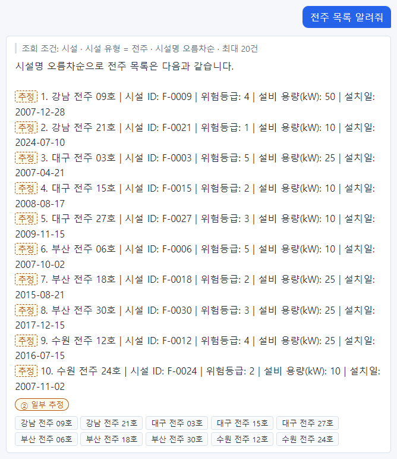

조회 조건에 "시설명 오름차순"이 붙었고, 답이 순번과 `|` 로 나뉜 줄로 나와 ② 일부 추정입니다. 목록의 이름·값은 근거 칩으로 확인하면 데이터와 맞습니다.

### 위험등급이 4인 철탑 보여줘

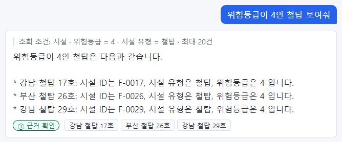

위험등급 4인 철탑입니다. 22장에서 대구 철탑 11호가 3이 되어, 처음 상태보다 하나 적게 나옵니다.

### 설비 용량이 2000kW 이상인 시설 보여줘

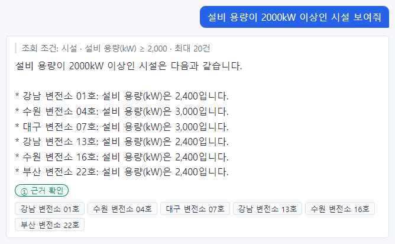

"이상"은 ≥ 입니다. 2,000kW 이상인 시설.

## 24.3 한 대상의 정보

### F-0001 정보 알려줘

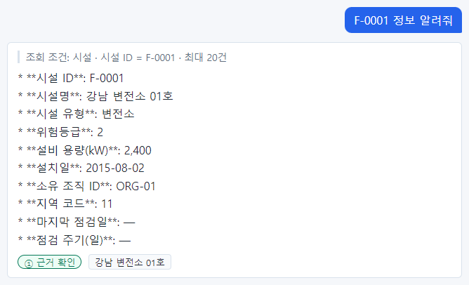

식별자로 물으면 정확히 하나가 나옵니다. 답에 `**` 강조 기호가 보이지만 내용에는 문제가 없습니다.

### 수원 전주 12호는 어느 조직 소유야?

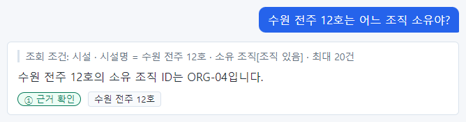

"어느 조직 소유"를 물었는데 답은 조직 이름이 아니라 소유 조직 ID(ORG-04)입니다. 시설에는 조직 ID 만 있기 때문입니다. 이름이 필요하면 "ORG-04 조직 이름"을 이어서 물으세요.

### 대구 변전소 19호 설치일은 언제야?

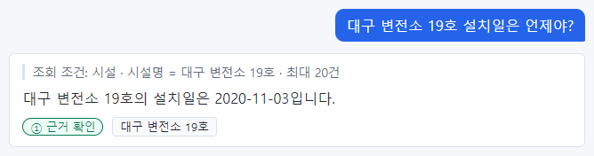

이름으로 한 대상의 한 값을 물었습니다. 설치일 2020-11-03.

### 지역 코드 41은 어디야?

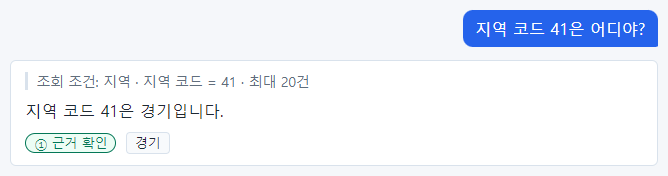

지역 코드로 지역 이름을 찾았습니다. 41 은 경기.

### 강남변전소1호 위험등급 알려줘

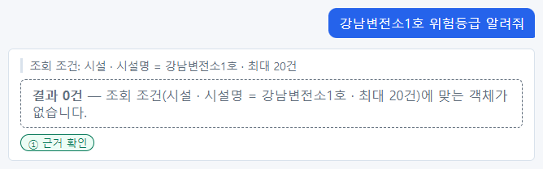

띄어쓰기와 번호가 등록된 이름(강남 변전소 01호)과 달라 **결과 0건** 입니다. 이름은 글자 그대로 같아야 찾습니다.

## 24.4 순위·상위 몇 개

### 설비 용량이 가장 작은 시설 3개는?

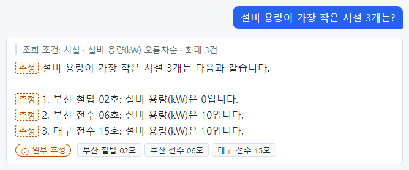

오름차순 = 작은 것부터. ② 는 순번·첫 문장의 추정 표시 때문입니다.

### 가장 최근에 설치된 시설 5개 보여줘

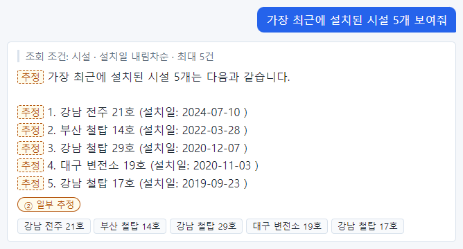

설치일 내림차순 = 최근 것부터.

### 가장 오래된 철탑 3개 알려줘

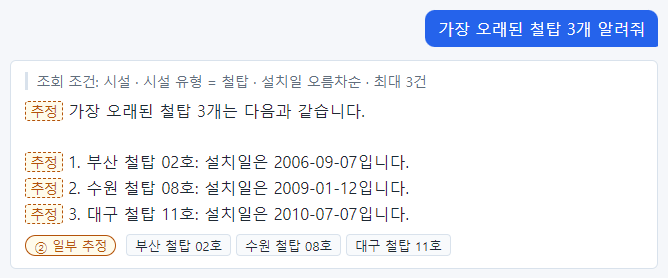

유형 조건과 정렬이 함께 들어갔습니다.

## 24.5 묶어서 세기와 계산

### 소유 조직별 시설 수는?

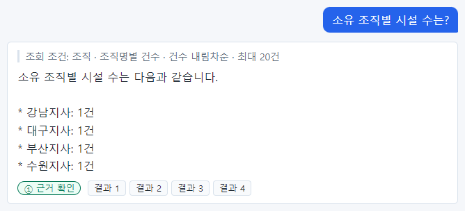

**잘못 이해한 예.** 조회 조건이 "조직 · 조직명별 건수"로, 시설이 아니라 조직을 조직명마다 셌습니다(모두 1건). 지사별 시설 수는 지사마다 따로 물으세요(「22장 22.2」).

### 시설 유형별 평균 위험등급은?

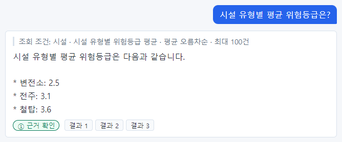

묶어서 평균을 냈습니다. 철탑 평균이 3.6 — 22장에서 대구 철탑 11호를 낮춰 처음 상태(3.7)보다 조금 내려갔습니다.

### 시설 유형별 설비 용량 합계 알려줘

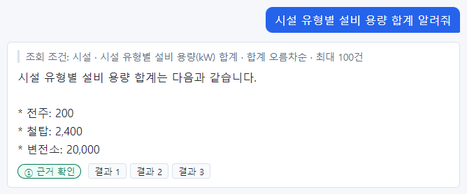

묶어서 합계를 냈습니다. 합계 오름차순이라 전주 → 철탑 → 변전소 순서입니다.

### 전체 시설의 평균 위험등급은?

전체 평균 3.07.

### 설비 용량이 가장 큰 값은 얼마야?

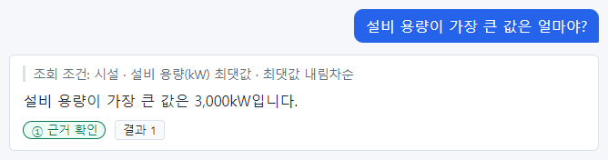

최댓값만 물으면 값만 나옵니다. 어느 시설인지 보려면 "설비 용량이 3000kW인 시설"을 물으세요.

### 전주의 최소 설비 용량은?

조건을 단 최솟값입니다.

## 24.6 날짜 조건

### 2015년에 설치된 시설 알려줘

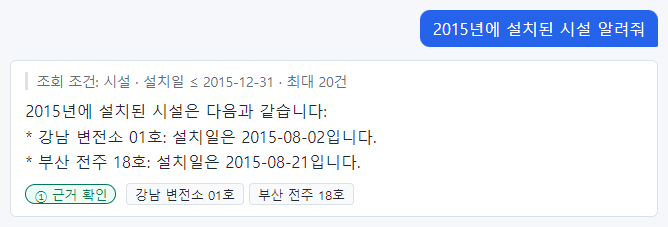

**조건 하나가 빠진 예.** "설치일 ≤ 2015-12-31"뿐이라 2015년 이전도 조회되었습니다. 답에는 2015년 시설만 적혔지만 조회 조건이 틀렸으므로 믿으면 안 됩니다. "2015년 1월 1일부터 12월 31일까지"로 물으세요.

### 2010년부터 2015년 사이에 설치된 변전소는?

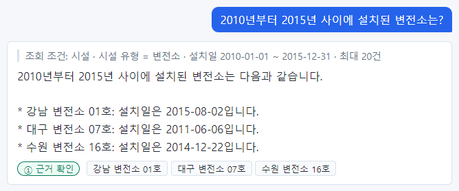

범위(~)를 맞게 이해했습니다. 이렇게 시작과 끝을 함께 말하면 정확합니다.

### 설치된 지 10년 넘은 전주는 몇 개야?

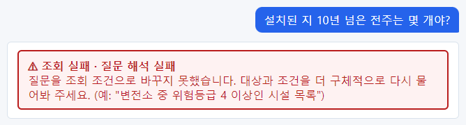

"10년 넘은" 같은 상대 날짜는 표현하지 못해 **질문 해석 실패** 입니다. 날짜로 바꿔 물으세요.

## 24.7 관계 따라가기와 조건 여러 개

### 부산지사 소유 시설은 몇 개야?

관계 조건으로 셌습니다. 부산지사 8개.

### 경기에 있는 시설 목록

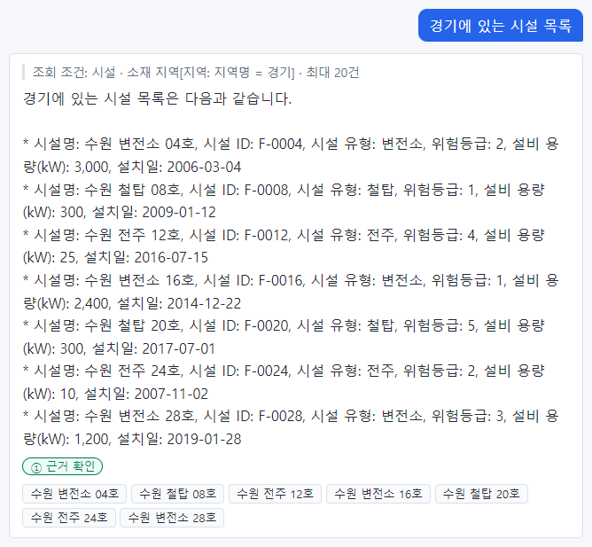

"목록"만 써도 목록으로 이해합니다.

### 대구 지역의 위험등급 4 이상 시설은?

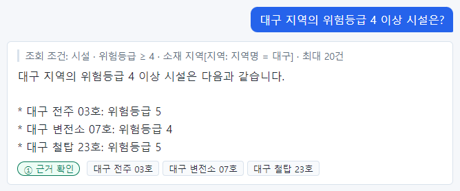

관계 조건(대구)과 값 조건(4 이상). 대구 철탑 11호가 3이 되어 빠졌습니다.

### 수원지사 소유 철탑의 평균 설비 용량은?

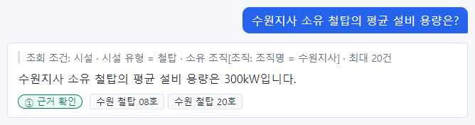

**계산이 조회 조건에 없는 예.** 조회 조건 끝이 "평균"이 아니라 "최대 20건"(목록)입니다. 답의 평균 300kW 는 서버가 아니라 AI 가 목록을 보고 쓴 값입니다. 이번에는 맞았지만, 계산이 필요하면 조회 조건 끝에 "○○ 평균"이 있는지 확인하세요.

### 서울에 있는 위험등급 2 이하 시설

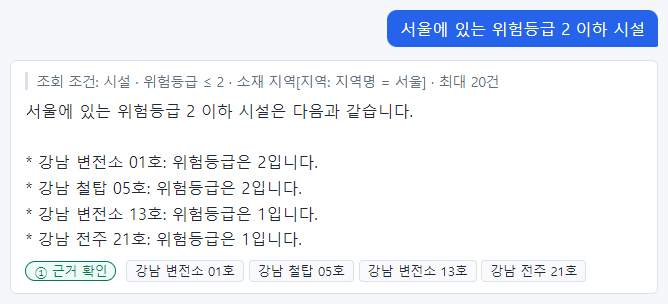

관계 조건과 값 조건이 모두 들어갔습니다.

### 2015년 이후 설치된 위험등급 4 이상 철탑

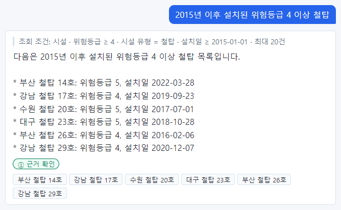

조건 셋이 모두 들어갔습니다.

### 강남지사 소유 변전소 중 용량 2000kW 이상인 것

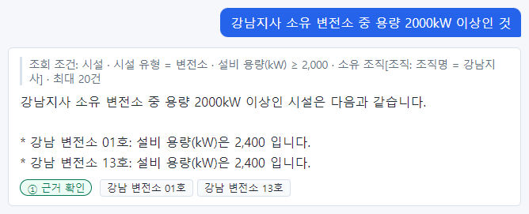

조건 셋(변전소, 2,000kW 이상, 강남지사)이 모두 들어갔습니다.

## 24.8 답할 수 없는 질문·0건·인사

### 다음 달 점검 일정 알려줘

데이터에 점검 일정이 없어 **질문 해석 실패** 입니다. 지어내지 않습니다.

### 변전소 고장 원인이 뭐야?

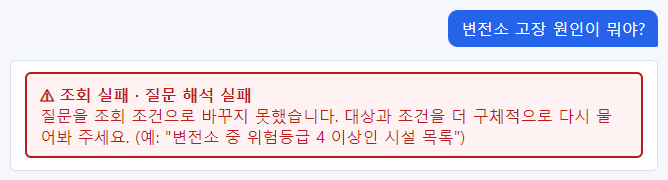

고장 원인도 데이터에 없습니다. "왜"를 묻는 질문은 답하지 않습니다.

### 2030년 이후에 설치된 시설은?

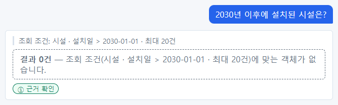

미래 날짜라 **결과 0건** 입니다.

### 고마워

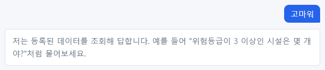

감사 인사는 데이터 질문이 아니라 안내만 나옵니다.

## 둘째 묶음: 22장 이후에 더 물어본 질문

아래는 22장에서 점검 기록을 연결한 뒤, 조직·지역·점검 기록 질문과 오타·길게 묻기·경계 조건을 더 물어본 화면입니다.

## 24.9 조직·지역

### 조직 목록을 담당자와 함께 보여줘

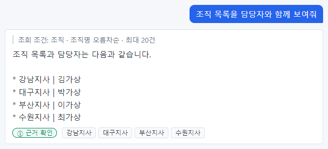

"담당자와 함께"를 따로 조건으로 두지 않고 목록으로 이해했습니다. 답에 담당자 이름이 함께 나왔습니다(개인정보 속성 — 업무에 필요할 때만).

### ORG-03 조직 이름 알려줘

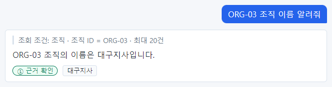

조직 ID 로 조직 이름을 찾았습니다. 「24.3」 g14 처럼 시설의 소유 조직 ID 를 이름으로 바꿀 때 씁니다.

### 담당자 연락처가 010-0000-0004인 조직은?

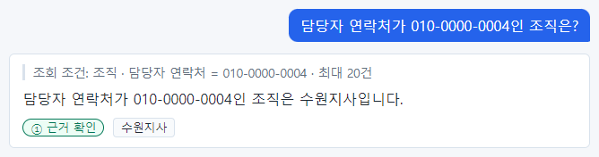

개인정보 속성(담당자 연락처)으로도 조회할 수 있습니다. 화면에는 보이지만 처리 기록과 외부 AI 전송에서는 가려집니다.

### 경남 지역 코드 알려줘

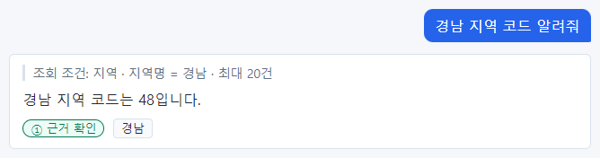

지역 이름으로 코드를 찾았습니다.

### 대구지사 담당자는 누구야?

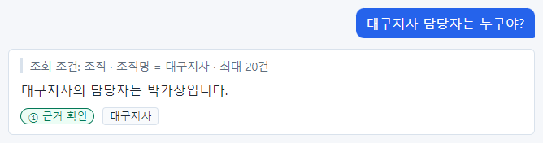

조직 이름으로 담당자를 찾았습니다.

### 지역별 시설 수 알려줘

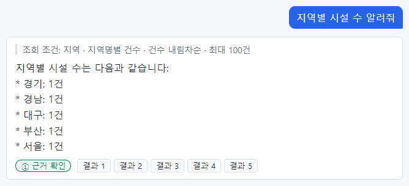

**잘못 이해한 예.** "지역 · 지역명별 건수" — 시설이 아니라 지역을 세어 모두 1건입니다. 지역별 시설 수는 「24.5」의 "지역 코드별 시설 수"(g 묶음)처럼 시설을 세라고 물으세요.

### 시설이 가장 많은 지역은?

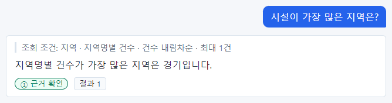

**근거 없는 답.** 지역을 세어(모두 1건) 그중 첫째인 "경기"를 답했습니다. 실제로 시설이 가장 많은 곳은 서울·부산(8곳)입니다. 등급이 ①이어도 이런 답이 나옵니다.

### 조직별 평균 위험등급 알려줘

관계(조직)로 묶은 평균은 표현하지 못해 질문 해석 실패입니다. 조직마다 따로 물으세요.

## 24.10 점검 기록

### 점검 기록 목록 보여줘

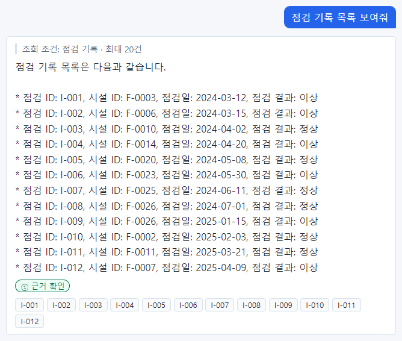

점검 기록 12건이 모두 나왔습니다.

### 점검 결과가 정상인 점검 기록은 몇 건?

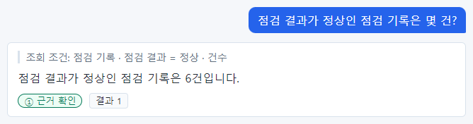

"정상"은 정확히 값 조건(= 정상)으로 이해했습니다. 「22장 22.9」의 "이상"(≠ 정상)과 비교해 보세요.

### 2024년에 한 점검 기록 보여줘

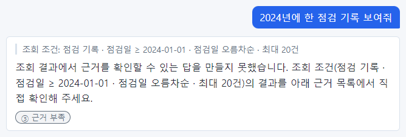

조회 조건에 2024년의 끝이 없고(≥ 2024-01-01), 답은 ③ 근거 부족입니다. 두 가지 모두 다시 물을 이유입니다.

### 가장 최근 점검 기록 3개 알려줘

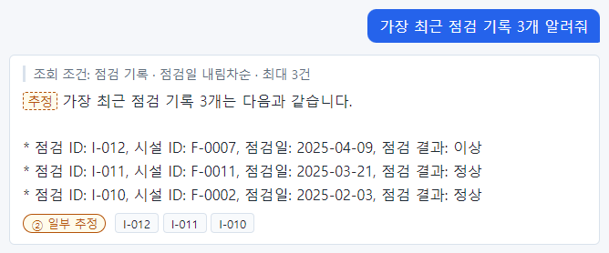

최근 순 3건. ② 는 첫 문장의 추정 표시.

### I-005 점검 기록 알려줘

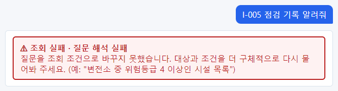

점검 ID 로 물었는데 질문 해석 실패입니다. 새 타입이라 아직 질문이 잘 통하지 않습니다(「32장」의 실험 참고).

### F-0026 시설의 점검 기록 보여줘

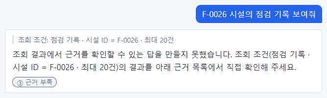

조회 조건은 맞는데(시설 ID = F-0026) ③ 근거 부족입니다. 근거 칩을 직접 보거나 "점검 대상 시설이 부산 철탑 26호인 점검 기록"으로 물으세요.

### 점검일이 2025-03-21인 점검 기록은?

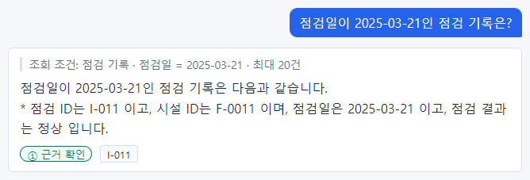

날짜 하나로 정확히 찾았습니다.

### 점검 결과별 점검 기록 수

점검 결과별로 묶어 셌습니다.

## 24.11 오타·띄어쓰기

### 강남 변전소 1호 위험등급 알려줘

"1호"는 "01호"와 다른 글자라 결과 0건.

### 강남변전소 01호 위험등급 알려줘

띄어쓰기가 달라 결과 0건.

### f-0007 설비 용량

식별자는 대소문자도 같아야 합니다. 소문자 "f-0007"은 결과 0건.

### 변전쏘 몇 개야?

"변전쏘"(오타)는 정해진 값 "변전소"로 맞춰 이해했습니다. 정해진 값(enum)은 AI 가 맞춰 주지만 이름·식별자는 맞춰 주지 않습니다.

### 강남 지사 소유 시설 몇 개야?

조직명은 "강남지사"로 붙여 써야 합니다. 띄어 쓰면 질문 해석 실패.

## 24.12 길게 묻기

### 이번 주 점검 계획을 세우려고 하는데, 위험등급이 4 이상인 변전소가 몇 개인지 알려줄래?

배경 설명이 섞여도 핵심 조건(변전소, 4 이상, 건수)만 들어갔습니다.

### 보고서를 써야 해서 그런데요, 부산지사가 소유한 철탑 목록 좀 부탁드립니다.

"좀 부탁드립니다" 같은 말투와 상관없이 조건 둘이 들어갔습니다.

### 위험등급이 5인 시설 중에서 서울에 있는 것만 알고 싶어요. 가능할까요?

질문 끝의 "가능할까요?"도 문제없습니다.

## 24.13 경계 조건

### 위험등급 3 초과인 시설 몇 개?

"초과"는 >.

### 위험등급 3 미만인 시설 몇 개?

"미만"은 <. 3 초과 13 + 3 미만 12 + 3인 5 = 30.

### 위험등급이 2에서 4 사이인 시설은 몇 개야?

"사이"는 양 끝을 포함한 범위(2 ~ 4)로 이해했습니다.

### 설비 용량이 1200kW 이상 2400kW 이하인 변전소

이상(≥)과 이하(≤)를 함께 썼습니다.

### 2017년 1월 1일 이후 설치된 철탑

"1월 1일 이후"는 당일을 뺀 > 로 이해했습니다.

### 2017년 1월 1일 포함 이후에 설치된 철탑

"포함"을 말하면 ≥ 로 이해했습니다. 경계일이 중요하면 "포함"을 말하세요.

### 2016년 말까지 설치된 전주는 몇 개?

"말까지"는 ≤ 2016-12-31.

### 설비 용량이 1200kW인 시설 보여줘

값이 정확히 같은(=) 조건.

## 24.14 같은 뜻 다른 말

### 변전소가 총 몇 곳인지 알려주세요

높임말도 같은 조건.

### 철탑 중에 위험등급 5인 거

짧게 말해도 조건 둘이 모두 들어갔습니다.

### 부산지사에서 관리하는 시설 보여줘

"관리하는"도 소유 조직 관계로 이해했습니다.

### 위험등급이 3보다 크거나 같은 시설은 몇 개?

"3보다 크거나 같은"은 ≥ 3.

## 24.16 이 장의 핵심

> **요령**
>
> - "넘는"(>)과 "이상"(≥), "이전"(<)과 "이하"(≤)처럼 낱말 하나가 조건의 기호를 바꿉니다.
> - 이름은 글자 그대로, 날짜는 날짜로(상대 날짜 ×), 범위는 시작과 끝을 함께.
> - 계산(평균·합계)은 조회 조건 끝에 계산이 있어야 서버가 계산한 값입니다.
> - 실습으로 데이터가 바뀌면 답도 바로 바뀝니다 — 숫자가 예전과 다르면 데이터 변경부터 의심하세요.
