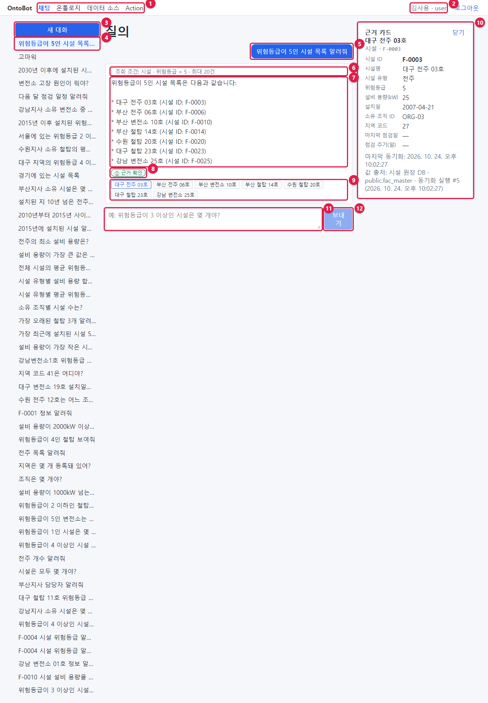
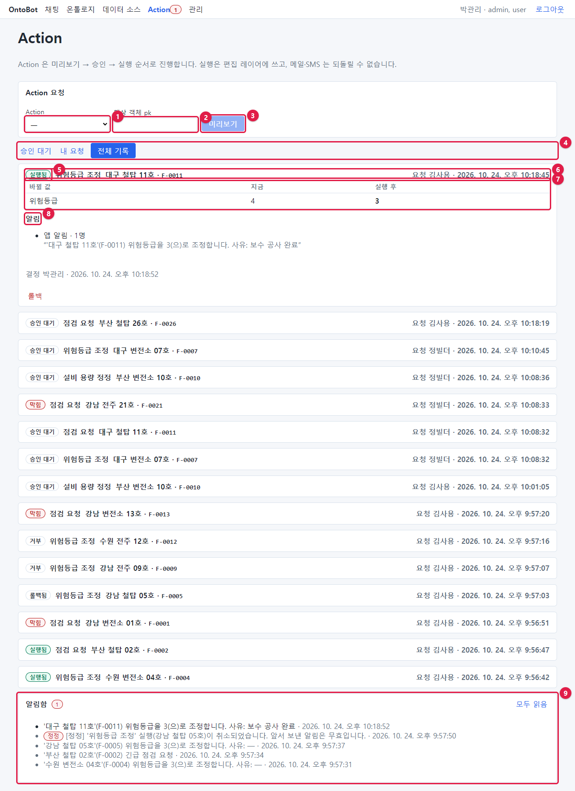
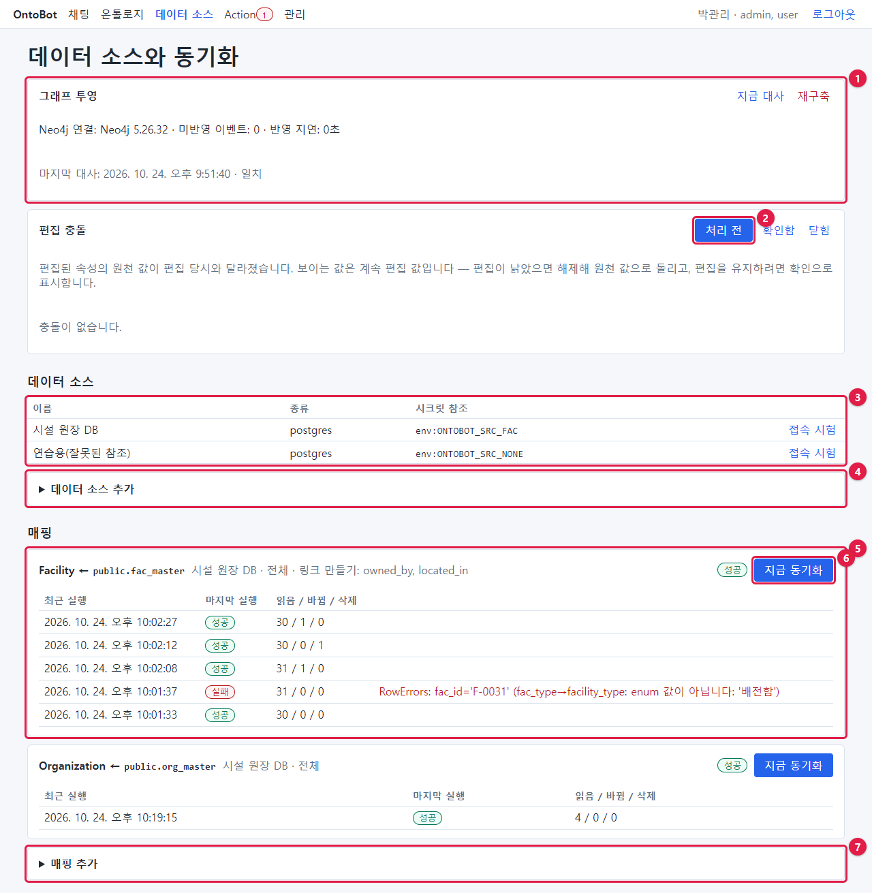
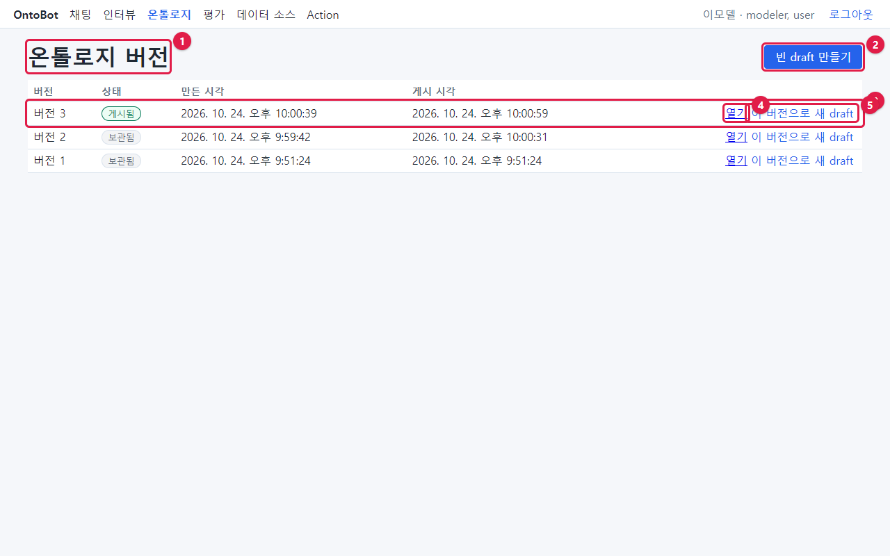
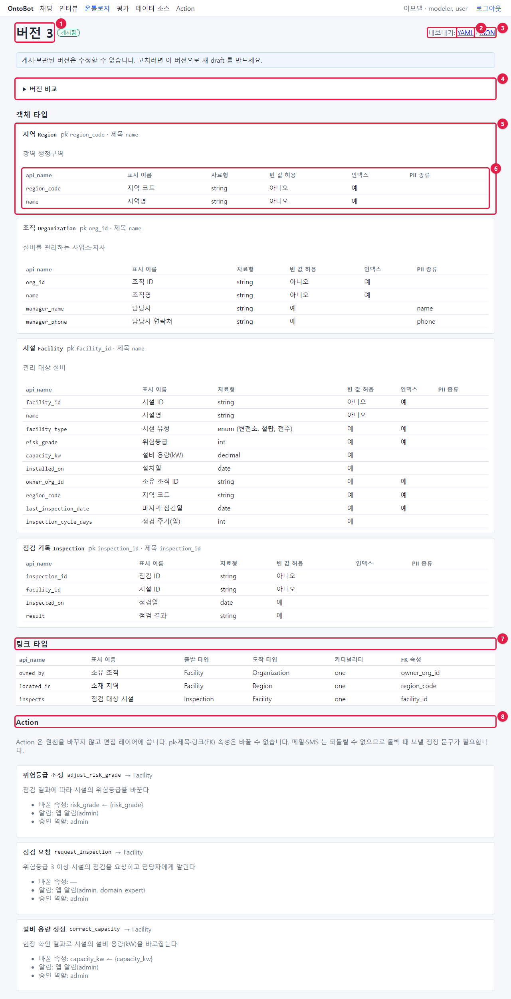
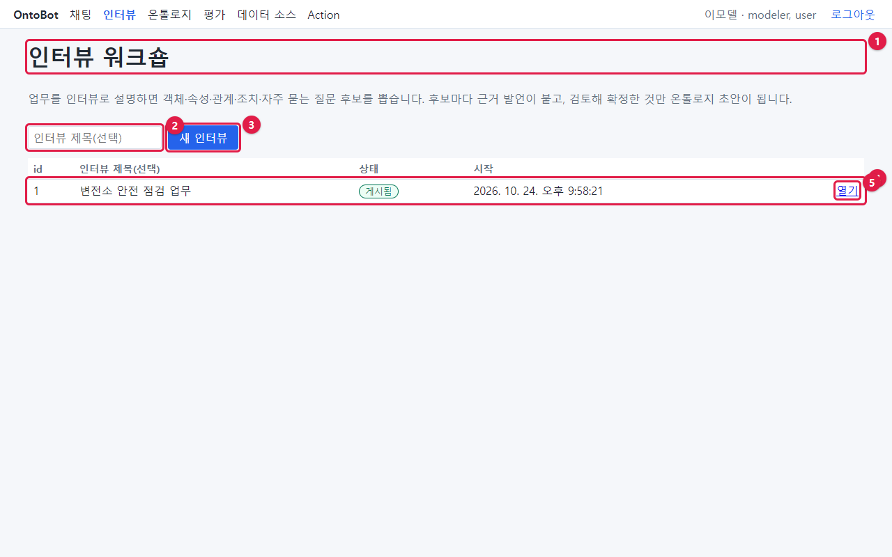
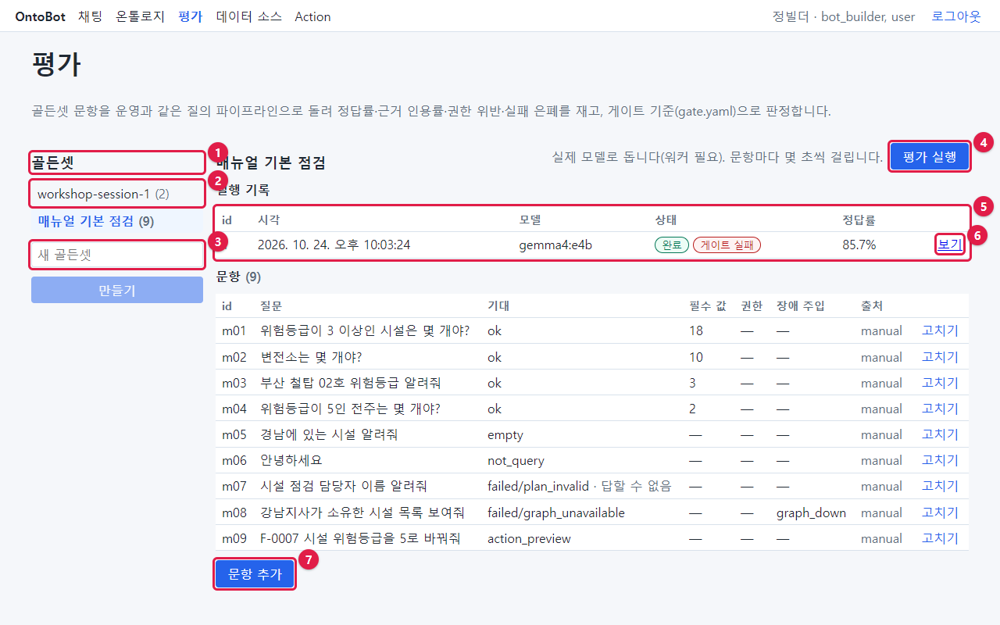
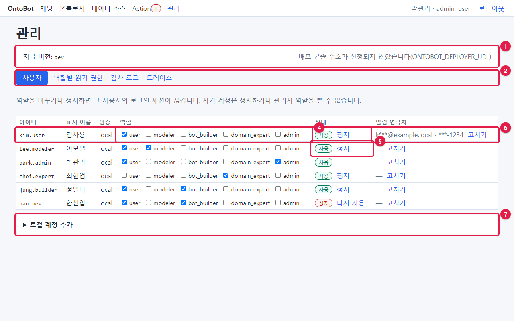

# 30장 화면별 해설(찾아보기용)

화면마다 모든 부분에 번호를 달아 한 장씩 정리했습니다. "이 화면의 이 칸은 뭐였지?" 할 때 찾아보세요. 각 화면의
자세한 사용법은 표의 "장" 칸에 적은 장에 있습니다.

## 30.1 채팅 화면

| 번호 | 부분 | 하는 일 | 장 |
| --- | --- | --- | --- |
| ① | 메뉴 | 역할에 따라 보이는 메뉴. 지금 화면은 파란 글씨 | 3장 |
| ② | 내 이름 · 역할 | 로그인한 사람과 역할 | 2·3장 |
| ③ | **새 대화** | 새 주제로 대화 시작. "그 중" 맥락이 이어지지 않음 | 7장 |
| ④ | 지금 보는 대화 | 파란 굵은 글씨. 이름은 첫 질문 | 7장 |
| ⑤ | 내 질문 | 파란 말풍선 | 4장 |
| ⑥ | 조회 조건 | 챗봇이 질문을 이해한 내용. **가장 먼저 확인** | 4·5장 |
| ⑦ | 답 본문 | AI 가 조회 결과로 쓴 문장 | 5장 |
| ⑧ | 등급 | ① 근거 확인 · ② 일부 추정 · ③ 근거 부족 | 5장 |
| ⑨ | 근거 칩 | 답이 기댄 데이터. 누르면 근거 카드 | 5장 |
| ⑩ | 근거 카드 | 대상의 지금 값(굵은 값 = 인용됨), 마지막 동기화, 값 출처, 편집됨 | 5·13장 |
| ⑪ | 입력 칸 | 질문 입력. Enter 보내기, Shift + Enter 줄 바꿈 | 4장 |
| ⑫ | **보내기** | 진행 중에는 "답을 만드는 중…"으로 바뀌고 눌리지 않음 | 4장 |

## 30.2 Action 화면

| 번호 | 부분 | 하는 일 | 장 |
| --- | --- | --- | --- |
| ① | Action 목록 | 요청할 Action 고르기(괄호 안은 대상 종류) | 11장 |
| ② | 대상 객체 pk | 대상의 식별자. Action 을 고르면 오른쪽에 파라미터 칸이 생김 | 11장 |
| ③ | **미리보기** | 요청을 만들고 바뀔 내용을 보여 줌 | 11장 |
| ④ | 탭 | 승인 대기 · 내 요청 · 전체 기록 | 11·12장 |
| ⑤ | 상태 배지 | 승인 대기 · 막힘 · 거부 · 실행됨 · 실패 · 롤백됨 | 9장 |
| ⑥ | 요청 줄 | Action · 대상 · 요청자 · 시각. 누르면 펼침/접힘 | 11장 |
| ⑦ | 바뀔 값 | 지금 → 실행 후 | 10장 |
| ⑧ | 알림 | 통로 · 받는 사람 수 · 문구. 되돌릴 수 없음 표시 | 9·10장 |
| ⑨ | 알림함 | 받은 앱 알림, 정정 배지, **모두 읽음** | 13장 |

펼친 카드 아래에는 상태에 따라 **승인하고 실행** · 거부 사유 · **거부**(승인자, 승인 대기), **요청 거두기**(요청자,
승인 대기), **롤백**(승인자·관리자, 실행됨)이 보입니다.

## 30.3 데이터 소스 화면

| 번호 | 부분 | 하는 일 | 장 |
| --- | --- | --- | --- |
| ① | 그래프 투영 | 관계 저장소 연결·미반영·지연·대사. 지금 대사·재구축(관리자) | 19장 |
| ② | 편집 충돌 거르기 | 처리 전 · 확인함 · 닫힘 | 19장 |
| ③ | 데이터 소스 표 | 이름 · 종류 · 시크릿 참조 · **접속 시험** | 18장 |
| ④ | **데이터 소스 추가** | 새 연결 | 18장 |
| ⑤ | 매핑 카드 | 타입 ← 원천 표 · 데이터 소스 · 모드 · 링크 · 상태 · 최근 실행 | 18장 |
| ⑥ | **지금 동기화** | 바로 동기화(워커가 실행) | 18장 |
| ⑦ | **매핑 추가** | 새 매핑 | 18장 |

## 30.4 온톨로지 버전 목록

| 번호 | 부분 | 하는 일 | 장 |
| --- | --- | --- | --- |
| ① | 제목 | 온톨로지 버전 | 16장 |
| ② | **빈 draft 만들기** | 빈 설계도에서 시작 | 16장 |
| ③ | 버전 줄 | 버전 · 상태 · 만든 시각 · 게시 시각 | 16장 |
| ④ | **열기** | 버전 열기 | 16장 |
| ⑤ | **이 버전으로 새 draft** | 고칠 수 있는 복사본 만들기 | 16·17장 |

## 30.5 온톨로지 버전 화면

| 번호 | 부분 | 하는 일 | 장 |
| --- | --- | --- | --- |
| ① | 버전 번호 · 상태 | draft · 게시됨 · 보관됨 | 16장 |
| ② | **YAML** | YAML 파일로 내보내기 | 16장 |
| ③ | 내보내기 | YAML · JSON. draft 이면 오른쪽에 **게시** | 16장 |
| ④ | **버전 비교** | 다른 버전과의 차이(추가·삭제·변경) | 16장 |
| ⑤ | 객체 타입 카드 | 표시 이름 · api_name · pk · 제목 · 설명. draft 이면 **삭제** | 16장 |
| ⑥ | 속성 표 | api_name · 표시 이름 · 자료형 · 빈 값 허용 · 인덱스 · PII. draft 이면 **수정** · **삭제** · **속성 추가** | 16장 |
| ⑦ | 링크 타입 | 출발 · 도착 · 카디널리티 · FK 속성 | 16장 |
| ⑧ | Action | Action 정의 요약. draft 이면 **고치기** · **삭제** · **Action 추가** | 17장 |

draft 버전에는 맨 위에 **게시 전 검사**, **임포트 (YAML/JSON)** 칸이 더 있습니다.

## 30.6 인터뷰 목록

| 번호 | 부분 | 하는 일 | 장 |
| --- | --- | --- | --- |
| ① | 제목과 안내 | 인터뷰 워크숍이 무엇인지 | 14장 |
| ② | 인터뷰 제목(선택) | 새 인터뷰의 제목 | 14장 |
| ③ | **새 인터뷰** | 인터뷰를 만들고 바로 연다 | 14장 |
| ④ | 인터뷰 줄 | id · 제목 · 상태(진행 중·제출됨·게시됨) · 시작 | 14·15장 |
| ⑤ | **열기** | 인터뷰 화면 | 14장 |

## 30.7 평가 화면

| 번호 | 부분 | 하는 일 | 장 |
| --- | --- | --- | --- |
| ① | 골든셋 | 골든셋 목록 제목 | 20장 |
| ② | 골든셋 이름 (문항 수) | 누르면 그 골든셋 | 20장 |
| ③ | 새 골든셋 · **만들기** | 새 골든셋 | 20장 |
| ④ | **평가 실행** | 실제 모델로 문항을 모두 돌림 | 20장 |
| ⑤ | 실행 기록 | id · 시각 · 모델 · 상태(완료·게이트 통과/실패) · 정답률 | 20장 |
| ⑥ | **보기** | 게이트 판정과 문항별 결과 | 20장 |
| ⑦ | **문항 추가** | 새 문항. 각 문항은 **고치기** | 20장 |

## 30.8 관리 화면(사용자 탭)

| 번호 | 부분 | 하는 일 | 장 |
| --- | --- | --- | --- |
| ① | 지금 버전 · 배포 콘솔 | 설치 버전, 배포 콘솔 링크 | 21장 |
| ② | 탭 | 사용자 · 역할별 읽기 권한 · 감사 로그 · 트레이스 | 21장 |
| ③ | 사용자 줄 | 아이디 · 표시 이름 · 인증 | 21장 |
| ④ | 역할 | 체크하면 **역할 저장** 이 나타남 | 21장 |
| ⑤ | 상태 | 사용/정지, **정지** · **다시 사용** | 21장 |
| ⑥ | 알림 연락처 | 가려진 메일·전화, **고치기** | 21장 |
| ⑦ | **로컬 계정 추가** | 새 계정 | 21장 |
