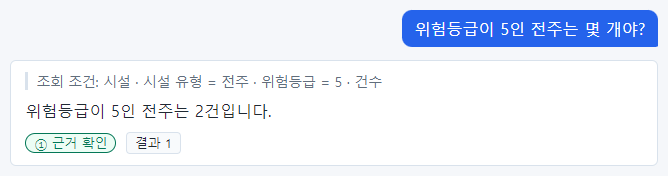
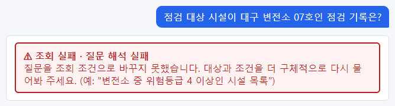
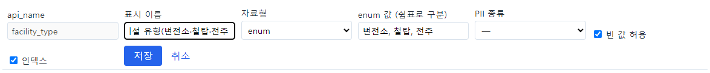
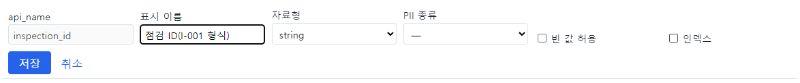
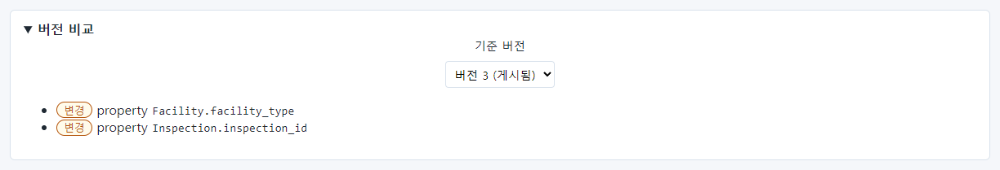
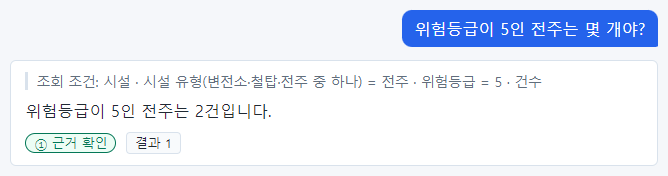
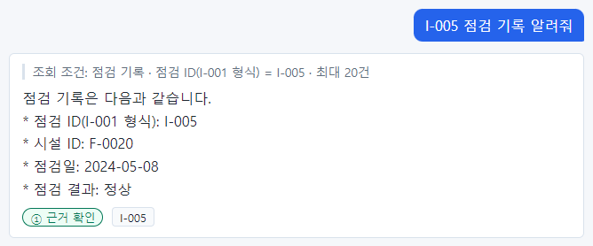

# 32장 설계도 다듬기 실험(모델러)

챗봇이 질문을 잘 알아듣는지는 설계도의 **표시 이름**에 크게 달려 있습니다. 챗봇은 질문의 낱말을 설계도의 이름과
맞춰 보며 조회 계획을 세우기 때문입니다. 이 장은 실제로 표시 이름을 고치기 전과 후에 같은 질문을 세 번씩 물어 결과를
비교한 실험입니다. 같은 방법으로 여러분 회사의 설계도도 다듬을 수 있습니다.

## 32.1 실험 방법

1. **고치기 전**: 문제가 있던 질문 네 개를 새 대화에서 각각 세 번씩 묻고 조회 조건과 결과를 적는다.
2. **고치기**: 새 draft 에서 표시 이름 두 개를 고쳐 게시한다.
3. **고친 뒤**: 같은 질문을 같은 방법으로 세 번씩 묻는다.
4. 결과를 표로 비교한다.

| 실험 질문 | 고치기 전 문제(앞 장에서 본 것) |
| --- | --- |
| 위험등급이 5인 전주는 몇 개야? | 6장 촬영 때 전주를 철탑으로 이해함 |
| I-005 점검 기록 알려줘 | 질문 해석 실패(25장·24장) |
| 점검 대상 시설이 대구 변전소 07호인 점검 기록은? | 질문 해석 실패(25장) |
| 지역별 시설 수 알려줘 | 시설이 아니라 지역을 셈(25장·24장) |

> **요령** 한 번만 물어서는 판단하지 마세요. 같은 질문도 매번 같게 이해한다는 보장이 없으므로, 세 번 이상 물어 몇 번
> 맞는지로 비교해야 합니다.

## 32.2 고치기 전 결과

| 질문 | 1회 | 2회 | 3회 |
| --- | --- | --- | --- |
| 위험등급이 5인 전주는 몇 개야? | 맞음(전주 · 5 · 건수) | 맞음 | 맞음 |
| I-005 점검 기록 알려줘 | 질문 해석 실패 | 질문 해석 실패 | 질문 해석 실패 |
| 점검 대상 시설이 대구 변전소 07호인 점검 기록은? | 질문 해석 실패 | 질문 해석 실패 | 질문 해석 실패 |
| 지역별 시설 수 알려줘 | 틀림(지역을 셈) | 틀림 | 틀림 |

첫 질문은 이번 세 번 모두 맞았습니다. 6장 촬영 때 틀렸던 것과 비교하면, 이 질문은 "가끔" 틀리는 질문입니다.

고치기 전 화면입니다.

## 32.3 고친 것

새 draft 에서 표시 이름 두 개를 고쳤습니다.

**시설 유형** → `시설 유형(변전소·철탑·전주 중 하나)` — 값의 종류를 이름에 드러냄

**점검 ID** → `점검 ID(I-001 형식)` — 질문의 "I-005" 같은 글자가 이 속성의 값이라는 것을 드러냄

버전 비교로 두 속성의 "변경"을 확인하고 게시했습니다.

## 32.4 고친 뒤 결과

| 질문 | 1회 | 2회 | 3회 | 바뀜 |
| --- | --- | --- | --- | --- |
| 위험등급이 5인 전주는 몇 개야? | 맞음 | 맞음 | 맞음 | 그대로(원래도 맞음) |
| I-005 점검 기록 알려줘 | **맞음** | **맞음** | **맞음** | **0/3 → 3/3** |
| 점검 대상 시설이 대구 변전소 07호인 점검 기록은? | 질문 해석 실패 | 질문 해석 실패 | 질문 해석 실패 | 그대로 |
| 지역별 시설 수 알려줘 | 틀림 | 틀림 | 틀림 | 그대로 |

"I-005 점검 기록 알려줘"는 조회 조건 "점검 기록 · 점검 ID(I-001 형식) = I-005"로 정확히 찾았습니다.

## 32.5 실험에서 배운 것

| 배운 것 | 내용 |
| --- | --- |
| 값의 모양을 드러내면 효과가 크다 | "I-005"가 어느 속성의 값인지 몰라 실패하던 질문이, "(I-001 형식)"을 표시 이름에 넣자 매번 맞았다 |
| 이미 맞는 질문은 바뀌지 않았다 | 시설 유형에 값 목록을 드러내도 결과는 같았다(원래 맞았으므로). 나빠지지는 않았다 |
| 관계·묶어 세기 오해석은 이름으로 안 고쳐진다 | "점검 대상 시설이 ○○인", "지역별 시설 수"는 그대로. 질문 표현을 바꾸도록 사용자에게 안내하고(「24장」), 골든셋에 넣어 개발팀에 알린다 |
| 표시 이름은 화면에도 보인다 | 조회 조건과 근거 카드에 "시설 유형(변전소·철탑·전주 중 하나)"처럼 길게 보인다. 너무 길게 짓지 말 것 |

> **주의** 표시 이름은 바꿔도 되지만 **api_name 은 바꾸지 마세요.** 이 실험도 표시 이름만 고쳤습니다. 그리고 고친 뒤에는
> 평가(「20장」)를 돌려 다른 질문이 나빠지지 않았는지 확인하세요. 지금 판에서는 게시 뒤 워커 재시작이 필요합니다.

## 32.6 표시 이름 짓는 요령

| 요령 | 예 |
| --- | --- |
| 업무에서 부르는 말 그대로 | "위험등급"(○) · "risk"(×) |
| 단위를 괄호로 | "설비 용량(kW)" |
| 식별자는 모양을 괄호로 | "시설 ID(F-0001 형식)", "점검 ID(I-001 형식)" |
| 비슷한 이름끼리 구분되게 | "시설 ID"와 "소유 조직 ID"처럼 무엇의 ID 인지 |
| 짧게 | 조회 조건·근거 카드에 그대로 보임 |
| 한 이름에 한 뜻 | 같은 이름을 다른 속성에 쓰지 않기 |

> **알아 두기** 객체 타입의 **설명**(16장)도 챗봇이 참고합니다. "점검 기록 — 현장 점검원이 남긴 점검 결과(정상·이상·보류)"
> 처럼 무엇을 담는지와 값의 예를 적어 두세요.

## 32.7 이 장의 핵심

> **요령**
>
> - 문제 질문을 골라 고치기 전·후로 **세 번 이상** 물어 비교합니다.
> - 값의 모양(식별자 형식·단위·값 목록)을 표시 이름에 드러내면 잘 알아듣는 경우가 많습니다.
> - 관계·묶어 세기 오해석은 이름만으로 고쳐지지 않을 수 있습니다 — 사용자 안내와 골든셋으로 관리합니다.
> - api_name 은 그대로, 표시 이름만. 고친 뒤에는 평가.
